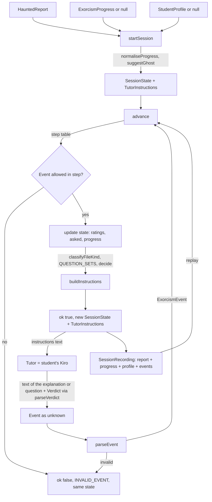
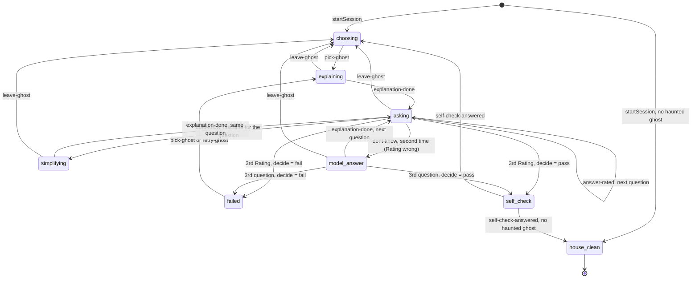

# Design Document

## Overview

Exorcism takes the `HauntedReport` made by ghost detection and runs the exorcism of its ghosts as a **pure step machine**: `advance(state, event)` returns the new state and the instructions that the student's own Kiro (the Tutor) must follow in the next step. The code never calls an AI, never reads GitHub or the disk, and never receives the text of the student's answers. The Tutor judges the answers and reports only a Verdict.

The design is small on purpose (minimum working version: 20 Nov 2026, today 12 Nov):

- Plain TypeScript functions in the existing package `@haunted-repo/core`, new folder `packages/core/src/exorcism/`, exported from `packages/core/src/index.ts` with `export * from "./exorcism/index.js"`.
- Every module is pure (data in, data out). No `Date`, `Math.random`, `process`, `fetch`, `fs` or `require` (Requirements 9.2, 9.3, 10.1).
- No new dependencies. Vitest 5.1.0 and fast-check 4.10.2 are already installed.
- Same style as ghost detection: ESM, `strict`, `noUncheckedIndexedAccess`, relative imports with `.js` extension, tests next to the code as `*.test.ts`, test helpers as `*.testutil.ts`.
- The `core` tsconfig has `lib: ["ES2023", "DOM"]` and `types: []`, so Node APIs are compile errors. This is the first guard for Requirement 9.2; a static purity test is the second (see Testing Strategy).
- It reuses ghost detection and does not copy it: types `Ghost`, `HauntedReport`, `Floor`, `Language`, and the functions `measureFactors`, `parseReport` and `floorOf`.
- The same package also contains one small fix in ghost detection: the new Ghost_Sentence (Requirement 8). It is independent from the engine and is built first.

### Decisions

| Decision | Reason |
| --- | --- |
| `advance(state, event)` is a pure function; on error it returns the **same** state | Meets Requirements 10.1, 10.5 and 10.6 literally and makes record/replay trivial. |
| `event` is typed `unknown`; `parseEvent` validates it | Recordings come from JSON, so the type system cannot be trusted at the border. Unknown fields, including `sampleAnswer`, are ignored by `parseEvent`, so the engine structurally ignores them (Requirements 11.8, 11.9). |
| The `SessionState` carries a copy of `ghosts: Ghost[]` | `advance` receives only state and event, and it needs `difficultyScore`, `path` and `language` of every ghost. This is a small addition to the Glossary definition of Session_State; it is JSON-safe and copied from the report at start. |
| The suggested ghost is derived (`suggestGhost`), not stored | One source of truth; it can never be out of date. |
| Progress is normalised at start: exactly one entry per report ghost, in report order | Requirement 7.6 (unknown paths dropped, missing ones `haunted`) is applied once, and every later function can assume a clean progress. |
| `TutorInstructions` has a `rules: RuleId[]` list next to the rendered `text` | Properties (Java rule, instruction rules) are checked on the list and on structured inputs. Searching the rendered text would be wrong because the Ghost_Text could contain any sentence. Unit tests also check that the text contains the sentence of each rule on fixed inputs. |
| Rules are a closed list of ids with one fixed English sentence each | Deterministic, testable, and each rule is tied to one requirement. |
| Only `null`, never `undefined` or optional fields, in every serialisable structure | `JSON.parse(JSON.stringify(x))` is then strictly equal to `x`. The single exception is `sampleAnswer` in a recorded event (data for the web demo only). |
| `Result<T, E = DetectErrorInfo>` becomes generic in `ghost-detection/types.ts` | Backward compatible (the default keeps old uses valid). Exorcism parsers return `Result<T, ExorcismErrorInfo>`. |
| Exorcism type names carry a prefix where a short name would clash (`ExorcismStep`, `ExorcismEvent`, `ExorcismProgress`, `SessionState`, `SessionRecording`, `GhostProgress`, `TutorInstructions`) | `Event`, `Step` and similar names clash with DOM globals (`lib: DOM`) or with ghost-detection exports. |
| `leave-ghost` is not accepted in `failed` or `self-check` | Exactly the table of Requirement 10.4. In `failed` the student can retry or pick another ghost, so leaving has no meaning. |
| The text of the `model-answer` explanation is not stored in the state | Nothing later needs it. It is still in the recording because it is a field of the event. |
| `floorOf` moves to `ghost-detection/floor.ts` and is re-exported from `report.ts` | `reasonFor` (in `factors.ts`) now needs the floor, and `report.ts` already imports `factors.ts`. A tiny third file avoids an import cycle. Existing imports keep working. |
| File kind is a simple tunable heuristic | See "File kind". Good enough for v1, checked with fixtures from the spikes. |
| Sort ties with `<` on strings, not `localeCompare` | Same order on every machine and locale (same rule as ghost detection). |

## Architecture

Data flow inside `@haunted-repo/core`. The caller (the Power, the web demo or a test) owns all input and output; the engine is a function.



The Tutor closes the loop outside the code: it reads `TutorInstructions.text`, writes something for the student, reads the student's answer, and then the caller builds the next Event (`explanation-done` with the text the Tutor wrote, `answer-rated` with the Rating got from `parseVerdict`, and so on).

### Step machine



(`house_clean`, `self_check` and `model_answer` use underscores only because of the diagram syntax; the real step names are `house-clean`, `self-check` and `model-answer`.)

### Transition table

`R` is the current ghost record (`state.current`). "Next question" means: `questionIndex + 1`, `dontKnowCount = 0`, `pendingQuestion = null`. "Decide" means `decide(ratings)` (below).

| Step | Event | Check | Effect | Next step |
| --- | --- | --- | --- | --- |
| `choosing` | `pick-ghost{path,text}` | `path` is a `haunted` ghost of the report | New attempt: `kind = classifyFileKind(text, language)`, `explanation = ""`, `simpler = []`, `attemptStart = asked[path].length`, `questionIndex = 0`, `dontKnowCount = 0`, `pendingQuestion = null`, `ratings = []` | `explaining` |
| `failed` | `pick-ghost{path,text}` | same | same as above (Requirement 10.14) | `explaining` |
| `failed` | `retry-ghost` | none | New attempt of the same ghost: ratings, `simpler`, index and counters reset, `attemptStart` updated; `explanation` is **kept** (the instructions use it to ask for another analogy) | `explaining` |
| `explaining` | `explanation-done{text}` | text not blank | `explanation = text` | `asking`, question 0 |
| `asking` | `answer-rated{rating,question}` | question not blank | `ratings.push(rating)`; `question` goes to `asked[path]` only if `pendingQuestion` is `null` | next question, or decide after the 3rd |
| `asking` | `dont-know{question}` | question not blank; `dontKnowCount = 0` | `dontKnowCount = 1`, `pendingQuestion = question` (also added to `asked[path]`, because it is new) | `simplifying` |
| `asking` | `dont-know{question}` | `dontKnowCount = 1` | `ratings.push("wrong")`; the question is not recorded again | `model-answer` |
| `simplifying` | `explanation-done{text}` | text not blank | `simpler.push(text)` | `asking`, same question (`pendingQuestion` is shown) |
| `model-answer` | `explanation-done{text}` | text not blank | none (the model answer is not stored) | next question, or decide after the 3rd |
| (decide) | | | pass: progress entry `exorcised` with the 3 ratings; fail: entry stays `haunted` with the ratings of the last attempt | `self-check` or `failed` |
| `self-check` | `self-check-answered{answer}` | `yes`, `half` or `no` | store `selfCheck` in the entry; `current = null` | `choosing` (new suggestion) or `house-clean` |
| `explaining`, `asking`, `simplifying`, `model-answer` | `leave-ghost` | none | `current = null`; progress unchanged; `asked` kept | `choosing` (or `house-clean`, see below) |
| `house-clean` | any | | `INVALID_EVENT` | |

After `leave-ghost` the ghost is still `haunted`, so there is always a haunted ghost and the next step is `choosing`. After `self-check-answered`, `house-clean` is reached only if no ghost is `haunted`.

Bounded loop (Requirement 5.8): per question at most one simplification (`dontKnowCount` is 0 or 1) and at most two askings; per attempt at most 3 simplifications. The number of events of one attempt is therefore at most 1 (explain) + 3 × 3 (ask, simplify, re-ask) + 3 (model answers) + 1 (self-check) = 14, plus the pick.

### Module layout

```
packages/core/src/
  index.ts                      adds: export * from "./exorcism/index.js"
  ghost-detection/
    floor.ts                    NEW: floorOf (moved from report.ts)
    factors.ts                  CHANGED: reasonFor wording (Requirement 8)
    report.ts                   CHANGED: re-exports floorOf from ./floor.js
    types.ts                    CHANGED: Result<T, E = DetectErrorInfo>
  exorcism/
    types.ts                    shared types (see Data Models)
    fileKind.ts                 classifyFileKind
    questions.ts                QUESTION_SETS
    rules.ts                    RuleId, RULE_SENTENCES
    instructions.ts             buildInstructions and one builder per step
    verdict.ts                  formatVerdict, parseVerdict
    progress.ts                 normaliseProgress, parseProgress, formatProgress, hauntedShare
    suggest.ts                  suggestGhost, isPickable
    event.ts                    parseEvent, ALLOWED_EVENTS
    engine.ts                   startSession, advance, decide
    recording.ts                parseRecording, formatRecording, replay
    index.ts                    public exports
    sessionArb.testutil.ts      model-based driver and arbitraries (tests only)
    tinySession.testutil.ts     small committed fixture (tests only)
    *.test.ts                   unit and property tests
```

| Module | Main exports | Requirements covered |
| --- | --- | --- |
| `types.ts` | all exorcism types | 7.2, 10.2, 10.3, 11.1 |
| `fileKind.ts` | `classifyFileKind` | 4.1, 4.2 |
| `questions.ts` | `QUESTION_SETS`, `objectiveOf` | 4.3 to 4.8 |
| `rules.ts` | `RuleId`, `RULE_SENTENCES` | 2.1 to 2.5, 2.8, 2.11, 3.1 to 3.4, 4.9 to 4.13, 5.1, 5.4, 5.6, 6.1, 6.2, 6.5, 10.9, 10.13 |
| `instructions.ts` | `buildInstructions` | the rule requirements above, 2.6, 2.7, 1.3, 6.4 |
| `verdict.ts` | `formatVerdict`, `parseVerdict` | 10.9, 10.10 |
| `progress.ts` | `normaliseProgress`, `parseProgress`, `formatProgress`, `hauntedShare` | 7.1 to 7.9 |
| `suggest.ts` | `suggestGhost`, `isPickable` | 1.1, 1.2, 1.4, 1.6 |
| `event.ts` | `parseEvent`, `ALLOWED_EVENTS` | 10.3 to 10.5 |
| `engine.ts` | `startSession`, `advance`, `decide` | 1.3, 1.5, 2.7, 4.9, 5.3 to 5.8, 6.3, 6.4, 6.6, 10.1, 10.2, 10.5 to 10.8, 10.11 to 10.14 |
| `recording.ts` | `parseRecording`, `formatRecording`, `replay` | 11.1 to 11.9 |
| `ghost-detection/factors.ts` (`reasonFor`) | `reasonFor` | 8.1 to 8.9 |

## Components and Interfaces

All signatures below are final for the design; bodies belong to the tasks.

```ts
// types.ts (exorcism): see Data Models for the types used here

// fileKind.ts
export function classifyFileKind(text: string, language: Language): FileKind;

// questions.ts
export const QUESTION_SETS: Readonly<Record<FileKind, readonly [string, string, string]>>;
// index 0 is the Core_Question objective. English, no line numbers.

// rules.ts
export type RuleId = /* closed list, see "Tutor rules" */;
export const RULE_SENTENCES: Readonly<Record<RuleId, string>>;

// instructions.ts
export function buildInstructions(state: SessionState): TutorInstructions;
// Reads state.step, state.profile, state.current, state.asked, state.ghosts, state.progress.

// verdict.ts
export function formatVerdict(reason: string, verdict: Verdict): string;
export function parseVerdict(text: string): Result<Verdict, ExorcismErrorInfo>;

// progress.ts
export function normaliseProgress(
  ghosts: readonly Ghost[],
  progress: ExorcismProgress | null,
): ExorcismProgress; // one entry per ghost, report order, unknown paths dropped
export function parseProgress(jsonText: string): Result<ExorcismProgress, ExorcismErrorInfo>;
export function formatProgress(progress: ExorcismProgress): string; // JSON.stringify
export function hauntedShare(
  report: { readonly ghosts: readonly Ghost[] },
  progress: ExorcismProgress | null,
): number; // 0..1, 0 when there are no ghosts

// suggest.ts
export function suggestGhost(ghosts: readonly Ghost[], progress: ExorcismProgress): Ghost | null;
export function isPickable(ghosts: readonly Ghost[], progress: ExorcismProgress, path: string): boolean;

// event.ts
export function parseEvent(raw: unknown): Result<ExorcismEvent, ExorcismErrorInfo>;
export const ALLOWED_EVENTS: Readonly<Record<ExorcismStep, readonly ExorcismEvent["type"][]>>;

// engine.ts
export interface StartOptions {
  progress?: ExorcismProgress;
  profile?: StudentProfile;
}
export function startSession(
  report: HauntedReport,
  options?: StartOptions,
): { state: SessionState; instructions: TutorInstructions };
export type Transition =
  | { ok: true; state: SessionState; instructions: TutorInstructions }
  | { ok: false; error: ExorcismErrorInfo; state: SessionState };
export function advance(state: SessionState, event: unknown): Transition;
export function decide(ratings: readonly Rating[]): boolean; // true = exorcised

// recording.ts
export function parseRecording(jsonText: string): Result<SessionRecording, ExorcismErrorInfo>;
export function formatRecording(recording: SessionRecording): string; // JSON.stringify
export function replay(
  recording: SessionRecording,
): Result<{ steps: { state: SessionState; instructions: TutorInstructions }[] }, ExorcismErrorInfo>;
// steps[0] is the start; steps[i] is the result of event i (1-based).
```

`advance` never mutates its input and never returns a structure that shares arrays or objects with the input in a way that later mutation could change it: it builds new objects with spread. Tests deep-freeze the input state and event.

`advance` runs, in order: `parseEvent(event)` (error → `INVALID_EVENT`), the step table `ALLOWED_EVENTS[state.step]` (error → `INVALID_EVENT`), event-specific checks (for `pick-ghost`: `isPickable`), then the effect.

### Ghost-detection change in `types.ts`

```ts
export type Result<T, E = DetectErrorInfo> =
  { ok: true; value: T } | { ok: false; error: E };
```

### Start

`startSession(report, options)`:

1. `ghosts = report.ghosts.map(copy)`.
2. `progress = normaliseProgress(ghosts, options?.progress ?? null)`.
3. `profile = { knowsJava: options?.profile?.knowsJava ?? false }` (Requirement 2.9).
4. If `suggestGhost(ghosts, progress)` is `null` the step is `house-clean`, otherwise `choosing`.
5. `current = null`, `asked = {}`.

The `report` is assumed to be valid (it came from `detectGhosts`, or from `parseReport` in a recording).

### Decision

```ts
export function decide(ratings: readonly Rating[]): boolean {
  const good = ratings.filter((r) => r !== "wrong").length;
  return good >= 2 && ratings[0] !== "wrong";
}
```

`ratings[0]` is the Core_Question, because it is always asked first (Requirement 4.9). `decide` is exported and tested directly (P6).

### Suggestion

`suggestGhost` keeps the ghosts whose progress entry is `haunted`, and picks the one with the lowest `difficultyScore`, ties by `path` ascending using `a < b`. It returns `null` if none is haunted. `isPickable` is true only for a `haunted` ghost that is in the list.

### Record keys

`asked` is a plain object keyed by ghost path. It is always updated with `{ ...asked, [path]: [...] }` (a computed key in an object literal defines an own property, so a path such as `__proto__` cannot hit the prototype). Real paths in a report always have a supported extension, so this is only a guard.

### File kind

`classifyFileKind(text, language)` is a deterministic heuristic. It calls `measureFactors(text)` for `lines` and `branches`, and scans the code lines itself (non-empty lines that are not comment lines, using the same comment rule as `measureFactors`, each cut to 500 characters). Order of the rules, first match wins:

1. `factors.lines === 0` → `general` (empty or comment-only file; the explanation says the file has almost no code).
2. Entry-point: the file has an entry marker, or it is a barrel (every code line is an `import` or a re-export `export … from`) → `entry-point`.
3. `factors.branches === 0`, no function-like definition and at least one type declaration → `data-shape`.
4. At least one function-like definition → `logic`.
5. Otherwise → `general`.

Patterns (small, in one table in `fileKind.ts`, per language):

| Language | Entry marker | Function-like | Type declaration |
| --- | --- | --- | --- |
| TypeScript, JavaScript | `process.argv`, `createServer(`, `.listen(`, `createRoot(` | `\bfunction\b`, `=>`, or a method-looking line `^\s*(public\|private\|protected\|static\|async)\s+\w+.*\(` | `^(export\s+)?(declare\s+)?(interface\|type\|enum)\s+\w+` (TypeScript only) |
| Java | `public static void main(` | a method header line ending in `{` with a return type and `(...)` | `\b(record\|enum\|interface)\s+\w+` |
| Python | `if __name__ == "__main__"` | `^\s*(async\s+)?def\s+\w+` | `@dataclass`, or a class that extends `TypedDict`, `NamedTuple` or `Enum` |

For TypeScript, lines that start with `type ` or `export type `, and lines that look like a property signature (`name: (…) =>`), are ignored when looking for `=>` function-likes, so that a types file with function types still counts as `data-shape`.

Known limits (accepted for v1, honest): a Java class with only fields and getters is `logic` (the getters look like methods), not `data-shape`; a long file with one marker line may be called `entry-point`; keywords in strings count. The heuristic is tunable (one table). It is checked with fixture files from the spikes (a types file from `docs/spike-explicacion.md`, a logic file with loops and conditions from the 11 Nov spike) plus one example per kind and per language.

### Questions

`QUESTION_SETS` holds exactly 3 objectives per kind. Index 0 is the Core_Question.

| Kind | Objective 0 (Core_Question) | Objective 1 | Objective 2 |
| --- | --- | --- | --- |
| `data-shape` | what the file is for | what data one record carries | what happens when one piece of data is missing |
| `logic` | what the file does | what goes in and what comes out | when it fails or what can go wrong |
| `entry-point` | what the file starts or connects | which other parts it uses and in what order | what happens if one of those parts fails |
| `general` | what the file is for | what you would notice in the project if the file did not exist | what could go wrong in it |

`data-shape` does not contain "what goes in and what comes out" (Requirement 4.8). No objective contains a digit or the words "line" or "syntax" as a target.

### Tutor rules

Every instruction is the list of rule ids plus a fixed layout. The text is built as: a title line for the step, a `Ghost` block (path and the Ghost_Text in a fenced block; the fence is made longer than any run of backticks inside the text, so the text cannot close it), the step task, then one bullet per rule in list order (`RULE_SENTENCES[id]`), then the output format.

| RuleId | Requirement | Sentence (English, fixed) | Included in |
| --- | --- | --- | --- |
| `simple-english` | 2.4 | Write in English, with simple words and short sentences. | explaining, asking, simplifying, model-answer |
| `no-jargon` | 2.3 | Avoid jargon. Define any technical term you must use in one sentence, with an everyday analogy. | explaining, asking, simplifying, model-answer |
| `what-before-how` | 2.2 | Say first WHAT the file does in the project, and only then HOW it does it, in small pieces. | explaining |
| `no-question` | 2.1 | Do not ask any question in this message. | explaining, simplifying, model-answer |
| `no-lines` | 2.5, 4.10, 4.12 | Never ask about specific lines, line numbers or syntax details. A question may ask the student to predict a behaviour, but not about one specific line. | explaining, asking, simplifying, model-answer |
| `max-words` | 2.11, 5.4 | Use at most about 150 words and leave out secondary details. | explaining, simplifying |
| `java-allowed` | 2.8 | You may compare with Java. | explaining, asking, simplifying, model-answer, only if `knowsJava` |
| `java-forbidden` | 2.8 | Do not compare with Java. Use everyday analogies only. | the same steps, only if not `knowsJava` |
| `probable-reasons` | 3.1 | Present every reason for why the code does something as the probable reason ("probably", "most likely"), never as a sure fact. | **every step** |
| `separate-what-why` | 3.2 | Separate what the code does (it can be read in the file) from why the author wrote it that way (a guess). | explaining, simplifying |
| `admit-unknown` | 3.3 | If you cannot tell the reason from the file, say so instead of inventing one. | explaining, simplifying, model-answer, asking |
| `not-wrong-other-reason` | 3.4 | Do not give the verdict `wrong` only because the answer gives a different probable reason than yours. | asking |
| `one-question` | 4.9 | Write exactly one question in your message. | asking (new question) |
| `concrete-file` | 4.10 | Write the question about this concrete file, using its real names, data and behaviour. | asking (new question) |
| `different-questions` | 4.11, 4.13 | These questions were already asked about this file: … Write different questions that keep the same objective. | asking (new question), only if the ghost has question texts from previous attempts |
| `same-question` | 5.5 | Ask the student exactly this question again: … | asking (re-ask after a simplification) |
| `new-analogy` | 5.4, 10.13 | Use a new everyday analogy, different from the one used before. | simplifying; explaining after `retry-ghost` |
| `only-this-part` | 5.4 | Explain only the part that the question is about, and add the details the first explanation left out. | simplifying |
| `model-answer-short` | 5.6 | Show a short model answer to the question. | model-answer |
| `judge-behaviour` | 6.2 | Judge the behaviour that the answer describes, not the exact words used. | asking |
| `reason-then-verdict` | 6.1 | Give a short reason in plain language, and then the verdict. | asking |
| `verdict-format` | 10.9 | End your judgement with one last line that is exactly `VERDICT: right`, `VERDICT: half-right`, `VERDICT: wrong` or `VERDICT: dont-know`. | asking |
| `one-verdict` | 10.9 | Give exactly one verdict per message and per question, never the verdicts of several questions in one message. | asking |
| `dont-know-verdict` | 5.1 | If the answer means "I don't know" in any language, or is empty, or does not try to answer, the verdict is `dont-know`. | asking |
| `self-check-options` | 6.5 | Ask the student whether the file is now understood, with the options "yes", "half" and "no". | self-check |

The Java rule is present in the four steps where the Tutor writes prose (explaining, asking, simplifying, model-answer): exactly one of `java-allowed` / `java-forbidden`. `self-check`, `choosing`, `failed` and `house-clean` carry no comparison, so they contain neither (they only relay a short message or one fixed question).

### Instructions per step

| Step | Content (besides the rules) |
| --- | --- |
| `choosing` | Short English message for the student: which ghost is suggested (path, floor, ghost sentence), and that any `haunted` ghost can be picked. Lists the haunted ghosts. No Ghost_Text yet. Rules: `probable-reasons`. |
| `explaining` | Path and Ghost_Text. After `retry-ghost`, also the previous explanation text (`current.explanation` is not empty) and the rule `new-analogy`; the rules 2.2 to 2.5, 2.8 and 2.11 stay (Requirement 10.13). No question. |
| `asking` | Path, Ghost_Text, and **only the objective of the current question** (`QUESTION_SETS[kind][questionIndex]`), never another objective. New question: `one-question`, `concrete-file`, `different-questions` (only with texts from `asked[path].slice(0, attemptStart)`). Re-ask: `pendingQuestion` and `same-question`. Then the judging rules. |
| `simplifying` | Path, Ghost_Text, the question (`pendingQuestion`), the explanation given before and the earlier simpler ones. Asks for a Simpler_Explanation of that part only. |
| `model-answer` | Path, Ghost_Text, the question and a request for a short model answer. |
| `self-check` | Message with the result (exorcised) and the fixed question with "yes", "half", "no". |
| `failed` | Short English message: the ghost stays haunted; the student can try the same ghost again after a new explanation, or pick another one. |
| `house-clean` | Short English message: the house is clean (Requirement 1.3). |

The choosing, failed and house-clean messages are for the student and are relayed by the Tutor.

## Data Models

```ts
export type ExorcismStep =
  | "choosing" | "explaining" | "asking" | "simplifying"
  | "model-answer" | "self-check" | "failed" | "house-clean";

export type Rating = "right" | "half-right" | "wrong";
export type Verdict = Rating | "dont-know";
export type FileKind = "data-shape" | "logic" | "entry-point" | "general";
export type SelfCheck = "yes" | "half" | "no";

export interface StudentProfile {
  knowsJava: boolean;
}

export type ExorcismErrorCode =
  | "INVALID_EVENT" | "INVALID_VERDICT" | "INVALID_PROGRESS" | "INVALID_SESSION";

export interface ExorcismErrorInfo {
  code: ExorcismErrorCode;
  message: string; // English
}

export interface GhostProgress {
  path: string;
  state: "haunted" | "exorcised";
  ratings: Rating[]; // length 0 or 3: the ratings of the last attempt
  selfCheck: SelfCheck | null;
}

export interface ExorcismProgress {
  ghosts: GhostProgress[];
}

export type ExorcismEvent =
  | { type: "pick-ghost"; path: string; text: string } // text may be "" (file with no code)
  | { type: "explanation-done"; text: string } // not blank
  | { type: "answer-rated"; rating: Rating; question: string } // question not blank
  | { type: "dont-know"; question: string } // question not blank
  | { type: "self-check-answered"; answer: SelfCheck }
  | { type: "retry-ghost" }
  | { type: "leave-ghost" };

export interface CurrentGhost {
  path: string;
  text: string; // the Ghost_Text given by the caller
  kind: FileKind;
  explanation: string; // "" until the first explanation is done; kept across retry-ghost
  simpler: string[]; // Simpler_Explanations of this attempt
  attemptStart: number; // asked[path].length when the attempt started
  questionIndex: 0 | 1 | 2;
  dontKnowCount: 0 | 1;
  pendingQuestion: string | null; // the question being re-asked after a simplification
  ratings: Rating[]; // length 0..3
}

export interface SessionState {
  step: ExorcismStep;
  profile: StudentProfile;
  ghosts: Ghost[]; // copied from the report at start
  progress: ExorcismProgress; // normalised: one entry per ghost, report order
  asked: Record<string, string[]>; // every question text ever asked per ghost path
  current: CurrentGhost | null;
}

export interface TutorInstructions {
  step: ExorcismStep;
  text: string;
  rules: RuleId[]; // ordered, as rendered
}

export type RecordedEvent =
  | Exclude<ExorcismEvent, { type: "answer-rated" } | { type: "dont-know" }>
  | (Extract<ExorcismEvent, { type: "answer-rated" | "dont-know" }> & { sampleAnswer?: string });

export interface SessionRecording {
  report: HauntedReport;
  progress: ExorcismProgress | null;
  profile: StudentProfile | null;
  events: RecordedEvent[];
}
```

Notes:

- `SessionState`, `ExorcismProgress` and `SessionRecording` contain only strings, numbers, booleans, `null`, arrays and plain objects, so `JSON.parse(JSON.stringify(x))` is strictly equal to `x` (Requirements 7.2, 10.2, 11.2). A recorded event has the key `sampleAnswer` only when it has a value; the key is never present with `undefined`.
- The state holds no Student answer text and no `sampleAnswer`; `parseEvent` copies only the known fields.
- The Haunted_Report stays free of progress (Requirement 7.1): progress is a separate value, and the state holds both.
- Question texts in `asked` are compared as exact strings; the engine never searches them.

### Verdict format

`formatVerdict(reason, verdict)` returns the reason with trailing whitespace removed, then `"\nVERDICT: "` and the verdict; when the trimmed reason is empty the result is only the verdict line.

`parseVerdict(text)` accepts only when:

1. the last non-empty line, after removing trailing whitespace and `\r`, is exactly `VERDICT: right`, `VERDICT: half-right`, `VERDICT: wrong` or `VERDICT: dont-know`; and
2. no other line (after removing a trailing `\r`) starts with `VERDICT:`.

Otherwise it returns `INVALID_VERDICT` with an English message ("The last line must be exactly one of: …" or "There is more than one VERDICT line; give one verdict per question."). It never looks at the Student's text; it receives only the Tutor's judgement.

### Progress format and validation

`parseProgress(jsonText)` uses `JSON.parse` in try/catch and a type guard: root object with `ghosts` array; each entry has a string `path`, `state` in the two values, `ratings` an array of length 0 or 3 of valid ratings, `selfCheck` in `yes | half | no | null`; no duplicate paths. Any failure returns `INVALID_PROGRESS`. The same guard (exported inside the package, not from `index.ts`) is used by `parseRecording`.

`hauntedShare(report, progress)` normalises the progress against the report ghosts (so unknown paths are ignored and missing ghosts count as haunted) and returns `haunted / ghosts.length`, or `0` when there are no ghosts.

### Recording and replay

`replay(recording)`:

1. `startSession(recording.report, { progress, profile })` (a `null` becomes "not given") gives `steps[0]`.
2. For event `i` (1-based) it calls `advance`. On `ok: false` it returns `INVALID_SESSION` with the message `Event <i> (<type>) is not accepted in the step "<step>".` and the engine's own message appended.
3. `sampleAnswer` is never read: `parseEvent` copies only known fields (Requirement 11.8).

`parseRecording(jsonText)` checks the structure by hand. It validates the report with `parseReport(JSON.stringify(report))` (the object is stringified again so ghost detection's validation is reused and not copied), the progress with the guard of `parseProgress`, the profile (`{ knowsJava: boolean }` or `null`), and each event with `parseEvent` plus the `sampleAnswer` check: present only on `answer-rated` and `dont-know`, and a string; a non-string value returns `INVALID_SESSION`. Any failure is `INVALID_SESSION` with an English message. `parseRecording` returns events that keep `sampleAnswer` (so the round trip is strict); `replay` ignores it.

### Ghost_Sentence (Requirement 8)

`reasonFor(f: Factors): string` keeps its signature. It computes the four `points` as before, picks the winner with the same tie order (`lines`, `branches`, `maxIndent`, `imports`), and computes `floor = floorOf(difficultyScore(f))`. If all points are 0 the file is empty and always on the attic floor.

| # | Floor | Winner | Sentence |
| --- | --- | --- | --- |
| 1 | attic | lines | `It is easy to read; the part that weighs most is its length (N lines of code).` |
| 2 | attic | branches | `It is easy to read; the part that weighs most is the number of decisions it makes (N if/elif/for/while/switch/case/catch).` |
| 3 | attic | maxIndent | `It is easy to read; the part that weighs most is how nested the code is (N levels).` |
| 4 | attic | imports | `It is easy to read; the part that weighs most is the number of other files it depends on (N imports).` |
| 5 | middle floor | lines | `It is of medium difficulty, mostly because it is fairly long (N lines of code).` |
| 6 | middle floor | branches | `It is of medium difficulty, mostly because it makes several decisions (N if/elif/for/while/switch/case/catch).` |
| 7 | middle floor | maxIndent | `It is of medium difficulty, mostly because the code is nested (N levels).` |
| 8 | middle floor | imports | `It is of medium difficulty, mostly because it depends on several other files (N imports).` |
| 9 | basement | lines | `It is hard, mostly because it is long (N lines of code).` |
| 10 | basement | branches | `It is hard, mostly because it makes many decisions (N if/elif/for/while/switch/case/catch).` |
| 11 | basement | maxIndent | `It is hard, mostly because the code is deeply nested (N levels).` |
| 12 | basement | imports | `It is hard, mostly because it depends on many other files (N imports).` |
| 13 | attic | all points 0 | `It is easy to read; it is very short and simple.` |

Word rules (Requirements 8.2 to 8.5): attic sentences never contain the word "hard"; middle floor sentences contain neither the whole words "hard" nor "easy"; basement sentences say "hard"; the first three words are `It is easy`, `It is of`, `It is hard`, which are different. The sentence stays a plain string, `parseReport` is not changed, and a report saved with the old sentence (`It is hard mostly because…`) still parses (Requirement 8.8).

**Import cycle.** `report.ts` imports `factors.ts`, and `reasonFor` now needs `floorOf`. So `floorOf` moves unchanged to `ghost-detection/floor.ts`; `factors.ts` imports it from there; `report.ts` has `export { floorOf } from "./floor.js"` and imports it for its own use, so `index.ts` and every existing import keep working.

**Ghost-detection tests that change.** Only `packages/core/src/ghost-detection/factors.test.ts`, `describe("reasonFor")` (checked by search in `packages/*/src`; `report.test.ts` calls `reasonFor` itself and compares with its own output, so it needs no change; `packages/web/src` does not use `reason`; the `dist` folders are build output and are ignored):

- The 4 tests "names lines/branches/maxIndent/imports when it wins" use `{lines: 200}`, `{branches: 30}`, `{maxIndent: 4}`, `{imports: 10}`. Each gets 20, 15, 10 and 5 points, so all are on the attic floor. Their expected strings become sentences 1 to 4 with N = 200, 30, 4 and 10.
- "says the file is simple when all points are 0" expects sentence 13.
- The tie-order test uses `all = { lines: 100, branches: 20, maxIndent: 4, imports: 20 }` (10 points each, score 40, **middle floor**). `reasonFor(all)` is sentence 5 and contains "long" (as "fairly long"), so that assertion still passes. With `lines: 0` the score is 30 (**attic**) and the sentence is sentence 2, which contains "decisions"; with `lines: 0, branches: 0` the score is 20 (attic) and the sentence is sentence 3, which contains "nested". So the three `toContain` assertions still pass without a change; the task tightens them to exact strings so that the floor is also checked.
- New tests: one per floor × factor (12) plus the zero case, using factors that reach each floor (for example lines 400 / branches 60 / maxIndent 8 / imports 20 for basement).
- Two property tests: determinism (P10) and floor wording (P11) over `Factors`.

The "Reason sentence" table in `.kiro/specs/ghost-detection/design.md` becomes outdated. A task of this spec adds a one-line pointer there (to this section); this design step does not edit that file. Ghost-detection Requirement 5.4 stays valid, because it only says that the sentence names the factor with the highest share.

## Correctness Properties

_A property is a characteristic or behavior that should hold true across all valid executions of a system-essentially, a formal statement about what the system should do. Properties serve as the bridge between human-readable specifications and machine-verifiable correctness guarantees._

After the reflection step: criterion 1.6 is split in two (the suggestion in P1, the invalid pick in P12); 2.7, 4.9, 5.3 to 5.7, 8.1 to 8.5 and the file kind lists (4.3 to 4.8) are better as examples or exhaustive checks; 5.8 and 6.3/6.4/6.6 each stay one property. P10 (sentence determinism) is almost trivially true for a pure function, so it is deferred.

Note on numbering: Requirement 9.4 cites "Verdict round-trip (10.9)", but the round-trip property itself is criterion 10.10 (10.9 is the format rule). This design cites 10.10 and keeps 10.9 for the format example tests. `requirements.md` is not edited.

The label `mínimo` means: the fast-check property is part of the minimum version of 20 Nov. The label `aplazable` means: only the fast-check property can be deferred; the example-based unit tests of the same criterion are still part of the minimum.

### Property 1: Suggestion is the easiest haunted ghost

For any report and any progress, `suggestGhost` returns `null` if and only if no ghost is `haunted`; otherwise it returns a `haunted` ghost such that no `haunted` ghost has a lower `difficultyScore`, and among equal scores the path is the smallest.

**Validates: Requirements 1.1, 1.2, 1.6**

Generator: `reportArb` (existing) with unique paths and scores drawn from a small range to force ties, plus `progressArb` (state per ghost). Label: **mínimo**. It protects the default order of the whole house.

### Property 2: Java rule

For any student profile and any state of the driver in the steps `explaining`, `asking`, `simplifying` or `model-answer`, the instruction `rules` contain `java-allowed` if and only if `knowsJava` is `true`, contain `java-forbidden` if and only if it is `false`, and never both. A session started without a profile behaves as `knowsJava = false`.

**Validates: Requirements 2.8, 2.9, 2.10**

Generator: `fc.boolean()` for the profile (or none), `fc.array(fc.nat())` for the driver choices. Label: **mínimo**. A wrong Java comparison confuses the main audience.

### Property 3: File kind is a single stable label

For any text and any language, `classifyFileKind` returns one of the four kinds, and calling it twice with the same input returns the same kind.

**Validates: Requirements 4.1, 4.2**

Generator: `textArb` (existing) and `fc.constantFrom` of the four languages. Label: **aplazable**. A pure function without state or hidden input; the example tests per kind and language cover the heuristic.

### Property 4: Instruction rules for a new question

For any ghost and any attempt reached by the driver, the instruction for a new question (step `asking`, `pendingQuestion` is `null`) has the rules `one-question`, `concrete-file` and `no-lines`; its `text` contains the path and the objective of the current question and none of the other two objectives; it has `different-questions` if and only if `asked[path].slice(0, attemptStart)` is not empty, and then its `text` contains every one of those question texts. No objective of any file kind contains a line number.

**Validates: Requirements 4.9, 4.10, 4.11, 4.12, 4.13, 3.1**

Generator: driver states plus `textArb` for the Ghost_Text, filtered so that the text does not contain any objective string, and question texts that are random non-blank strings. The "no line number" part is an exhaustive check on `QUESTION_SETS`, not random. Label: **mínimo**. These rules are what keeps the questions about behaviour and not about lines.

### Property 5: Bounded loop

For any sequence of driver choices, in one attempt at a ghost each question is asked at most twice, there is at most one simplification per question and at most 3 simplifications per attempt, and the attempt ends (the step leaves `explaining`/`asking`/`simplifying`/`model-answer`) after at most 14 events.

**Validates: Requirements 5.7, 5.8**

Generator: `fc.array(fc.nat(), { maxLength: 200 })` into `driveSession`; the counts are computed from the trace. Label: **mínimo**. It guarantees that the student can never be stuck in an endless loop of "I don't know".

### Property 6: Decision

For any list of 3 ratings, `decide` is true if and only if at least 2 ratings are `right` or `half-right` and the first rating is not `wrong`. For any driver session, after the 3rd rating the engine goes to `self-check` and marks the ghost `exorcised` if and only if `decide` is true, and otherwise goes to `failed` and keeps it `haunted`.

**Validates: Requirements 6.3, 6.4, 6.6**

Generator: `fc.array(fc.constantFrom("right","half-right","wrong"), { minLength: 3, maxLength: 3 })`; for the engine part, driver choices. Label: **mínimo**. This is the rule that decides when a ghost disappears.

### Property 7: Progress round trip

For any valid `ExorcismProgress`, `parseProgress(formatProgress(p))` returns an equal progress.

**Validates: Requirements 7.4**

Generator: `progressArb` (to add): unique paths, state, ratings of length 0 or 3, `selfCheck` or `null`. Label: **aplazable**. `JSON.stringify` of plain data; the example tests with the INVALID_PROGRESS cases cover the parser.

### Property 8: Haunted share range

For any report and any progress (including unknown paths and missing ghosts), `hauntedShare` is a number from 0 to 1; it is 1 when the report has at least one ghost and none is `exorcised` in the report; it is 0 when all report ghosts are `exorcised`; it is 0 (not `NaN`) when the report has no ghosts.

**Validates: Requirements 7.7, 7.8**

Generator: `reportArb` (including the empty list) and an arbitrary progress that may contain extra paths. Label: **aplazable**. Short arithmetic; the web only uses it later for the map.

### Property 9: Haunted share is monotonic

For any report and progress, marking one more ghost `exorcised` does not raise `hauntedShare`.

**Validates: Requirements 7.9**

Generator: as P8, plus an index of a ghost to mark. Label: **aplazable**. Follows from P8's definition.

### Property 10: Ghost sentence is deterministic

For any `Factors`, `reasonFor` called twice returns the same string.

**Validates: Requirements 8.6**

Generator: `fc.record` of four non-negative integers (some above the caps). Label: **aplazable**. Pure function; no state.

### Property 11: Ghost sentence follows the floor wording

For any `Factors`, with `floor = floorOf(difficultyScore(f))`: the sentence names the winner factor and contains its value as a whole number; on `attic` it starts with `It is easy` and has no whole word "hard"; on `middle floor` it starts with `It is of` and has neither whole word "hard" nor "easy"; on `basement` it starts with `It is hard`; the three starts are different.

**Validates: Requirements 8.1, 8.2, 8.3, 8.4, 8.5, 8.7**

Generator: `fc.record` of four integers in 0..1000. Label: **mínimo**. It protects the fix of a known wrong behaviour (easy files called "hard").

### Property 12: Invalid events leave the state unchanged

For any state reached by the driver and any `unknown` event that is not accepted (its type is not allowed in the step, its fields are missing or of the wrong type, blank text where text is required, a `pick-ghost` of an `exorcised` or unknown path), `advance` returns `ok: false`, the code `INVALID_EVENT`, and a state equal to the input state.

**Validates: Requirements 1.4, 1.6, 10.3, 10.4, 10.5, 10.6**

Generator: driver states, and events from `fc.anything()` mixed with real events in the wrong step; the oracle is the table `ALLOWED_EVENTS` plus a field check written separately in the test. The input is deep-frozen. Label: **mínimo**. It protects the state machine from every bad input.

### Property 13: Engine determinism and JSON-safe state

For any state reached by the driver and any event, calling `advance` twice with the same state and event returns equal results, and every state and instruction survives `JSON.parse(JSON.stringify(x))` with strict equality.

**Validates: Requirements 10.1, 10.2, 10.7**

Generator: driver choices. Label: **mínimo**. It is the base of record and replay.

### Property 14: Verdict round trip

For any verdict and any reason text without a line that starts with `VERDICT:`, `parseVerdict(formatVerdict(reason, verdict))` returns the same verdict.

**Validates: Requirements 10.9, 10.10**

Generator: `fc.constantFrom` of the four verdicts and `fc.string()` filtered for the forbidden line start (including texts with `\r\n`, blank lines and trailing spaces). Label: **mínimo**. The Verdict line is the only thing the engine trusts from the Tutor.

### Property 15: Recording round trip

For any valid `SessionRecording`, `parseRecording(formatRecording(r))` returns an equal recording.

**Validates: Requirements 11.1, 11.2**

Generator: `recordingArb`: a `reportArb`, a normalised or `null` progress, a profile or `null`, and the events of a driver session with random `sampleAnswer` strings on `answer-rated` and `dont-know` (the key absent when not generated). Label: **aplazable**. Only matters when the web consumes recordings; the fixture test covers a real recording in the minimum.

### Property 16: Replay equals the live session

For any recording made from a driver session, `replay` called twice returns the same sequence of states and instructions, and it equals the sequence the live driver produced.

**Validates: Requirements 11.3**

Generator: driver choices, recorded as events. Label: **mínimo**. This is what makes the recorded walkthrough of the web demo trustworthy.

### Property 17: Sample answers are ignored

For any recording, adding, changing or removing every `sampleAnswer` gives the same replay (same states and instructions).

**Validates: Requirements 11.8, 11.9**

Generator: `recordingArb` plus a function that rewrites `sampleAnswer` (remove, replace with another string, add to every eligible event). Label: **aplazable**. `parseEvent` ignores unknown fields by construction; a unit test of the fixture checks it in the minimum.

### Summary table (P1 to P17)

| id | Property | Requirements | Label | Test file |
| --- | --- | --- | --- | --- |
| P1 | Suggestion is the easiest haunted ghost | 1.1, 1.2, 1.6 | mínimo | `suggest.test.ts` |
| P2 | Java rule | 2.8, 2.9, 2.10 | mínimo | `instructions.test.ts` |
| P3 | File kind is a single stable label | 4.1, 4.2 | aplazable | `fileKind.test.ts` |
| P4 | Instruction rules for a new question | 4.9 to 4.13, 3.1 | mínimo | `instructions.test.ts` |
| P5 | Bounded loop | 5.7, 5.8 | mínimo | `engine.test.ts` |
| P6 | Decision | 6.3, 6.4, 6.6 | mínimo | `engine.test.ts` |
| P7 | Progress round trip | 7.4 | aplazable | `progress.test.ts` |
| P8 | Haunted share range | 7.7, 7.8 | aplazable | `progress.test.ts` |
| P9 | Haunted share is monotonic | 7.9 | aplazable | `progress.test.ts` |
| P10 | Ghost sentence is deterministic | 8.6 | aplazable | `ghost-detection/factors.test.ts` |
| P11 | Ghost sentence follows the floor wording | 8.1 to 8.5, 8.7 | mínimo | `ghost-detection/factors.test.ts` |
| P12 | Invalid events leave the state unchanged | 1.4, 1.6, 10.3 to 10.6 | mínimo | `engine.test.ts` |
| P13 | Engine determinism and JSON-safe state | 10.1, 10.2, 10.7 | mínimo | `engine.test.ts` |
| P14 | Verdict round trip | 10.9, 10.10 | mínimo | `verdict.test.ts` |
| P15 | Recording round trip | 11.1, 11.2 | aplazable | `recording.test.ts` |
| P16 | Replay equals the live session | 11.3 | mínimo | `recording.test.ts` |
| P17 | Sample answers are ignored | 11.8, 11.9 | aplazable | `recording.test.ts` |

Why this split. The **mínimo** group protects the decision logic (P1, P6), the state machine (P5, P12, P13), the format border with the Tutor (P14, P4, P2), the bug fix of this spec (P11) and the base of the recorded demo (P16). The **aplazable** group is either trivially true for pure functions on plain data (P3, P7, P8, P9, P10) or matters only when the web consumes recordings (P15, P17). If time runs short, those seven properties become their example tests only; the code under them is the same.

## Error Handling

| Situation | Code | Where | Message idea (English) |
| --- | --- | --- | --- |
| Event not accepted in the step, fields missing or of the wrong type, blank text, `pick-ghost` of a non-haunted or unknown path | `INVALID_EVENT` | `advance` (`ok: false`, same state) | `This event is not accepted in the step "asking".` / `The ghost "x.ts" is not haunted or is not in the report.` |
| Verdict line missing, wrong, or more than one `VERDICT:` line | `INVALID_VERDICT` | `parseVerdict` | `The last line must be exactly one of: VERDICT: right, VERDICT: half-right, VERDICT: wrong, VERDICT: dont-know.` |
| Progress JSON invalid or has a duplicate path | `INVALID_PROGRESS` | `parseProgress` | `This text is not a valid exorcism progress.` |
| Recording JSON invalid, bad report, bad event, non-string `sampleAnswer`, or an event not accepted during replay | `INVALID_SESSION` | `parseRecording`, `replay` | `Event 7 (answer-rated) is not accepted in the step "simplifying".` |

Not errors:

- A haunted report with 0 ghosts starts in `house-clean`; `hauntedShare` is 0 (no division by zero).
- A `fewFiles` or `partial` report works the same.
- An empty Ghost_Text is allowed in `pick-ghost`; the file kind is `general`.
- Unknown paths in a progress are dropped; missing ghosts count as `haunted` (Requirement 7.6).
- After `INVALID_VERDICT` the caller may ask the Tutor again; how many times is decided in the Power spec.

`advance` and `startSession` never throw for a valid report; `advance` never throws for any `unknown` event. A thrown error would be a bug, not a spec error.

## Testing Strategy

Tools: Vitest 5.1.0 (`npm test`, single run) and fast-check 4.10.2. Each property is **one** `fc.assert(fc.property(...), { numRuns: 100 })` with a comment `// Feature: exorcism, Property N: <title>`. Tests are in `packages/core/src/exorcism/*.test.ts` (the existing glob `packages/*/src/**/*.test.ts` matches them). `npm run check` (lint, format check, build, test) is the gate before every commit. Nothing here calls the network: `npm test` and `npm run check` stay offline (Requirement 9.6).

### No external service, no live test

The engine uses no external service, so no live test is required (Requirement 9.5) and there are no mocks. The text that the Tutor writes at run time cannot be called by any automated test. It is covered by the **manual spikes**: `docs/spike-explicacion.md` (types file) and the 11 Nov spike (file with loops and conditions). The automated tests check only that the required rules are present in the instructions and that the state machine behaves; they cannot check that Kiro writes a good explanation or a good question. That stays manual.

### Test helpers (`*.testutil.ts`)

`sessionArb.testutil.ts` is the model-based driver:

```ts
// the events the engine MUST accept in this state (written in the test, not taken from the engine)
export function validEventsFor(state: SessionState): ExorcismEvent[];

// starts a session and, at each step, picks validEventsFor(state)[choice % length]
export function driveSession(
  report: HauntedReport,
  profile: StudentProfile | null,
  choices: readonly number[],
): { states: SessionState[]; instructions: TutorInstructions[]; events: ExorcismEvent[] };
```

- `validEventsFor` lists, per step: `choosing` → `pick-ghost` for each haunted ghost (with a fixed generated text); `explaining` → `explanation-done` with a text, `leave-ghost`; `asking` → `answer-rated` with each of the 3 ratings, `dont-know`, `leave-ghost` (with the pending question when there is one, else a new question text); `simplifying` and `model-answer` → `explanation-done`, `leave-ghost`; `self-check` → 3 answers; `failed` → `retry-ghost`, `pick-ghost`; `house-clean` → none. This is an independent oracle of Requirement 10.4.
- Choices come from `fc.array(fc.nat())`, so failing cases shrink.
- The driver stops when `validEventsFor` is empty (`house-clean`) or the choices run out.
- Used by P2, P4, P5, P6, P12 (with `fc.anything()` and wrong-step events), P13, P15, P16, P17, and by the check that every state survives `JSON.parse(JSON.stringify(s))` with `toStrictEqual` (Requirement 10.2).
- The input state and event of `advance` are deep-frozen in the property tests, so an accidental mutation fails with a `TypeError` in strict mode.

Existing generators are reused: `reportArb.testutil.ts` and `textArb.testutil.ts`. New arbitraries only for what is missing: `progressArb`, `ratingsArb`, `recordingArb`, `eventLikeArb` (events with wrong fields). `tinySession.testutil.ts` exports a small `SessionRecording` (3 ghosts, texts included) as a TypeScript object and as a JSON string.

### Unit and example tests

- `fileKind.test.ts`: one example per kind and language, the two spike fixtures (types file → `data-shape`, logic file → `logic`), empty and comment-only files → `general`, a barrel → `entry-point`, the Java getter limit documented as a test.
- `questions.test.ts`: **exhaustive** (not random): every kind has exactly 3 objectives, none contains a digit or a line number, and `data-shape` does not contain "what goes in and what comes out".
- `instructions.test.ts`: for fixed inputs, the rendered text contains the sentence of every rule in `rules` and the path and the Ghost_Text; `explaining` contains no question rule; after `retry-ghost` it contains the previous explanation and `new-analogy`; the fence is longer than any backtick run in the Ghost_Text; `probable-reasons` is in every step.
- `verdict.test.ts`: accepted and rejected forms (no last line, two verdict lines, trailing `\r`, text after the verdict).
- `progress.test.ts`: normalisation (unknown path dropped, missing ghost haunted), invalid shapes and duplicate paths → `INVALID_PROGRESS`, share for 0 ghosts.
- `engine.test.ts`: each row of the transition table; each edge case of `requirements.md` (empty answer path, `dont-know` twice, `dont-know` twice on the last question, 2 good ratings with a `wrong` Core_Question, leave halfway, pick of an exorcised or unknown ghost, missing profile, `fewFiles` and `partial` reports, all exorcised, 0 ghosts, last self-check → `house-clean`); `INVALID_EVENT` for each wrong step; `asked` kept across `leave-ghost` and across attempts.
- `recording.test.ts`: the end-to-end **fixture replay**: the committed recording walks through a pass, `dont-know` twice, a fail and a retry; the expected steps are checked at fixed positions; a recording with an event in the wrong step gives `INVALID_SESSION` with the position; a non-string `sampleAnswer` is rejected.
- `ghost-detection/factors.test.ts`: the changes listed in "Ghost_Sentence", one test per floor × factor, an old-style report with the old sentence still parses with `parseReport` (Requirement 8.8).
- `ghost-detection/types` change: no new test; the build (`tsc`) proves the default type parameter keeps the old uses valid.

### Static purity test

`purity.test.ts` reads the non-test source files of `packages/core/src/exorcism/` as text and fails if any imports a `node:` module or uses `Date`, `Math.random`, `process`, `fetch` or `require` (Requirements 9.2, 9.3, 10.1). It must not import `node:fs` (core has no Node types), so it uses the Vite feature `import.meta.glob("./*.ts", { query: "?raw", import: "default", eager: true })` and excludes `*.test.ts` and `*.testutil.ts` by file name. The file starts with `/// <reference types="vite/client" />` to type `import.meta.glob`; `vite` is already installed in the workspace (`node_modules/vite/client.d.ts` exists), so no new dependency is added, and `types: []` only disables automatic inclusion and does not block this reference. The first task that writes this file checks that `npm run build` still passes; if it does not, the file is excluded from the `core` `tsconfig` build and still runs in Vitest.

### Property test configuration

Minimum 100 runs per property, one property per `fc.assert`, tag `// Feature: exorcism, Property N: <title>`, generators as listed in each property. fast-check is used as it is; nothing is implemented from scratch.

## Requirement Coverage

| Requirement | Modules | Main tests |
| --- | --- | --- |
| 1 Order and free choice | `suggest.ts`, `engine.ts`, `instructions.ts` | P1, P12, engine examples |
| 2 Explain first | `instructions.ts`, `rules.ts`, `engine.ts` | P2, instruction examples |
| 3 Probable reasons | `instructions.ts`, `rules.ts` | P4 (3.1), instruction examples |
| 4 Three behaviour questions | `fileKind.ts`, `questions.ts`, `instructions.ts`, `engine.ts` | P3, P4, exhaustive question check |
| 5 "I don't know" | `engine.ts`, `instructions.ts`, `event.ts` | P5, engine examples |
| 6 Ratings and decision | `engine.ts`, `verdict.ts`, `instructions.ts` | P6, P14, engine examples |
| 7 Progress and share | `progress.ts` | P7, P8, P9, progress examples |
| 8 Ghost sentence | `ghost-detection/factors.ts`, `floor.ts`, `report.ts` | P10, P11, factors examples |
| 9 Tests, platform, location | whole package, `index.ts` | purity test, `npm run check` |
| 10 Step machine | `engine.ts`, `event.ts`, `verdict.ts` | P12, P13, P14, engine examples |
| 11 Record and replay | `recording.ts` | P15, P16, P17, fixture replay |

## Build Order

Not a task list; only the order that lets the minimum be shown by 20 Nov.

1. Ghost-detection sentence fix (`floor.ts`, `reasonFor`, `Result` generic, test changes, P11), because it is independent and fixes a known wrong behaviour.
2. Types, progress, suggestion, verdict and questions (small, pure, no dependency between them).
3. File kind, rules and instructions.
4. Event parsing and the engine (`startSession`, `advance`, `decide`), with the driver and P2, P4, P5, P6, P12, P13.
5. Recording and replay, with the fixture and P16.
6. Deferred properties (P3, P7, P8, P9, P10, P15, P17) if time remains.

## Risks

- **File kind can be wrong.** The heuristic misclassifies some files (for example Java classes with getters). The effect is a less fitting question set, not a wrong result. The table is small and tunable, and the spike fixtures guard the two cases already seen.
- **The Tutor may ignore the VERDICT format.** `parseVerdict` returns `INVALID_VERDICT`; the Power decides what to do (out of scope here). The rules `verdict-format` and `one-verdict` ask for the format clearly.
- **Long instructions.** The Ghost_Text is repeated in each step, so each instruction is long. Accepted: files are limited to about 100 KB by ghost detection, and the Tutor reads one instruction at a time.
- **Instruction text is only checked for rule presence.** Whether Kiro follows the rules is covered by manual spikes only.
- **`import.meta.glob` in the purity test** needs the Vite type reference; a fallback is described above.
- **The `SessionState` copies the ghosts.** It is larger than a state with only paths, but it is still small (at most 5 ghosts) and keeps `advance` pure with only state and event.
