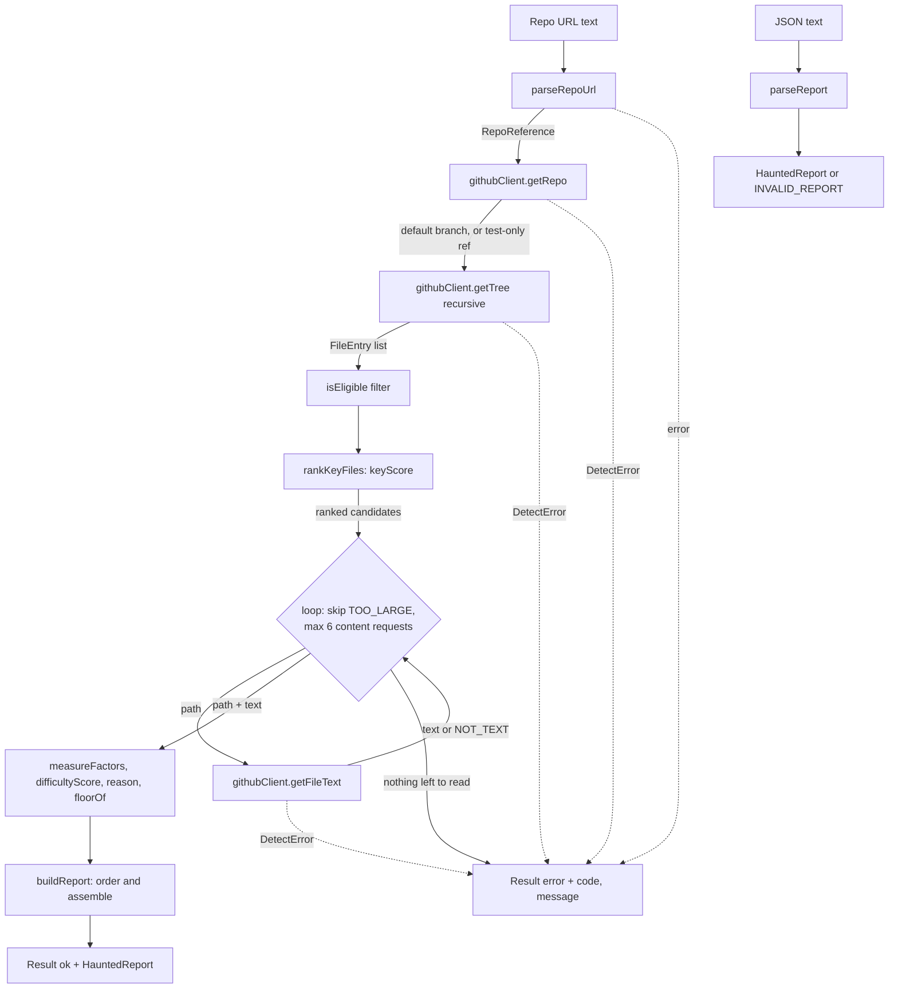

# Design Document

## Overview

Ghost detection takes a public GitHub URL and returns a `HauntedReport`: up to 5 key files ("ghosts"), each with a difficulty score, ordered from easy (attic) to hard (basement).

The design is small on purpose (deadline: 20 Nov 2026):

- Plain TypeScript functions in a new shared package `packages/core` (`@haunted-repo/core`), folder `packages/core/src/ghost-detection/`.
- Almost every module is pure (data in, data out). Only `githubClient.ts` uses the network.
- No new dependencies. It uses only the globals `fetch`, `TextDecoder` and `AbortSignal`, so the same code runs in Node 24 and in a browser (Requirement 7.9).
- Only the default branch is analysed. The only way to pick another commit is the test-only `ref` option of `detectGhosts`, used by the live test.
- No MCP wiring, no CLI, no storage. The Power and the demo website will call `detectGhosts` in later specs.
- Same style as the project: ESM, `strict`, `noUncheckedIndexedAccess`, imports with `.js` extension (NodeNext), tests next to the code as `*.test.ts`.

### Decisions

| Decision                                            | Reason                                                                                          |
| --------------------------------------------------- | ----------------------------------------------------------------------------------------------- |
| Code lives in a new package `packages/core`          | `power` and `web` both have `rootDir: "src"`, so the web cannot import `../power/src`. The Power will be packaged, and the web must not pull it in. Both depend on `core` instead (Requirement 7.8). |
| Default branch only; `ref` is a test-only option     | Simpler URL parsing, no branch errors. The live test still needs a pinned commit (Requirement 7.2). |
| `detectGhosts` returns a `Result`, never throws     | Requirement 6.6. Internally the client throws a small `DetectError`; the orchestrator catches it. |
| File text is fetched one file at a time, in order   | Simple, deterministic, and easy to count against the 8-request budget.                           |
| Only `.js` suffix on relative imports, no path alias | Matches NodeNext in `tsconfig.base.json`.                                                        |
| Hand-written type guard in `parseReport`            | No schema library needed for one small type.                                                    |
| Sort with `<` on strings, not `localeCompare`       | Same order on every machine and locale (determinism).                                           |

## Architecture

Data flow of `detectGhosts` inside `@haunted-repo/core`:



### Package `@haunted-repo/core`

```
packages/core/
  package.json
  tsconfig.json
  src/
    index.ts                 re-exports ./ghost-detection/index.js
    ghost-detection/         (files below)
```

`packages/core/package.json`:

```json
{
  "name": "@haunted-repo/core",
  "version": "0.0.0",
  "private": true,
  "type": "module",
  "main": "./dist/index.js",
  "types": "./dist/index.d.ts",
  "exports": { ".": { "types": "./dist/index.d.ts", "default": "./dist/index.js" } },
  "scripts": { "build": "tsc" }
}
```

`packages/core/tsconfig.json` (checked with `tsc --noEmit` on a scratch file, with TypeScript 6.0.3):

```json
{
  "extends": "../../tsconfig.base.json",
  "compilerOptions": {
    "outDir": "dist",
    "rootDir": "src",
    "declaration": true,
    "types": [],
    "lib": ["ES2023", "DOM"]
  },
  "include": ["src"]
}
```

- `tsconfig.base.json` has `types: ["node"]`. Core overrides it with `types: []`, so Node globals such as `Buffer` or `process` are compile errors (checked: TS2591).
- `lib: ["ES2023"]` alone is not enough: `fetch`, `AbortSignal` and `TextDecoder` are then "cannot find name" errors (checked). Adding `"DOM"` makes them compile. The cost is that DOM-only names (`document`, `window`) also compile; that is accepted, and the browser run of the demo is the real check.
- Test files in core may import `vitest` and `fast-check`, but not `node:*` modules. The live test and the fake GitHub only need `fetch`/`Response`.
- `declaration: true` is needed so `power` and `web` get types from `dist/index.d.ts`.
- Relative imports inside core use the `.js` extension (NodeNext).

`power` and `web` get `"dependencies": { "@haunted-repo/core": "0.0.0" }`. With npm workspaces, `npm install` links `node_modules/@haunted-repo/core` to `packages/core` because the version matches; `package-lock.json` must be updated and committed. These two `package.json` edits belong to the later specs that use core, not to this one.

**Build order.** The order is fixed explicitly in the root `package.json`: `"build": "npm run build -w @haunted-repo/core && npm run build -w @haunted-repo/power && npm run build -w @haunted-repo/web"`. The build is deterministic: `core` is built first, so its `dist` exists when `power` and `web` compile against it. It works on Windows because npm runs scripts with `cmd.exe`, which supports `&&`. A new package must be added to this script, in dependency order (after every package it depends on).

**Browser use.** The web calls `api.github.com` directly. Checked with a request that sends an `Origin` header: GitHub answers `Access-Control-Allow-Origin: *`, and `Access-Control-Expose-Headers` includes `X-RateLimit-Remaining`, `X-RateLimit-Reset` and `Retry-After`, so the client can read them in a browser. The client sets only Accept and X-GitHub-Api-Version. It does not set User-Agent: GitHub requires one, but Node's etch and every browser send their own. A preflight request (OPTIONS with Access-Control-Request-Headers: accept,x-github-api-version) was answered 204 with Access-Control-Allow-Origin: * and X-GitHub-Api-Version in the allowed headers, so the headers used are accepted from a browser.

### Files

```
packages/core/src/ghost-detection/
  types.ts          shared types (see Data Models)
  errors.ts         DetectError class + ErrorCode helpers
  repoUrl.ts        parseRepoUrl, formatRepoUrl
  eligibility.ts    isEligible
  keyFiles.ts       keyScore, rankKeyFiles, pickKeyFiles
  factors.ts        measureFactors, difficultyScore, reasonFor
  report.ts         floorOf, buildReport
  githubClient.ts   createGitHubClient (the only network module)
  detectGhosts.ts   orchestrator
  parseReport.ts    JSON text -> HauntedReport
  fakeGitHub.testutil.ts   strict fake GitHub (tests only)
  index.ts          public exports
  *.test.ts         unit and property tests
```

`fakeGitHub.testutil.ts` is compiled by `tsc` with the rest of `src`. This is harmless: the package is private.

## Components and Interfaces

```ts
// repoUrl.ts
export function parseRepoUrl(text: string): Result<RepoReference>;
export function formatRepoUrl(ref: RepoReference): string; // https://github.com/o/r

// eligibility.ts
export function isEligible(path: string): boolean;

// keyFiles.ts
export function keyScore(entry: FileEntry): number;
export function rankKeyFiles(entries: FileEntry[]): FileEntry[]; // eligible only, best first
export function pickKeyFiles(entries: FileEntry[], max?: number): FileEntry[]; // rank.slice(0, max ?? 5)

// factors.ts
export function measureFactors(text: string): Factors;
export function difficultyScore(f: Factors): number; // integer 0..100
export function reasonFor(f: Factors): string;

// report.ts
export function floorOf(score: number): Floor;
export function buildReport(input: BuildInput): HauntedReport;

// githubClient.ts
export interface GitHubClientOptions {
  fetch?: typeof fetch; // injectable for tests
  timeoutMs?: number; // default 10_000
}
export interface GitHubClient {
  getRepo(owner: string, repo: string): Promise<{ defaultBranch: string | null }>;
  // ref: the default branch name, or the test-only commit SHA
  getTree(owner: string, repo: string, ref: string): Promise<{ entries: TreeEntry[]; truncated: boolean }>;
  getFileText(owner: string, repo: string, ref: string, path: string): Promise<string>; // throws NOT_TEXT
  readonly requestCount: number;
}
export function createGitHubClient(opts?: GitHubClientOptions): GitHubClient;

// detectGhosts.ts
export interface DetectOptions extends GitHubClientOptions {
  ref?: string; // TEST ONLY: a commit SHA read instead of the default branch. No URL can set it.
}
export function detectGhosts(url: string, opts?: DetectOptions): Promise<Result<HauntedReport>>;

// parseReport.ts
export function parseReport(jsonText: string): Result<HauntedReport>;
```

`Result<T>` is `{ ok: true; value: T } | { ok: false; error: DetectErrorInfo }`. For `detectGhosts` the success value is the report, so callers read `result.value`. (The requirements call the success shape "report"; the exact field name is an implementation detail.)

`BuildInput` is `{ repo: RepoReference-with-resolved-ref, analysed, truncated, partial, skipped, ghosts: ScoredFile[] }` where `ScoredFile` is `{ path, language, factors }`. `buildReport` computes score, floor and reason, orders the ghosts and sets `picked` and `fewFiles`. Because it sorts, the download order cannot change the result (Requirement 6.5).

## Data Models

```ts
export type Language = "TypeScript" | "JavaScript" | "Java" | "Python";
export type Floor = "attic" | "middle floor" | "basement";

export type ErrorCode =
  | "INVALID_URL"
  | "REPO_NOT_FOUND"
  | "RATE_LIMITED"
  | "NETWORK_ERROR"
  | "EMPTY_REPO"
  | "NO_SUPPORTED_FILES"
  | "INVALID_REPORT";

export interface DetectErrorInfo {
  code: ErrorCode;
  message: string; // English
}

export type Result<T> = { ok: true; value: T } | { ok: false; error: DetectErrorInfo };

export interface RepoReference {
  owner: string;
  repo: string;
}

export interface FileEntry {
  path: string; // as in the tree, "/" separated
  size: number; // bytes, from the tree
}

export interface Factors {
  lines: number;
  branches: number;
  maxIndent: number;
  imports: number;
}

export interface Ghost {
  path: string;
  language: Language;
  difficultyScore: number; // integer 0..100
  floor: Floor;
  factors: Factors;
  reason: string;
}

export interface SkippedFile {
  path: string;
  reason: "TOO_LARGE" | "NOT_TEXT";
}

export interface Overview {
  owner: string;
  repo: string;
  ref: string; // the ref really used (the default branch name, or the test-only SHA)
  analysed: number; // number of Eligible_Files found
  picked: number; // ghosts.length
  truncated: boolean;
  fewFiles: boolean;
  partial: boolean;
  skipped: SkippedFile[];
  message: string | null; // English text when fewFiles is true, else null
}

export interface HauntedReport {
  overview: Overview;
  ghosts: Ghost[]; // easy to hard
}
```

Only strings, numbers, booleans, `null`, arrays and plain objects are used, so the report is JSON-safe (Requirement 6.7). There is no "exorcised" field (Requirement 6.10). `null` is used instead of `undefined` so the JSON round trip is exact.

### Language by extension

`.ts .tsx` → TypeScript, `.js .jsx .mjs .cjs` → JavaScript, `.java` → Java, `.py` → Python.

### Eligibility (`isEligible(path)`)

A path is eligible when all of these hold. Folder and extension checks are case-insensitive.

1. The extension is in the list above.
2. No folder segment (every segment except the file name) is one of `node_modules, dist, build, out, vendor, target, coverage, .git, __pycache__, .next`.
3. The file name does not end with `.d.ts` or `.min.js`, does not contain `.generated.`, `.gen.` or `.config.`, does not start with `.eslintrc.`, and is not `setup.py`. Lock files have no supported extension, so they are already out.
4. It is not a test: the name does not contain `.test.` or `.spec.`, does not start with `test_`, does not end with `Test.java`, and no folder segment is `test`, `tests`, `__tests__` or `spec`.

The tree filter also keeps only entries with `type === "blob"` and a mode starting with `100` (regular files). This drops folders, symlinks (`120000`) and submodules (`160000`), which GitHub would not return as plain text.

### Key score (`keyScore`)

`score = name + location + size`, where `dirs` is the list of folder segments of the path and `base` is the file name without its last extension (lower case).

- `name`: 40 if `base` is one of `main, index, app, server, program, __main__`, else 0.
- `location`: 30 if `dirs.length === 0`; 20 if `dirs.length === 1` and `dirs[0]` is `src`, `app` or `lib`; 10 if `dirs.length === 2` and `dirs[0]` is `src`, `app` or `lib`; else 0.
- `size`: `30 * clamp((size - 200) / (20000 - 200), 0, 1)`.

`rankKeyFiles` filters with `isEligible`, sorts by score descending, then path ascending (`a < b`). `pickKeyFiles` takes the first 5. The score is a plain float; ties are broken by path, so the order is always the same.

For a monorepo (Requirement 4.8) nothing special is done: `packages/x/src/index.ts` has 3 folders, so it gets 0 location points and only competes on name and size.

### Factors (`measureFactors(text)`)

1. Remove a leading BOM (`\uFEFF`). Split on `/\r?\n/`. This makes `\n` and `\r\n` give the same result (Requirement 5.5).
2. Cut each line to its first 500 characters (decision: "one line of more than 500 characters counts as a single line" is read as "never more than one line, and cheap to scan").
3. Drop lines that are empty after `trim()`. Call the rest `nonEmpty`.
4. A line is a _comment line_ when its trimmed text starts with `//`, `#`, `/*` or `*`.
5. `lines` = number of `nonEmpty` lines that are not comment lines.
6. `branches` = number of matches of `/\b(if|elif|for|while|switch|case|catch)\b/g` over non-comment lines. `else if` counts once, through its `if`; `elif` counts once; a bare `else` does not count.
7. `maxIndent` = the maximum over `nonEmpty` lines of `tabs + floor(spaces / 4)`, where `tabs` and `spaces` are the counts of leading tab and space characters.
8. `imports` = number of `nonEmpty` lines whose trimmed text matches `/^(import\b|from\s+\S+\s+import\b)/` or contains `require(`.

Known limits (accepted, honest): keywords inside strings count; a bare `else` is not counted; a trailing `//` comment is not removed.

### Difficulty score

```ts
const part = (value: number, cap: number, weight: number) =>
  (Math.min(value, cap) / cap) * weight;

points = {
  lines: part(f.lines, 400, 40),
  branches: part(f.branches, 60, 30),
  maxIndent: part(f.maxIndent, 8, 20),
  imports: part(f.imports, 20, 10),
};
difficultyScore = Math.round(points.lines + points.branches + points.maxIndent + points.imports);
```

Each part is between 0 and its weight, and the weights add up to 100, so the result is an integer from 0 to 100. All parts are non-decreasing in their factor, and `Math.round` is non-decreasing, which gives the monotonic property.

### Reason sentence

`reasonFor(f)` computes the four `points` above and picks the factor with the highest points. Ties are broken in this fixed order: `lines`, `branches`, `maxIndent`, `imports`. The sentence comes from a fixed table:

| Winner      | Sentence                                                      |
| ----------- | ------------------------------------------------------------- |
| `lines`     | `It is hard mostly because it is long (N lines of code).`     |
| `branches`  | `It is hard mostly because it makes many decisions (N if/elif/for/while/switch/case/catch).` |
| `maxIndent` | `It is hard mostly because the code is deeply nested (N levels).` |
| `imports`   | `It is hard mostly because it depends on many other files (N imports).` |

If all points are 0 (empty file), the sentence is `It is very short and simple.`

### Floor

`floorOf(score)`: `score <= 33` → `attic`, `score <= 66` → `middle floor`, else `basement`.

### Order

`buildReport` sorts ghosts by `difficultyScore` ascending, then `path` ascending.

## GitHub client

All calls are anonymous. Headers on every request: `Accept: application/vnd.github+json` (raw content uses `application/vnd.github.raw+json`) and `X-GitHub-Api-Version: 2022-11-28` (no `User-Agent`, see Browser use). Every request uses `signal: AbortSignal.timeout(timeoutMs)`.

Endpoints (checked against docs.github.com REST docs):

| Step | Request                                                        | Used for                                                                  |
| ---- | -------------------------------------------------------------- | ------------------------------------------------------------------------- |
| 1    | `GET /repos/{owner}/{repo}`                                    | Exists and is public; `default_branch`.                                   |
| 2    | `GET /repos/{owner}/{repo}/git/trees/{ref}?recursive=1`        | All paths and sizes in one call. `{ref}` is a branch name or a commit SHA; the response has `tree[]` (`path`, `mode`, `type`, `size`) and `truncated`. |
| 3    | `GET /repos/{owner}/{repo}/contents/{path}?ref={ref}` with raw media type | Raw text of one file. Raw works for files up to 100 MB, and we only ask for files up to 100 KB. |

File path parts are encoded one by one with `encodeURIComponent` and joined with `/`. In step 2 `{ref}` is the default branch name read in step 1 (a name such as `feat/x` is possible for a default branch, but rare; it is not special-cased) or, in tests only, a commit SHA.

Step 1 is also made when the test-only `ref` is given. It keeps the request count the same in both cases and tells "repository missing" (`REPO_NOT_FOUND`) apart from other tree failures.

### Mapping of responses

Rule order inside the client: first the rate limit check, then the status.

| Response                                                                               | Result                                                                   |
| -------------------------------------------------------------------------------------- | ------------------------------------------------------------------------ |
| Status 403 or 429 and header `x-ratelimit-remaining` is `0`                            | `RATE_LIMITED`. Reset time from `x-ratelimit-reset` (UTC epoch seconds). |
| Status 403 or 429 with `retry-after` header (secondary limit)                          | `RATE_LIMITED`. Reset time = now + seconds, or "in about N seconds" if no clock is wanted. |
| Status 403 or 429 otherwise                                                            | `RATE_LIMITED` with a generic "try again in a minute" text.              |
| Step 1: 404 (also 301 to another repo is followed by fetch)                            | `REPO_NOT_FOUND`                                                         |
| Step 1: 200 and `default_branch` missing/empty, and no ref was given                   | `EMPTY_REPO`                                                             |
| Step 2: 409 (GitHub says "Git Repository is empty")                                    | `EMPTY_REPO`                                                             |
| Step 2: 404 or 422 (for example a test-only `ref` that does not exist)                 | `NETWORK_ERROR` (simplest: the repository was already confirmed by step 1, and a normal user can never send a `ref`). It falls under the "unexpected status" row; no dedicated code. |
| Step 3: any non-200                                                                    | `NETWORK_ERROR` ("GitHub could not give file X, try again")               |
| Any other status (5xx, unexpected 4xx), body that is not JSON where JSON is expected   | `NETWORK_ERROR`                                                          |
| `fetch` rejects (offline, DNS) or the abort timeout fires (`TimeoutError`/`AbortError`) | `NETWORK_ERROR`                                                          |

The reset time is shown in UTC ISO text, for example `The GitHub limit resets at 2026-11-12T10:00:00Z.` (from epoch seconds, no clock needed).

### Request budget (max 8)

`client.requestCount` counts every call made. The orchestrator uses 1 (repo) + 1 (tree) + at most 6 (files). Skipping a file because the tree says it is bigger than 102,400 bytes costs no request. The client throws a plain `Error` if a 9th request is attempted (a bug guard, not a user error).

### UTF-8 check

`getFileText` reads `await res.arrayBuffer()` and decodes with `new TextDecoder("utf-8", { fatal: true })`. A decoding error is turned into `DetectError("NOT_TEXT")` (an internal code, not part of the public `ErrorCode`); the orchestrator catches it and records a `NOT_TEXT` skip. A NUL byte in the text is also treated as `NOT_TEXT` (binary file with a code extension, very unlikely, one line of code).

## Orchestrator (`detectGhosts`)

```ts
async function detectGhosts(url, opts) {
  const parsed = parseRepoUrl(url);             // INVALID_URL
  if (!parsed.ok) return parsed;
  try {
    const client = createGitHubClient(opts);
    const { defaultBranch } = await client.getRepo(owner, repo);
    const ref = opts?.ref ?? defaultBranch;          // test-only SHA, else default branch; EMPTY_REPO if none
    let { entries, truncated } = await client.getTree(owner, repo, ref);
    if (entries.length > 5000) { entries = entries.slice(0, 5000); truncated = true; }
    const files = entries.filter(isRegularBlob).map(toFileEntry);
    const candidates = rankKeyFiles(files);
    if (candidates.length === 0) return error("NO_SUPPORTED_FILES");
    const analysed = candidates.length;

    const scored = [], skipped = [];
    let used = 0, partial = false;
    for (const c of candidates) {
      if (scored.length === 5) break;
      if (c.size > 102_400) { skipped.push({ path: c.path, reason: "TOO_LARGE" }); continue; }
      if (used === 6) break;
      used++;
      try {
        const text = await client.getFileText(owner, repo, ref, c.path);
        scored.push({ path: c.path, language: languageOf(c.path), factors: measureFactors(text) });
      } catch (e) {
        if (isCode(e, "NOT_TEXT")) { skipped.push({ path: c.path, reason: "NOT_TEXT" }); continue; }
        if (isCode(e, "RATE_LIMITED") && scored.length > 0) { partial = true; break; }
        throw e;
      }
    }
    // Requirement 2.12: eligible files exist but every one was skipped
    if (scored.length === 0) return error("NO_SUPPORTED_FILES", skippedMessage(skipped));
    return ok(buildReport({ ... }));
  } catch (e) {
    if (e instanceof DetectError) return { ok: false, error: e.info };
    throw e; // a real bug, not a spec error
  }
}
```

Notes:

- The tree is cut to 5,000 entries _before_ filtering, as in Requirement 2.4.
- "Everything skipped" is a normal rule, not a gap (Requirement 2.12): when no file could be read, `NO_SUPPORTED_FILES` is returned, and its message lists the skipped paths with their reasons (`skippedMessage`). A rate limit before the first file is read is `RATE_LIMITED`, not this error.
- Ranking uses only paths and sizes, so no download is needed to choose candidates (Requirement 4.1).
- Request count in the worst case: 1 + 1 + 6 = 8.
- `fewFiles` and its message are set by `buildReport` when `picked` is 1 or 2: `This looks like a small project, so only N file(s) were picked.`

### `parseRepoUrl` rules

1. `trim()`. Remove `?query` and `#hash`.
2. Remove an optional `http://` or `https://` (case-insensitive), then an optional `www.`.
3. The next part must be `github.com` (case-insensitive) followed by `/`.
4. Split the rest by `/`. Segment 1 is the owner (`/^[A-Za-z0-9-]+$/`), segment 2 is the repo (`/^[A-Za-z0-9._-]+$/`, not `.` or `..`).
5. Remove a trailing `.git` from the repo name (the repo must not be empty after that).
6. Every segment after the repo name is ignored (`/tree/main/src`, `/issues`, a final `/`). No branch or ref is ever read from the URL (Requirement 1.1).

`formatRepoUrl` returns `https://github.com/{owner}/{repo}` plus `/tree/{ref}` when there is a ref. The round-trip property is limited to the valid set above: repo names that do not end in `.git`, refs with no `?`, `#`, spaces, `%`, empty segments or leading/trailing `/`.

### `parseReport` rules

`JSON.parse` inside try/catch, then a type guard checks: root object with `overview` and `ghosts`; every field of `Overview` and `Ghost` has the right primitive type; `floor` and `reason`/`language` values are in their unions; scores are integers 0 to 100; factors are non-negative integers; `ghosts` is an array. Any failure returns `INVALID_REPORT`. The guard does not re-check that the floor matches the score (it only checks shape).

## Error Handling

| Situation                                              | Code                 | Message idea (English)                                                                       |
| ------------------------------------------------------ | -------------------- | -------------------------------------------------------------------------------------------- |
| URL empty, not GitHub, no owner or repo                | `INVALID_URL`        | `That does not look like a GitHub repository URL. Example: https://github.com/owner/repo`     |
| Repo 404                                               | `REPO_NOT_FOUND`     | `Repository not found. Only public GitHub repositories are supported.`                        |
| 403/429 rate limit                                     | `RATE_LIMITED`       | `GitHub rate limit reached. It resets at <UTC time>. Try again after that.`                   |
| Network failure, timeout (10 s), unexpected status (also tree 404/422, for example a wrong test-only `ref`) | `NETWORK_ERROR`      | `Could not reach GitHub. Please try again in a moment.`                                       |
| Empty repo (409, or no default branch)                 | `EMPTY_REPO`         | `This repository is empty. Add some code and try again.`                                      |
| No eligible files                                      | `NO_SUPPORTED_FILES` | `No supported source files found. Supported languages: TypeScript, JavaScript, Java and Python. Test files alone are not analysed.` |
| Eligible files exist but every one was skipped (Requirement 2.12) | `NO_SUPPORTED_FILES` | `All supported files were skipped: src/a.ts (too large), src/b.ts (not text). Nothing could be analysed.` (paths and reasons listed) |
| Bad report JSON                                        | `INVALID_REPORT`     | `This text is not a valid Haunted Repo report.`                                               |

Not errors: file too large (`skipped`, `TOO_LARGE`), file not UTF-8 (`skipped`, `NOT_TEXT`), tree too big (`truncated`), rate limit after at least one file (`partial`), 1 or 2 files (`fewFiles`).

## Correctness Properties

_A property is a characteristic or behavior that should hold true across all valid executions of a system-essentially, a formal statement about what the system should do. Properties serve as the bridge between human-readable specifications and machine-verifiable correctness guarantees._

After the reflection step, the criteria 5.6 and 5.7 stay separate (different generators of failure), and the "at most 5 / subset of eligible" checks are folded into the determinism property 3. Everything else is one property per criterion.

### Property 1: Repository URL round trip

For any valid `RepoReference` (owner and repo from the allowed character sets), parsing the URL produced by `formatRepoUrl` returns an equal `RepoReference`.

**Validates: Requirements 1.1, 1.6, 1.7**

### Property 2: Eligible set does not depend on order

For any list of paths and any permutation of it, the set of paths accepted by `isEligible` is the same.

**Validates: Requirements 3.6**

### Property 3: Picking is deterministic and bounded

For any list of `FileEntry`, calling `pickKeyFiles` twice returns the same list in the same order; the same list is returned for any permutation of the input; it has at most 5 items; every item is eligible; and when there are 5 or more eligible files the picked ones have the 5 highest scores.

**Validates: Requirements 4.5, 4.6, 4.9**

### Property 4: Difficulty score is an integer from 0 to 100

For any text, `difficultyScore(measureFactors(text))` is an integer with `0 <= score <= 100`.

**Validates: Requirements 5.3, 5.6**

### Property 5: Measuring is deterministic

For any text, measuring it twice gives equal `Factors` and equal scores.

**Validates: Requirements 5.7**

### Property 6: Adding a branching line never lowers the score

For any text and any line that is not a comment and contains a Branching_Keyword as a whole word, appending that line gives a score greater than or equal to the original score.

**Validates: Requirements 5.8**

### Property 7: Line endings do not matter

For any text without `\r`, replacing every `\n` by `\r\n` gives the same `Factors` and the same score.

**Validates: Requirements 5.5, 5.9**

### Property 8: Report order does not depend on download order

For any list of scored files and any permutation of it, `buildReport` returns equal reports, and the ghosts are sorted by score ascending, then by path ascending.

**Validates: Requirements 6.1, 6.5**

### Property 9: Report JSON round trip

For any valid `HauntedReport`, `parseReport(JSON.stringify(report))` returns an equal report.

**Validates: Requirements 6.7, 6.8**

## Testing Strategy

Tools: Vitest 5 (`npm test`, single run) and fast-check 4 (already in the root `devDependencies`). Each property is **one** `fc.assert(fc.property(...), { numRuns: 100 })` with a comment `// Feature: ghost-detection, Property N: <title>`. Tests are in `packages/core/src/ghost-detection/*.test.ts`, which the glob `packages/*/src/**/*.test.ts` of the root `vitest.config.ts` already matches.

### Vitest configs and the live test script

- `vitest.config.ts` (used by `npm test` and `npm run check`) keeps its `include` and adds `exclude: [...configDefaults.exclude, "**/*.live.test.ts"]` (`configDefaults` from `vitest/config`). Without this, the include glob would also match the live test.
- New `vitest.live.config.ts`: `include: ["packages/*/src/**/*.live.test.ts"]`, `testTimeout: 30_000`.
- New root script: `"test:live": "vitest run --config vitest.live.config.ts"`. It is not part of `check`.

### Property tests and generators

| Property | Generators                                                                                                                                                                  |
| -------- | --------------------------------------------------------------------------------------------------------------------------------------------------------------------------- |
| 1        | `owner`: `fc.stringMatching(/^[A-Za-z0-9-]{1,20}$/)`. `repo`: `fc.stringMatching(/^[A-Za-z0-9._-]{1,20}$/)` filtered to not end in `.git` and not be `.`/`..`. |
| 2        | `fc.array(pathArb)` and `fc.shuffledSubarray` (or sort by a random key) for the permutation. `pathArb`: 0 to 4 folder segments from `fc.constantFrom("src","lib","app","test","tests","spec","node_modules","dist","build","docs")` mixed with random words, plus a file name from random stems (`index`, `main`, `foo.test`, `x.d`, `a.min`, `b.config`, `Foo`, `test_x`) and extensions `.ts .tsx .js .jsx .mjs .cjs .java .py .md .json .lock`. |
| 3        | `fc.array(fc.record({ path: pathArb, size: fc.integer({ min: 0, max: 200_000 }) }), { maxLength: 30 })`, plus a permutation. Unique paths (`fc.uniqueArray` by path).        |
| 4, 5     | `textArb`: `fc.array(lineArb)` joined with `\n`. `lineArb` is `fc.oneof` of: any string without `\r`/`\n`; keyword lines such as `if (x) {` or `elif x:`; lines with random leading tabs/spaces; comment lines (`// ...`, `# ...`, `/* ...`, ` * ...`); import lines (`import a from "b"`, `from x import y`, `const a = require("b")`); lines longer than 500 characters. Also the empty array (empty file). |
| 6        | `textArb` plus `branchLineArb`: random indent + one of `if`, `elif`, `for`, `while`, `switch`, `case`, `catch` + ` (x) {`. The line is appended after a `\n`.                         |
| 7        | `textArb` with a filter that the text has no `\r`.                                                                                                                         |
| 8        | `fc.uniqueArray` of `{ path, language, factors }` where factors are `fc.integer` in 0..500 (and some above the caps), plus a permutation.                                  |
| 9        | `reportArb`: built from `fc.record` with integers (`fc.integer`, no NaN, no `-0`), `fc.string()`, `fc.boolean()`, the `Floor`, `Language` and skipped-reason `fc.constantFrom`, and `fc.array` for ghosts and skipped. |

### Unit tests (examples)

- `repoUrl`: a table of accepted forms (with/without `https://`, `www.`, `.git`, trailing `/`, `/tree/main/src`, `/issues`; the extra parts are ignored and no ref is produced) and rejected ones (empty, `gitlab.com/...`, missing owner, missing repo). `parseRepoUrl` never throws for any `fc.string()`.
- `eligibility`: a table for each rule in Requirement 3 (including `.d.ts`, `.min.js`, `setup.py`, `Test.java`, `__tests__/`).
- `keyFiles`: score table with boundary sizes 199, 200, 10,100, 20,000, 20,001 and the location cases 0, 1 and 2 folder levels.
- `factors`: hand-written snippets for each factor, a comment-only file, a 600-character line, CRLF text, an empty file (score 0), and the reason sentence for each winner plus the tie order.
- `report`: floor boundaries 0, 33, 34, 66, 67, 100; `fewFiles` for 1 and 2 ghosts.
- `parseReport`: valid text, invalid JSON, wrong types, and `fc.jsonValue()` never throws.
- `detectGhosts` with the fake GitHub (see below): default branch, test-only `ref` (commit SHA), a wrong `ref` giving `NETWORK_ERROR`, every error code, `truncated`, `TOO_LARGE`, `NOT_TEXT`, all eligible files skipped (`NO_SUPPORTED_FILES` with the skipped paths in the message), `partial`, request count never above 8, and "never throws".

### Strict fake GitHub (`fakeGitHub.testutil.ts`)

`createFakeGitHub(repos)` returns a `fetch` function. It must never be more permissive than the real API (testing rule). It:

- Returns 404 for unknown owner/repo, 404 for an unknown tree ref (a branch name or a SHA that is not in the fixture), 404 for a contents path that is not in the tree, 409 on the tree of an empty repo, and 404 for any unknown route.
- Returns 405 for any method other than GET, and 400 if `User-Agent` or `Accept` is missing (GitHub rejects requests without a User-Agent).
- Returns the real field names and types (`default_branch`, `tree[].path/mode/type/size`, `truncated`) and returns `size` only for blobs.
- Without the raw `Accept` header, the contents route returns the JSON/base64 form, not the raw text, so a client bug cannot hide.
- Can be told to answer 403 with `x-ratelimit-remaining: 0` and `x-ratelimit-reset` after N requests, to return invalid UTF-8 bytes, to hang until the abort signal fires (timeout test with a small `timeoutMs`), and to return 5xx.
- Counts requests, so tests can assert the budget of 8.

A few tests check the fake itself (for example: unknown ref gives 404, missing `User-Agent` gives 400).

### Live GitHub test (INTEGRATION)

One file `packages/core/src/ghost-detection/detectGhosts.live.test.ts`, run only by `npm run test:live`. It makes one call: `detectGhosts("https://github.com/lukeed/sirv", { ref: "1135207e92c40354543cbd15c763c7a61d79d432" })`, with no token and no environment variable. The pinned SHA keeps the result stable. The assertions share that one result: it is `ok`, `overview.ref` equals the SHA, there are 1 to 5 ghosts, scores are integers 0 to 100, ghosts are ordered, and `parseReport(JSON.stringify(report))` works. The call uses the default client timeout of 10 seconds; the test timeout is 30 seconds (from `vitest.live.config.ts`).

If the result is an error, the test fails. For `RATE_LIMITED` the failure message is: `GitHub rate limit reached (60 requests per hour without a token). Wait until the limit resets (<reset time from the error>) and run npm run test:live again.` (Requirement 7.4). There is no skipping, so a green live run always means the real API was reached.

## Risks and cuts

- **Rate limit.** Without a token GitHub allows 60 requests per hour per IP, and one live run uses up to 8. The live test is manual (`npm run test:live`), so `npm run check` never touches GitHub and cannot hit the limit. In the deployed demo, each visitor has their own 60 requests per hour (the browser calls GitHub from the visitor's IP), about 7 analyses per hour; `RATE_LIMITED` shows the reset time.
- **New packages must be added to the root build script in dependency order.** The build order is explicit in the root `package.json`, so a package missing from the script is not built.
- **`lib: ["DOM"]` in core** lets DOM-only names compile by mistake. The browser run of the demo is the check.
- **The counter limits** (keywords inside strings, bare `else` not counted) are accepted; do not try to fix them with a parser.

What to drop first if time runs short, in this order:

1. The tests of the fake itself and the `fc.jsonValue()` test (keep the property tests).
2. The secondary-limit details (`retry-after`): treat every 403/429 as `RATE_LIMITED` with the generic text.
3. The `message` text variants: keep one sentence per error.
4. Properties 2 and 8 can become two example tests each (keep 1, 3 to 7 and 9).

Do not cut: the real-API test, the strict fake for status codes 404/403/409, the request budget, and properties 4 to 7 (they protect the score that the whole feature is about).

## Requirements Traceability

Module paths are inside `packages/core/src/ghost-detection/`.

| Requirement | Module(s)                                    | Main tests                                        |
| ----------- | -------------------------------------------- | ------------------------------------------------- |
| 1.1, 1.2    | `repoUrl.ts`                                 | URL table, Property 1                             |
| 1.3, 1.4    | `githubClient.ts`, `detectGhosts.ts`         | fake GitHub 404 / 403                             |
| 1.5         | `githubClient.ts` (no auth header)           | live test                                         |
| 1.6, 1.7    | `repoUrl.ts`                                 | Property 1                                        |
| 2.1, 2.2    | `detectGhosts.ts`, `githubClient.ts`         | fake GitHub: default branch, test-only SHA        |
| 2.3         | `githubClient.ts`                            | fake GitHub: one tree request                     |
| 2.4         | `detectGhosts.ts`                            | fake GitHub: 5,001 entries, `truncated` flag      |
| 2.5         | `githubClient.ts`                            | fake GitHub: timeout, 5xx, wrong `ref`            |
| 2.6         | `githubClient.ts`, `detectGhosts.ts`         | fake GitHub: 409                                  |
| 2.7, 2.8    | `githubClient.ts`, `detectGhosts.ts`         | fake GitHub: request count, large file            |
| 2.9, 2.10   | `detectGhosts.ts`                            | fake GitHub: `skipped`, invalid UTF-8             |
| 2.11        | `githubClient.ts`, `detectGhosts.ts`         | fake GitHub: limit after first file               |
| 2.12        | `detectGhosts.ts`                            | fake GitHub: all eligible files skipped           |
| 3.1 to 3.5  | `eligibility.ts`, `detectGhosts.ts`          | eligibility table                                 |
| 3.6         | `eligibility.ts`                             | Property 2                                        |
| 4.1 to 4.4  | `keyFiles.ts`                                | score table                                       |
| 4.5, 4.6    | `keyFiles.ts`                                | Property 3                                        |
| 4.7         | `report.ts`                                  | report unit test                                  |
| 4.8         | `keyFiles.ts`                                | score table (monorepo path)                       |
| 4.9         | `keyFiles.ts`                                | Property 3                                        |
| 5.1 to 5.4  | `factors.ts`                                 | factor snippets (including `elif`), reason table  |
| 5.5         | `factors.ts`                                 | long line, CRLF, Property 7                       |
| 5.6 to 5.9  | `factors.ts`                                 | Properties 4 to 7                                 |
| 6.1, 6.2    | `report.ts`                                  | report unit test, Property 8                      |
| 6.3, 6.4    | `report.ts`                                  | report unit test                                  |
| 6.5         | `report.ts`                                  | Property 8                                        |
| 6.6         | `detectGhosts.ts`                            | "never throws" tests                              |
| 6.7, 6.8    | `types.ts`, `parseReport.ts`                 | Property 9                                        |
| 6.9         | `parseReport.ts`                             | parseReport unit tests                            |
| 6.10        | `types.ts`                                   | type has no such field                            |
| 7.1, 7.2    | `detectGhosts.live.test.ts`                  | live test (lukeed/sirv, pinned SHA via `ref`)     |
| 7.3         | `vitest.config.ts`, `vitest.live.config.ts`, root `package.json` | `npm test` skips `*.live.test.ts`; `npm run test:live` runs only them |
| 7.4         | `detectGhosts.live.test.ts`                  | failure message on `RATE_LIMITED`                 |
| 7.5         | `fakeGitHub.testutil.ts`                     | tests of the fake                                 |
| 7.6         | all `*.test.ts` property tests               | Properties 1 to 9                                 |
| 7.7         | whole package                                | `npm run check` on Windows                        |
| 7.8         | `packages/core` (`package.json`, `tsconfig.json`) | `npm run build` builds core first            |
| 7.9         | `packages/core/tsconfig.json` (`types: []`)  | compiles without Node types; browser run in the demo spec |
