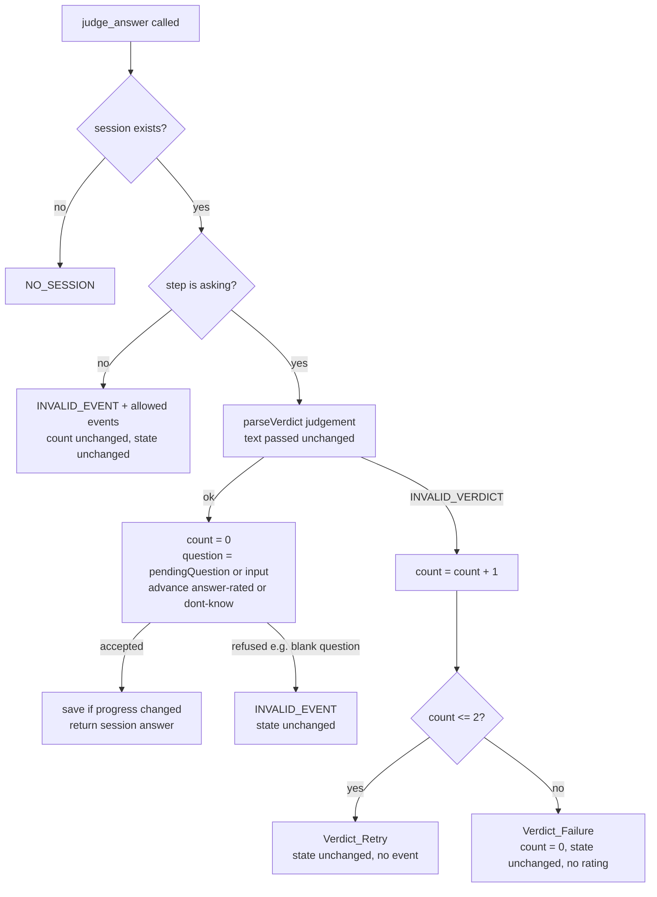

# Design Document

## Overview

This design turns the approved requirements of `kiro-power` into a small plan. The Power is one folder, `packages/power/`, that Kiro copies as it is. Inside it, one bundled JavaScript file (the Power_Server) gives the Tutor (the Student's own Kiro) six tools. The tools keep one Session_State in memory, call the Engine of `@haunted-repo/core`, read GitHub through `@haunted-repo/core`, and save one JSON file per repository in the Power_Data_Folder.

Main decisions (each one is explained in its section):

| Decision | Choice | Why this and not another |
|---|---|---|
| Bundler | esbuild 0.28.2 (one ESM file, `bundle/server.mjs`) | Smallest tool that does the job. One function call, no config file, same output on every OS. Rolldown comes with Vite but is not a direct dependency of this repo. |
| Bundle up to date | CI step `git status --porcelain` after `npm run check` | Works without extra tools, says exactly which file is stale, and also fails for a bundle that was never committed. |
| Tools | 6 tools (find, continue, pick, send event, judge, status) | Fewest tools that cover Requirements 2 to 10 without making the Tutor build engine events by hand where the Power can do it. |
| Data file | `haunted-repo--<owner>@<repo>.json`, lowercase | `@` is not allowed in owner or repo, so two repositories can never give the same name. |
| Writability | Checked once at start-up (7.10), and at every save (7.6) | One rule. The Student is told once per change of state, not on every call. |
| Core tests helpers | One Vitest alias `core-testutil/` that points to `packages/core/src/` | No change in `packages/core` (11.1) and no relative imports scattered in tests. |

Terms used here, in one sentence each, the first time they matter:

- **Bundle**: one file that holds our code and all libraries it needs, so Kiro does not have to install anything.
- **MCP** (Model Context Protocol): the way Kiro talks to a program that gives it tools. The program here is the Power_Server.
- **stdio**: the Power_Server reads requests from its standard input and writes answers to its standard output. This is why the server must never print anything else to the output.
- **Property-based test**: a test that tries hundreds of random inputs against a rule that must always hold.

Sources checked on 15 Nov 2026:

- `@modelcontextprotocol/sdk` is at version 1.32.2 on npm (node >= 18, peer dependency `zod` ^3.25 or ^4). Tools are registered with `server.registerTool(name, { description, inputSchema: { field: z.type() } }, handler)`. A failed tool call is a normal result with `isError: true` and a text content ([SDK server guide](https://github.com/modelcontextprotocol/typescript-sdk/blob/v1.x/docs/server.md)).
- esbuild is at 0.28.2 on npm (node >= 18).
- zod is at 4.6.7 on npm.
- The spike result (`docs/spike-power.md`): Kiro runs `node ${PLUGIN_ROOT}/<file>` from a plain copy of the Power folder, with no `node_modules/`; `PLUGIN_DATA` is `...\.kiro\powers\data\power`.

## Architecture

### 1. Files and folders of `packages/power/`

```
packages/power/
  plugin.json            manifest (updated: real description, version 0.1.0, no "haunted spike" keyword)
  mcp.json               one server, "haunted-repo", started with ${PLUGIN_ROOT}/bundle/server.mjs
  package.json           dependencies and scripts (see section 2)
  tsconfig.json          type check only (noEmit)
  skills/
    exorcise-ghosts/
      SKILL.md           the Tutor_Skill (section 8)
  bundle/
    server.mjs           the committed bundle (the only file Kiro runs)
  scripts/
    bundle.ts            builds bundle/server.mjs with esbuild (run by Node 24 directly)
  src/
    server.ts            entry point: reads PLUGIN_DATA, builds the Power, connects stdio
    register.ts          registers the six tools (zod schemas, thin handlers)
    power.ts             class HauntedPower: all the logic, no MCP, no direct disk access
    verdictGate.ts       pure functions for the judgement flow (section 7)
    dataFile.ts          pure: file name, serialise and parse the Repository_Data_File
    store.ts             IO: folder store (temp file + rename) and memory store
    messages.ts          every English text the Power_Server writes
    guardFetch.ts        pure: guardFetch(fetch) refuses any URL whose origin is not https://api.github.com
    *.test.ts            tests next to the code (same style as the other packages)
```

Rules for the layout:

- `power.ts`, `verdictGate.ts`, `dataFile.ts` and `guardFetch.ts` do not import the MCP SDK and do not touch the disk. `power.ts` receives its helpers (`fetch`, a store) as arguments. So every rule can be tested without Kiro (Requirement 11.5).
- `store.ts` is the only module that uses `node:fs`. `register.ts` and `server.ts` are the only modules that use the SDK.
- The committed bundle is `packages/power/bundle/server.mjs`. It cannot go in `dist/`, because `dist/` is in `.gitignore`. It is a single file, as Requirement 1.9 asks.
- `mcp.json` declares the server once, with `"args": ["${PLUGIN_ROOT}/bundle/server.mjs"]`, no `env`, no keys (1.3). The `${PLUGIN_ROOT}` form is the one proven by the spike; the relative form was never tested, so it is not used.
- Removed from the spike: `src/spike/`, `skills/haunted-spike/`, the `spike-relative` entry of `mcp.json`, and the placeholder `src/index.ts` and `src/index.test.ts` (`add`, Requirement 11.3).
- Requirement 1.6 (no compiled test files): `tsc` no longer writes any output (`noEmit`), so no `*.test.js` file is ever produced. The bundle is built only from `src/server.ts` and what it imports, so no test is inside it. The old `packages/power/dist/` folder is ignored by git and can be deleted locally.

### 2. The bundled server file

- **Bundler:** esbuild 0.28.2, a development dependency of `@haunted-repo/power` (exact version). It runs from `scripts/bundle.ts` with `build({ ... })`.
- **Settings:** `entryPoints: ["src/server.ts"]`, `bundle: true`, `platform: "node"`, `target: "node24"`, `format: "esm"`, `outfile: "bundle/server.mjs"`, `minify: false` (a readable file makes a stale-file diff easy to review), `legalComments: "none"`, `sourcemap: false`, and `alias: { "@haunted-repo/core": "../core/src/index.ts" }`.
- **Why the alias:** the bundle is built from the core source, not from `packages/core/dist/`. So the result does not depend on the order of the build and it uses the same code the tests use. esbuild reads the `./x.js` imports of core as `x.ts` files.
- **Output format:** ESM in a `.mjs` file, so Node runs it without a `package.json` next to it. A one-line banner (`createRequire`) is added because some libraries inside the SDK use `require`. The stdio smoke test (section 10) proves that the bundle starts on Node 24.
- **Inside the bundle:** our code, `@modelcontextprotocol/sdk` 1.32.2, `zod` 4.6.7 and `@haunted-repo/core`. Nothing else is needed at run time except Node 24 (1.7).
- **Scripts of `packages/power/package.json`:**
  - `"build": "tsc --noEmit && node scripts/bundle.ts"` (same pattern as `packages/web`, which already runs a TypeScript script with Node).
  - No separate `bundle` script is needed; `build` does both.
- **Root `build` script:** unchanged. It runs core, then power, then web. Power's `tsc --noEmit` needs the types of core, which come from `packages/core/dist/` (built first); the bundle itself does not need `dist/`.
- **How `npm run check` fits in:** `build` rewrites `bundle/server.mjs` and the next step (`npm test`) runs the smoke test against the fresh file. If the Student forgets to commit it, `git status` shows the file as changed.
- **How CI checks that the committed file is up to date:** one new step in `.github/workflows/ci.yml`, after `npm run check`: `test -z "$(git status --porcelain -- packages/power/bundle)" || { git status --porcelain -- packages/power/bundle; exit 1; }`. `check` has just rebuilt the file in the CI checkout, so any difference from the committed file fails the job. git diff does not see an untracked file, so a bundle that was never committed would pass; git status --porcelain fails for both a changed and an untracked bundle. This step runs on Ubuntu, so no PowerShell rule applies to it.
- **Determinism and line endings:** esbuild writes the same text for the same input and always uses `\n`; `.gitattributes` has `* text=auto eol=lf`, so Windows and Linux agree. One risk remains: the comments esbuild writes with module paths. They are relative and use `/`, so Windows and Linux should match. If the first CI run shows a difference, the first fix is to set `charset: "utf8"`; if it still differs, the file is built only in CI (open doubt 12.4).
- **Tooling changes:**
  - `packages/power/tsconfig.json`: remove `outDir` and `rootDir`, add `"noEmit": true`, include `src` and `scripts`, and add `paths` for the test helpers (section 3).
  - `eslint.config.js`: add `**/bundle/` to `globalIgnores`, so the 1 MB generated file is not linted.
  - `.prettierignore`: add `packages/power/bundle/`.
  - Root `vitest.config.ts`: add the helper alias (section 3).
- **New exact dependencies** (`package-lock.json` is updated, 11.2): `@haunted-repo/core` `0.0.0`, `@modelcontextprotocol/sdk` `1.32.2`, `zod` `4.6.7` as dependencies; `esbuild` `0.28.2` as a development dependency. The `package-lock.json` created on Windows must also contain the Linux esbuild binary entry so `npm ci` works in CI; `npm install` writes all optional platform entries, and CI proves it.

### 3. Reusing `@haunted-repo/core`

- **In the bundle:** core is bundled from its source (section 2).
- **In the tests:** the root `vitest.config.ts` already maps `@haunted-repo/core` to `packages/core/src/index.ts` (PLAN.md note g). The Power tests use the same alias, so `npm test` never needs a built `dist/`.
- **Core test helpers without a fragile relative import** (Requirement 11.5, the Medium of PR #20): core does not export its test helpers and Requirement 11.1 forbids changing core. So one more alias is added in `vitest.config.ts`, and one `paths` entry in `packages/power/tsconfig.json`, for the same prefix:

  | Import in a Power test | Points to |
  |---|---|
  | `core-testutil/ghost-detection/fakeGitHub.testutil.js` | `packages/core/src/ghost-detection/fakeGitHub.testutil.ts` |
  | `core-testutil/ghost-detection/reportArb.testutil.js` | `packages/core/src/ghost-detection/reportArb.testutil.ts` |
  | `core-testutil/exorcism/progressArb.testutil.js` | `packages/core/src/exorcism/progressArb.testutil.ts` |
  | `core-testutil/exorcism/tinySession.testutil.js` | `packages/core/src/exorcism/tinySession.testutil.ts` |

  The prefix is `core-testutil/` and not `@haunted-repo/core/...`, because Vite would treat the second form as a sub-path of the existing `@haunted-repo/core` alias. If core moves a helper, only this one alias line changes. This is the minimum fix for the Medium of PR #20 that does not touch core.
- **Open doubt (no change made):** the cleanest fix is a core entry point only for tests (for example `@haunted-repo/core/testing`). That needs a change in `packages/core` and its own approved change (Requirement 11.1). See doubt 12.2.
- **Fake GitHub and User-Agent:** the strict fake rejects a request without a `User-Agent` header, and the real core client sends none (Node adds one). The Power tests wrap the fake in a tiny function that adds `User-Agent: vitest`, exactly as `detectGhosts.test.ts` does. The wrapper stays strict in every other way.

### Architecture diagram

```mermaid
flowchart LR
  Student([Student]) <--> Tutor[Tutor = Kiro + Tutor_Skill]
  Tutor <-- "MCP over stdio" --> Server[Power_Server<br/>bundle/server.mjs]
  subgraph Power_Server
    Register[register.ts<br/>6 tools] --> Power[power.ts<br/>HauntedPower + Session_State]
    Power --> Gate[verdictGate.ts]
    Power --> DataFile[dataFile.ts]
    Power --> Store[store.ts]
    Power --> Core[@haunted-repo/core<br/>Engine + Detection + GitHub client]
  end
  Store --> Folder[(Power_Data_Folder<br/>PLUGIN_DATA)]
  Core --> GitHub[(api.github.com)]
```

## Components and Interfaces

### 4. The Power_Tools

Common rules for all tools:

- Every tool returns a normal MCP result with two text items: first a short English message for the Student, then a JSON text with the data. A failure sets `isError: true`. No `outputSchema` is used: the JSON is plain text that the Tutor reads (simpler, and Kiro shows it as it is).
- Every tool that needs a session answers `NO_SESSION` when none exists (9.3), with a message that says to call `find_ghosts` or `continue_house`.
- HauntedPower runs one tool call at a time: every public method is chained on one internal promise queue, so a call that waits for GitHub (find_ghosts, pick_ghost) can never be overtaken by another call. Kiro may call two tools at the same time.
- **Session answer.** Every answer of a session tool carries the same block, so the Tutor always knows where it is (4.2):

  ```
  { ok: true, step, allowedEvents, instructions, hauntedShare, message, warning? }
  ```

  `instructions` is the `text` of `buildInstructions(state)` unchanged. `allowedEvents` is `ALLOWED_EVENTS[step]`. After a refusal the same block is returned with the unchanged state, so the Tutor can re-sync.
- **Error answer:** `{ ok: false, code, message, step?, allowedEvents? }`.
- **Session_State in memory:** one object inside `HauntedPower`: `{ owner, repo, report, state, invalidCount }`. `state` is the engine `SessionState`; `invalidCount` is the Invalid_Judgement_Count. It is created by `find_ghosts` or `continue_house` and is changed only by `advance` (4.1). The Power_Server never keeps the Student's answers (4.7).

| Tool | Input (zod) | Covers | What it does | Error codes |
|---|---|---|---|---|
| `find_ghosts` | `url: string`, `knowsJava?: boolean`, `replace?: boolean` | 2.1 to 2.7, 4.1, 4.8, 7.2, 7.5 | Reads the URL with `parseRepoUrl`. Looks at the Repository_Data_File **before** any network call. If one exists (valid or broken) and `replace` is not `true`, it refuses. Otherwise it runs `detectGhosts`, saves `{report, progress}` with all ghosts `haunted`, starts the session with `startSession` and returns the ghosts (path, floor, score, reason, in report order), `hauntedShare`, `suggested` (`suggestGhost`) and the Tutor_Instructions of the `choosing` step. `partial: true` adds a warning that the list is incomplete (2.5). `fewFiles: true` adds the `message` of the report (2.6). | `INVALID_URL`, `REPO_NOT_FOUND`, `RATE_LIMITED`, `NETWORK_ERROR`, `EMPTY_REPO`, `NO_SUPPORTED_FILES`, `DATA_EXISTS` (valid file, no `replace`), `INVALID_REPORT` / `INVALID_PROGRESS` (broken file, no `replace`) |
| `continue_house` | `url: string`, `knowsJava?: boolean` | 4.1, 9.2, 7.5 | No network. Reads the Repository_Data_File of that repository and starts a new session with `startSession(report, { progress, profile })`, so `exorcised` ghosts stay `exorcised`. Any attempt in memory is dropped (7.9). | `INVALID_URL`, `NO_DATA` (no file: call `find_ghosts`), `INVALID_REPORT`, `INVALID_PROGRESS` |
| `pick_ghost` | `path: string` | 3.1 to 3.4, 4.1, 4.2 | Checks that the step allows `pick-ghost` and that `isPickable` is true for that path **before** any request. Reads the Ghost_Text with a new `createGitHubClient({ fetch })` and `getFileText(owner, repo, report.overview.ref, path)`. Sends `{ type: "pick-ghost", path, text }` to `advance`. The text is given unchanged. | `NO_SESSION`, `INVALID_EVENT`, `GHOST_TEXT_UNREADABLE` (any error of the read, with the core message when it has one; state unchanged) |
| `send_event` | `type: "explanation-done" \| "self-check-answered" \| "retry-ghost" \| "leave-ghost"`, `text?: string`, `answer?: "yes" \| "half" \| "no"` | 4.4, 4.5, 4.10, 4.11, 4.12, 6.3, 6.4, 7.3 | Builds the event, checks it with `parseEvent`, and calls `advance`. `text` is the explanation, Simpler_Explanation or model answer the Tutor wrote. When the progress changed it is saved before the answer is returned (7.3). In `failed` it returns the two options of the Engine. In `house-clean` it returns the Engine message and `hauntedShare: 0`. | `NO_SESSION`, `INVALID_EVENT` (with allowed events) |
| `judge_answer` | `question: string`, `judgement: string` | 5.1 to 5.11, 6.2, 6.3, 6.4, 4.6 | The strict verdict flow of section 7. | `NO_SESSION`, `INVALID_EVENT`, `INVALID_VERDICT` (retry), `VERDICT_FAILED` |
| `house_status` | none | 10.1, 10.2 | Returns every ghost (path, floor, `haunted` or `exorcised`) and `hauntedShare` from `hauntedShare(report, progress)`, plus English text such as "3 of 5 ghosts still haunt this house". | `NO_SESSION` |

Notes on the choices:

- `pick-ghost` is its own tool, because only the Power_Server may read the Ghost_Text (it must reach the Engine unchanged, 3.3). The Tutor never sends text for `pick-ghost`.
- `answer-rated` and `dont-know` are never sent by the Tutor. Only `judge_answer` sends them, and only from a Verdict that `parseVerdict` accepted (5.2).
- `pick_ghost` is also the way to start another ghost from `failed` (the Engine allows `pick-ghost` there).
- **`replace: true`:** it exists only on `find_ghosts`. Without it, an existing file is never changed. With it, both the report and the progress of **that** repository are replaced (2.7) or a broken file is overwritten (7.5). Files of other repositories are never touched. The refusal text says what the file is (valid or broken), names the file, and says that the Tutor must ask the Student before sending `replace: true`.
- **Where the question is kept (4.6).** `judge_answer` receives the question text from the Tutor. If `state.current.pendingQuestion` is not `null` (a question repeated after a Simpler_Explanation), the Power_Server sends **that** text to the Engine and ignores the one the Tutor sent. Otherwise it sends the Tutor's text. A blank question is refused by `parseEvent` (`INVALID_EVENT`).
- **Save rule (7.3).** After every accepted `advance`, the Power compares `formatProgress(state.progress)` with the saved one. If it changed, it saves before it answers. The Engine only changes the progress when a ghost becomes `exorcised`, stays `haunted` after a full attempt, or the self-check is answered, so this is exactly 7.3.
- **Network:** `fetch` is a constructor argument. In `server.ts` it is `guardFetch(globalThis.fetch)`. `guardFetch` is a pure exported function in its own module `src/guardFetch.ts`: it parses the request URL with `new URL()` and throws, without calling the inner `fetch`, if the URL does not parse or its origin is not exactly `https://api.github.com`. A prefix check is not used, because `https://api.github.com.evil.example/` would pass it. No `Authorization` header is ever added (8.2); the core client does not add one.

Example of `find_ghosts` answer (shortened):

```json
{ "ok": true, "step": "choosing", "allowedEvents": ["pick-ghost"],
  "instructions": "<text of buildInstructions, unchanged>",
  "hauntedShare": 1, "suggested": "src/a.ts",
  "ghosts": [{ "path": "src/a.ts", "floor": "attic", "difficultyScore": 12, "reason": "..." }],
  "warning": null }
```

### 7. The strict verdict flow (Requirement 5)

Constants: `MAX_VERDICT_RETRIES = 2`. The Invalid_Judgement_Count is `session.invalidCount`, a number in the in-memory session (0 at the start of a session).



How each requirement is met:

- **5.11:** the Step check comes **before** `parseVerdict` and does not touch the count.
- **5.1 and 5.2:** the only decision is `parseVerdict(judgement)` with the string exactly as received. There is no `trim`, no search for words, no default.
- **5.3:** `right`, `half-right` or `wrong` give `{ type: "answer-rated", rating, question }`; `dont-know` gives `{ type: "dont-know", question }`.
- **5.7:** the count is reset to 0 when `parseVerdict` accepts a text, after a Verdict_Failure, and after any `advance` the Engine accepts. If `parseVerdict` accepts but `advance` refuses (only a blank question), the count is already 0 and the state is unchanged.
- **5.9:** the count never goes above 3 (it is set back to 0 at 3), and a rejected judgement never reaches `advance`, so the state object is the same as before.
- **Text of a Verdict_Retry** (`ok: false`, `code: "INVALID_VERDICT"`, `isError: true`, plus `retry: true`, `triesLeft`):

  ```
  Your judgement was not accepted. <message of parseVerdict>
  Write the judgement again (do not ask the Student again). Allowed last lines:
  VERDICT: right | VERDICT: half-right | VERDICT: wrong | VERDICT: dont-know
  Tries left: 2.
  ```

  `triesLeft` is `3 - count`: 2 after the first rejection and 1 after the second.
- **Text of a Verdict_Failure** (`code: "VERDICT_FAILED"`, `retry: false`):

  ```
  The Tutor could not give a valid verdict for this answer. No rating was recorded.
  The step is still "asking". The Student can continue with the same question or leave the ghost.
  ```

  The step, `allowedEvents` and `instructions` of the unchanged state are added to the JSON.

### 8. The Tutor_Skill

- **Path and name:** `skills/exorcise-ghosts/SKILL.md`, front matter `name: exorcise-ghosts`.
- **Description (keywords a beginner uses):** "Use when the user wants to understand code an AI wrote for them, exorcise ghosts, find haunted files in a GitHub repository, or practise understanding a project. Haunted Repo finds the hardest files and teaches them with questions."
- **Order of calls the skill must give:**
  1. Ask the Student for the public GitHub URL, and ask whether the Student knows Java (4.8, the answer is `knowsJava`).
  2. Call `find_ghosts`. If it answers `DATA_EXISTS`, tell the Student a saved house exists and ask: continue it (`continue_house`) or start again (`find_ghosts` with `replace: true`)? Send `replace: true` only after the Student says yes (2.7, 7.5).
  3. Show the ghosts and the suggested one, and let the Student pick (`pick_ghost`).
  4. Loop: do exactly what `instructions` says for the current `step`. After each explanation, Simpler_Explanation or model answer, call `send_event` with `explanation-done` and the text. After each Student answer, write the Judgement and call `judge_answer`.
  5. At `self-check`, ask "yes", "half" or "no" and call `send_event` with `self-check-answered`. At `failed`, offer the two options (`retry-ghost` or `pick_ghost` for another ghost). At `house-clean`, congratulate the Student.
  6. At any time `house_status` shows the map. After a restart, use `continue_house` and ask about Java again (9.2).
- **Rules the skill must contain** (short list, one line each):
  - Write to the Student only in English, one question per message, wait for the answer before judging (4.3).
  - Follow `instructions` exactly. Never show the model answer before the step asks for it.
  - A Judgement is a short reason and then, as the **last line**, exactly one of `VERDICT: right`, `VERDICT: half-right`, `VERDICT: wrong`, `VERDICT: dont-know`. No bold, no space before it, no full stop, one `VERDICT:` line only.
  - "I don't know" in any language, an empty answer, or an answer that does not try to answer is `VERDICT: dont-know` (6.1).
  - If `judge_answer` answers `INVALID_VERDICT`, write the Judgement again without asking the Student; if `VERDICT_FAILED`, tell the Student and let them continue or leave the ghost.
  - If a response has a `warning`, tell the Student once, in plain English.
  - If the tools are not available: tell the Student to check that Node.js 24 is installed and to restart Kiro, and do not run an exorcism (1.8).
  - Do not send the Student's answers to any tool except inside the Judgement reason, and keep that reason short.
- **How it is checked:** the skill text is not testable by a machine. It is checked only by the manual end-to-end check in Kiro (Requirement 11.7, section 10).

## Data Models

### 5. The Repository_Data_File

**Name.** `haunted-repo--<owner>@<repo>.json`, with `<owner>` and `<repo>` in lowercase.

- **Marker:** the file name starts with `haunted-repo--`.
- **Allowed characters:** owner `[a-z0-9-]+`, repo `[a-z0-9._-]+`. These are the same patterns that `parseRepoUrl` of core uses, in lowercase. The builder checks them again (defence in depth) and throws if one fails.
- **Separator `@`:** it is not allowed in owner or repo, so two different repositories never give the same name. A separator made of `-` would not be safe: owner `a--b` with repo `c` and owner `a` with repo `b--c` would collide.
- **Lowercase:** GitHub and Windows ignore case, so `Lukeed/Sirv` and `lukeed/sirv` must be the same file. The original case stays inside the report.
- **No path traversal:** no `/`, `\`, `:` or `..` can appear, because only the characters above are allowed and the name always starts with the marker and ends with `.json`. A repo called `..` is already refused by `parseRepoUrl`; `...` is harmless inside `haunted-repo--a@....json`. The maximum length is 14 + 39 + 1 + 100 + 5 = 159 characters, under the 255 limit.
- **Own files only (7.11):** a file belongs to Haunted Repo if its whole name matches `^haunted-repo--[a-z0-9-]+@[a-z0-9._-]+\.json$`. The Power_Server opens files only by building a name from a URL (it never lists or scans the folder), and never changes a file whose name does not match. Another Power in the same `PLUGIN_DATA` folder is therefore never touched. Kiro names that folder after the last part of the import URL (`power` in the spike), so two Powers imported from URLs ending in `/power` share it; the marker is what keeps them apart.

**Content.**

```json
{ "format": 1, "report": { "...": "HauntedReport" }, "progress": { "ghosts": [] } }
```

- Written as text built from `JSON.stringify(report)` and `formatProgress(progress)` (7.2), with no extra fields. Nothing else is saved: no answers, no Ghost_Text, no Tutor text (7.4), no `knowsJava` (9.2).
- Read with `JSON.parse`, then `format === 1`, then `parseReport(JSON.stringify(report))` and `parseProgress(JSON.stringify(progress))`. The report's `overview.owner` and `overview.repo`, in lowercase, must match the file name; if not, the file is `INVALID_REPORT`. Any other problem gives `INVALID_REPORT` or `INVALID_PROGRESS` with a message that names the file (7.5).
- **Safe write.** Write to `<name>.<random>.tmp` in the same folder, then `rename` it over the final name. A crash leaves either the old file or the new one, never half of a file. A failed write tries to delete the temporary file and does not touch the final file. On Windows, rename can fail with EPERM, EBUSY or EACCES while another program (antivirus, indexer) holds the target file. store.ts retries the rename up to 5 times, waiting 50, 100, 200, 400 and 800 ms, before it reports a failed save (7.6).

### 6. `PLUGIN_DATA` and the memory fallback

One rule, in two moments:

| Moment | Case | Requirement | What happens |
|---|---|---|---|
| Start-up | `PLUGIN_DATA` is missing | 7.10 | Memory store for the whole run. |
| Start-up | The folder cannot be created or a probe file (`haunted-repo--probe.tmp`) cannot be written and deleted | 7.10 | Memory store for the whole run. |
| While running | A write or rename fails (disk full, permission changed) | 7.6 | The session continues in memory. The next save tries the folder again. |
| While running | An existing own file cannot be read for a reason other than "does not exist" | 7.5 | Same as a broken file: refuse and name the file (`replace` rules apply). |

- **Reading the requirements:** 7.10 says "the folder it names cannot be written", and 7.6 says "the folder or one of its files cannot be written". They overlap for a folder that is not writable. This design reads them like this: 7.10 is what is known **at start-up**; 7.6 is a failure **after** start-up. The behaviour is the same in both (keep everything in memory and tell the Student), so there is no contradiction. A clarifying wording for `requirements.md`, if the director agrees: in 7.10 add "at start-up" after "cannot be written", and in 7.6 add "after start-up" after "cannot be written".
- **Memory store:** a `Map` of file name to text. It holds the same data as the folder would, so `continue_house` works inside one run even without a folder.
- **Telling the Student once:** `HauntedPower` has a flag `storageOk`. The first answer of a run that starts in memory mode carries `warning: "Your progress will not be saved: ..."`. After that, no warning is sent while the state does not change. A failing save while the folder looked fine sets the flag to false and adds the warning once; a later successful save sets it back to true. The skill tells the Tutor to pass on any `warning` it receives, once.
- The probe file name starts with `haunted-repo--` and has no `@`, so it never matches the own-file pattern and never collides with a repository file.

## Correctness Properties

*A property is a characteristic or behavior that should hold true across all valid executions of a system-essentially, a formal statement about what the system should do. Properties serve as the bridge between human-readable specifications and machine-verifiable correctness guarantees.*

### Property 1: Strict verdict

*For any* text sent as `judgement` in a session whose step is `asking`, the Power_Server sends an Event to the Engine if and only if `parseVerdict(text)` accepts the text, and the Rating (or `dont-know`) of that Event is exactly the Verdict that `parseVerdict` returned. Texts that contain "I don't know", a bold verdict, extra spaces, a full stop, or two `VERDICT:` lines but no valid last line never produce an Event. The check looks at the step and the ratings of the Session_State after the call, not only at the code returned.

**Validates: Requirements 5.1, 5.2, 5.3, 5.8, 6.2**

### Property 2: Bounded retry

*For any* sequence of `judge_answer` calls in a session whose step is `asking`, the number of consecutive Verdict_Retries before a Verdict_Failure or an accepted Verdict is at most 2; the third consecutive rejected judgement is a Verdict_Failure; the count is 0 after a Verdict_Failure or an accepted Verdict; and after every rejected judgement the Session_State is equal to the one before the call and no Event was sent. A call when the step is not `asking` leaves the count and the state unchanged.

**Validates: Requirements 5.4, 5.6, 5.7, 5.9, 5.11, 9.4**

### Property 3: Save round-trip

*For any* valid Haunted_Report and any valid Exorcism_Progress, saving them in a Repository_Data_File of a real temporary folder and reading them back gives an equal report and an equal progress, and the file contains only the keys `format`, `report` and `progress`.

**Validates: Requirements 7.1, 7.2, 7.4, 7.8**

### Property 4: Network allowlist

*For any* sequence of tool calls, including URLs and paths made of arbitrary text, every URL that reaches the inner `fetch` through `guardFetch` parses with `new URL()` and has origin exactly `https://api.github.com`, and no request carries an `Authorization` header.

**Validates: Requirements 4.9, 7.7, 8.1, 8.2, 8.3, 8.4**

### Property 5: Safe file names

*For any* owner and repo accepted by `parseRepoUrl`, in any letter case, the Repository_Data_File name is lowercase, matches `^haunted-repo--[a-z0-9-]+@[a-z0-9._-]+\.json$`, contains no path separator, joined to a folder it stays inside that folder, and two references that differ in more than letter case give different names.

**Validates: Requirements 7.1, 7.11**

### Property 6: No change without `replace`

*For any* state of the Power_Data_Folder (no file, a valid file, or a file with arbitrary broken content) and any call of `find_ghosts` without `replace: true`, every file in the folder is byte-identical after the call, and no request is sent to GitHub.

**Validates: Requirements 2.2, 2.7, 7.5**

### Property 7: Foreign files untouched

*For any* set of other files in the Power_Data_Folder whose names do not match the own-file pattern, after any sequence of tool calls (with or without `replace: true`) those files are byte-identical.

**Validates: Requirements 7.11**

Reflection on overlaps: 5.2, 5.3, 5.8 and 6.2 are one property (the verdict decides everything). 5.4 to 5.7, 5.9 and 5.11 are one property (retries are bounded and a rejected judgement changes nothing). 4.9, 7.7, 8.1, 8.2, 8.3 and 8.4 are one property (network allowlist). 7.1, 7.2 and 7.8 are one property (the saved file reads back equal). 2.2, 2.7 and 7.5 are one property (no change without `replace`). The two properties on file names and foreign files come from 7.11.

| # | Property | Status |
|---|---|---|
| 1 | Strict verdict | Required (11.4) |
| 2 | Bounded retry | Required (11.4) |
| 3 | Save round-trip | Required (11.4) |
| 4 | Network allowlist | Required (11.4) |
| 5 | Safe file names | Optional, cheap |
| 6 | No change without `replace` | Optional, cheap |
| 7 | Foreign files untouched | Optional, cheap |

**Cut line and 7.8.** The Cut line in `requirements.md` lists 7.1 to 7.4 as "must have" but not 7.8, while 11.4 asks for the save round-trip test (PLAN.md Low). Fix proposed: write "7.1 to 7.4, 7.8" in the "Must have for the video" list. Properties 5, 6 and 7 are not asked by 11.4 and can be cut first if the work runs late; Property 6 goes with 2.7 and 7.5, which are already in "Cut first".

## Error Handling

All errors are normal tool results with `isError: true`, an English `message` and a stable `code`. A tool never throws to Kiro; `register.ts` wraps each handler in a `try/catch` that returns `{ ok: false, code: "INTERNAL", message }` for a bug, without any file path of the Student.

| Code | When | State and files |
|---|---|---|
| `INVALID_URL`, `REPO_NOT_FOUND`, `RATE_LIMITED`, `NETWORK_ERROR`, `EMPTY_REPO`, `NO_SUPPORTED_FILES` | Detection error (2.3). `REPO_NOT_FOUND` says that only public repositories work and the URL may be wrong, and never asks for a token (2.4). | Unchanged |
| `DATA_EXISTS` | A valid file exists and `replace` is not `true` (2.7) | Unchanged |
| `INVALID_REPORT`, `INVALID_PROGRESS` | The file is broken; the message names the file (7.5) | Unchanged until `replace: true` |
| `NO_DATA` | `continue_house` with no file | Unchanged |
| `NO_SESSION` | A session tool without a session (9.3) | Unchanged |
| `GHOST_TEXT_UNREADABLE` | Any error reading the Ghost_Text (404, not text, the 8-request budget) (3.2) | Session_State unchanged, `pick-ghost` not sent |
| `INVALID_EVENT` | Step does not allow it, or the Engine refused the event (4.5) | Unchanged; allowed events returned |
| `INVALID_VERDICT` (with `retry: true`), `VERDICT_FAILED` | Section 7 | Unchanged |
| `INTERNAL` | A bug | Unchanged as far as possible |

Not an error, a `warning` field: the list is incomplete (`partial`), progress is not saved (7.6, 7.10). The Power_Server never writes to its standard output except MCP messages; its own logs go to standard error, and never contain Student text.

### 11. Risks for the demo video

| Risk | What the design does |
|---|---|
| The Tutor writes a bad verdict line | Strict `parseVerdict`, up to 2 retries, then a clear failure; the skill shows the four exact lines. |
| Kiro does not call the tools in the right order | Every answer repeats `step`, `allowedEvents` and `instructions`; wrong calls return `INVALID_EVENT` with the allowed events. A short skill is easier to follow. |
| GitHub rate limit (60 requests per hour without a token) while recording | A `find_ghosts` uses up to 8 requests, a `pick_ghost` 1. `continue_house` uses none, so the video can restart from the saved file. `RATE_LIMITED` gives the reset time. Record after a break and avoid running `npm run test:live` (about 17 requests) just before. |
| `PLUGIN_DATA` folder does not survive an update or reinstall (not tested in the spike) | The design does not depend on it: the exorcism works without any saved file, and a lost file only means `find_ghosts` is run again. |
| The relative path `src/...` form in `mcp.json` was never tested | Not used. Only `${PLUGIN_ROOT}/bundle/server.mjs`, which the spike proved. |
| The committed bundle is out of date | CI step `git status --porcelain` (section 2); the smoke test runs the committed file. |
| The bundle was never committed | The same CI step fails the job. |
| Node version | `engines` says Node >= 24 in the root; the skill tells the Tutor to ask the Student to check Node.js 24 and restart Kiro when tools are missing. |
| The Tutor shows the model answer too early or leaks it | The Power_Server returns the model-answer instructions only in the step `model-answer`. Beyond that, only the skill text can stop it, and the manual check looks for it. |
| The session is lost when Kiro or the server restarts | Only finished ghosts are saved; `continue_house` restores them (9.2); the unfinished ghost stays `haunted` (7.9). |
| The stdio output is polluted | No `console.log` in `src/`; ESLint rule `no-console` for `packages/power/src` is proposed as a task. |

## Testing Strategy

### 9. Why property-based tests apply

The Power has pure logic with large input spaces (judgement texts, owner and repo names, call sequences, file contents), so fast-check (4.10.2, already in the repo) is used for Properties 1 to 7 with at least 100 runs each. Each property test is one test and has a comment `Feature: kiro-power, Property <n>: <text>`. The parts that are not suited to property tests are the MCP wiring, the skill text, and the real GitHub, which use examples, a smoke test, a live test and a manual check.

### 10. Tests

- **Unit tests (Vitest, `packages/power/src/*.test.ts`)** with the strict fake GitHub through the `core-testutil/` alias, wrapped to add `User-Agent` (section 3), and a new temporary folder per test (`fs.mkdtemp` in `os.tmpdir()`) as the Power_Data_Folder. They do not touch the network (11.5, 11.8): `fetch` is always injected.
  - Examples for each tool: a full exorcism walk with the `tinyRecording` report; each detection error code; `partial` and `fewFiles`; `DATA_EXISTS` and `replace: true`; broken files (invalid JSON, wrong `format`, invalid report, invalid progress, owner mismatch); Ghost_Text 404 and not text; first and second "I don't know" with the `pendingQuestion` check (4.6); `failed` and `house-clean`; a second `HauntedPower` on the same folder (restart, 9.1, 9.2, 7.9); no `PLUGIN_DATA`, a `PLUGIN_DATA` that is a file, and a save that fails after start-up (7.6, 7.10, warning only once).
  - Unit test with an injected rename that fails twice with EPERM and then works: the save succeeds and no warning is returned.
  - A table-driven test of the invalid judgements of 5.10.
  - `guardFetch` examples: a URL with another origin (for example `https://example.com/repos/a/b`) and `https://api.github.com.evil.example/` are refused, and the inner `fetch` is never called; a URL under `https://api.github.com/` reaches it unchanged.
  - Queue test: start pick_ghost with a slow fake fetch, call send_event before it resolves, and check that the final state equals the state of the same two calls run one after the other.
- **Property tests:** Properties 1 to 7 above. Property 1 and 2 drive `HauntedPower` directly and take a report from `tinyRecording`. Property 3 uses `reportArb` and `progressArb` with a real temporary folder. Property 4 wraps the fake `fetch` in a recorder, puts `guardFetch` in front of it, and feeds URL-like strings; it checks every request the recorder saw after passing through `guardFetch`.
  - **Generator of Property 1:** it mixes valid judgements (a random reason, then one of the four `VERDICT:` lines, with optional trailing spaces and optional CRLF line endings) with near misses (a leading space before `VERDICT:`, bold `**VERDICT: right**`, a full stop at the end, lowercase `verdict: right`, two `VERDICT:` lines where the last one is not valid, an empty text, only spaces). The check reads the step and the ratings of the Session_State after the call, and compares them with what `parseVerdict` returns for the same text; the return code alone is not enough.
  - **Each of Properties 1 and 2 must be seen failing once.** In the implementation task, temporarily add `.trim()` before `parseVerdict` (Property 1 must then fail on a leading-space near miss) and remove the count reset after a Verdict_Failure (Property 2 must then fail). Run the test, see it fail, revert the change, and write one line for each result in `docs/kiro-usage-log.md`.
- **Handlers called directly:** the tests call the methods of `HauntedPower`, not the MCP layer. This is simpler and covers all rules.
- **Stdio smoke test (one test, cheap):** `bundle.smoke.test.ts` starts `bundle/server.mjs` with the SDK `Client` and `StdioClientTransport` (with `PLUGIN_DATA` set to a temporary folder), lists the six tools, and calls `house_status` expecting `NO_SESSION`. It proves that the committed file starts on Node 24, includes the SDK and zod, and does not contain test file names (1.6). It makes no network call.
- **Manifest test (one test):** reads `plugin.json`, `mcp.json` and the front matter of `SKILL.md` and checks the fields of 1.1 to 1.4 (no `env` in `mcp.json`, `${PLUGIN_ROOT}` used).
- **Live test (`npm run test:live`, 11.6):** `packages/power/src/ghostText.live.test.ts`, matching the pattern `*.live.test.ts` of `vitest.live.config.ts`, with the real `fetch`. It calls `find_ghosts` for `https://github.com/lukeed/sirv`, then `pick_ghost` for the first ghost, and checks that the step is `explaining` and that the Ghost_Text read is not empty. It repeats the helpful rate-limit message of the existing core live test. It costs about 9 requests.
- **Manual end-to-end check in Kiro (11.7):**
  1. In Kiro, uninstall the spike Power (installed folder `power`), so its old tools do not mix with the new ones.
  2. Before merging, install with 'Import power from a folder' (the `packages/power/` folder of the branch) and run the whole check.
  3. After merging, install again with https://github.com/devcaos/haunted-repo/tree/main/packages/power and repeat one find_ghosts call, because the spike only proved 'Import power from GitHub' from main. Write both results in docs/spike-power-e2e.md.

  The whole check of step 2: run `find_ghosts` on `lukeed/sirv`, exorcise one ghost, answer "I don't know" once, and see at least one Verdict_Retry (the check may force one by asking the Tutor to end a judgement with a full stop). Also check: the Tutor writes in English only, one question per message, does not leak the model answer, tells the Student about a `warning` once, and asks before `replace: true`. The results of steps 2 and 3 go in `docs/spike-power-e2e.md`. For the video, this is the take to record: ghost list, one exorcism with one "I don't know", the map from `house_status`.

## 12. Doubts for the project director

1. **Bundle built in CI instead of committed?** Options: (a) commit the bundle and check it with `git status --porcelain` in CI (this design; required by Requirement 1.9 because Kiro installs from GitHub); (b) build only in CI and publish it from another branch (more moving parts). Recommendation: (a).
2. **Core test helpers.** Options: (a) the `core-testutil/` alias (this design, no change in core); (b) a core entry point for tests, which needs an approved change in `packages/core`. Recommendation: (a) now, (b) only if the alias breaks.
3. **Separate `continue_house` tool** (this design) or one tool `open_house` that continues when a file exists. Options: (a) two tools, so `find_ghosts` can refuse as 2.7 says; (b) one tool, which would load the file instead of refusing and change the wording of 2.7. Recommendation: (a).
4. **If the bundle differs between Windows and Linux** on the first CI run, options: (a) set `charset: "utf8"` and other esbuild options until the text is equal; (b) only trust the CI build and commit the file produced in CI. Recommendation: try (a) first; it is a task-time check.
5. **Wording changes in `requirements.md`** (not made here): add "at start-up" to 7.10 and "after start-up" to 7.6; add 7.8 to the Cut line "Must have" list; the glossary says "3 rejections before the failure" while the third rejection is already the failure (PLAN.md Low).
6. **ESLint `no-console` for the Power source** to protect the stdio output. Recommendation: yes, a one-line rule for `packages/power/src`.

### Requirements coverage

| Requirement | Where in this design |
|---|---|
| 0 Spike | Overview (sources), Architecture 1 and 2; already done in `docs/spike-power.md` |
| 1.1 to 1.4, 1.6 | Architecture 1, Testing Strategy (manifest and smoke tests) |
| 1.5, 1.7, 1.8 | Architecture 2, Components 8, Risks, manual check |
| 1.9 | Architecture 2 |
| 2.1 to 2.7 | Components 4 (`find_ghosts`), Data Models 5, Property 6 |
| 3.1 to 3.4 | Components 4 (`pick_ghost`), Error Handling |
| 4.1 to 4.12 | Components 4 and 8, Components 7 |
| 5.1 to 5.11 | Components 7, Properties 1 and 2 |
| 6.1 to 6.4 | Components 8 (skill), Components 7, Property 1 |
| 7.1 to 7.4, 7.8, 7.9 | Data Models 5, Components 4 (save rule), Property 3 |
| 7.5, 7.6, 7.10 | Data Models 6, Error Handling |
| 7.7, 8.1 to 8.4 | Components 4 (network), Property 4 |
| 7.11 | Data Models 5, Properties 5 and 7 |
| 9.1 to 9.4 | Components 4 (`continue_house`), Data Models 5 and 6, Testing Strategy |
| 10.1, 10.2 | Components 4 (`house_status`) |
| 11.1 | Architecture 3, doubt 2 |
| 11.2, 11.3 | Architecture 1 and 2 |
| 11.4 | Correctness Properties 1 to 4 |
| 11.5, 11.8 | Architecture 3, Testing Strategy |
| 11.6 | Testing Strategy (live test) |
| 11.7 | Testing Strategy (manual check) |
