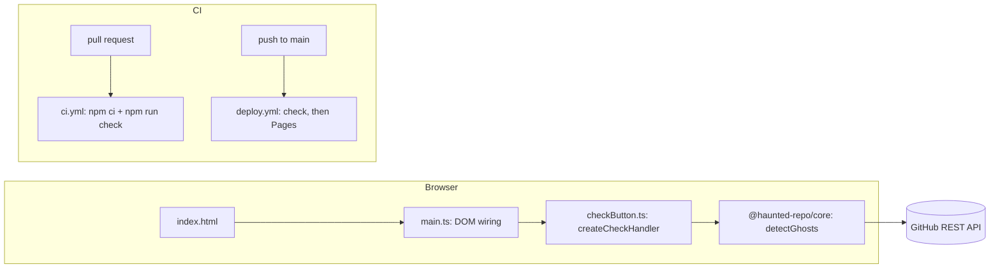

# Design Document

## Overview

`packages/web` becomes a Vite + TypeScript static site (no framework) published to GitHub Pages by GitHub Actions. The page is provisional: one button that calls `detectGhosts` from `@haunted-repo/core` on the Sample_Repo (`https://github.com/lukeed/sirv`) and shows the result.

Key decisions:

- The button logic lives in a pure module (`checkButton.ts`) that receives `detect` and a tiny `view` as arguments. The DOM file (`main.ts`) only connects them. Tests run in plain Node with no jsdom.
- Tests inject the strict `createFakeGitHub` as the `fetch` of `detectGhosts`. No network, no change in `packages/core/src`.
- Vite is already a root devDependency, pinned at `8.3.7`. No new dependency is added.

### Pinned versions (checked on 11 Nov 2026 against the official release pages)

| Item                                                                                   | Version used                                  | Source                                                                                                                                                                                          |
| -------------------------------------------------------------------------------------- | --------------------------------------------- | ----------------------------------------------------------------------------------------------------------------------------------------------------------------------------------------------- |
| `actions/checkout`                                                                     | `v7` (latest release v7.0.1)                  | [releases](https://github.com/actions/checkout/releases/latest)                                                                                                                                 |
| `actions/setup-node`                                                                   | `v7` (latest release v7.1.0)                  | [releases](https://github.com/actions/setup-node/releases/latest)                                                                                                                               |
| `actions/configure-pages`                                                              | `v6` (latest release v6.0.0, runs on Node 24) | [releases](https://github.com/actions/configure-pages/releases/latest)                                                                                                                          |
| `actions/upload-pages-artifact`                                                        | `v5` (latest release v5.0.0)                  | [releases](https://github.com/actions/upload-pages-artifact/releases/latest), [README](https://github.com/actions/upload-pages-artifact/blob/main/README.md) (input `path`, default `_site/`) |
| `actions/deploy-pages`                                                                 | `v5` (latest release v5.0.1)                  | [releases](https://github.com/actions/deploy-pages/releases/latest)                                                                                                                             |
| `vite` (root devDependency, exact)                                                     | `8.3.7`                                       | `npm view vite`: 8.3.8 exists; 8.3.7 is already in `package-lock.json`, so it stays. Needs Node `^20.19.0 \|\| >=22.12.0`, fine on Node 24.                                                     |

Workflows reference the major tag (`@v7`), which is the form the official docs use. The README of `upload-pages-artifact` still shows `@v3` and `deploy-pages@v4` in its example; those are older than the latest releases, so the table above wins. Content was rephrased for compliance with licensing restrictions.

## Architecture



`deploy.yml` has two jobs. `build` runs `npm ci`, `npm run check`, then uploads `packages/web/dist`. `deploy` needs `build` and runs `deploy-pages`. If `check` fails, `deploy` never starts.

## Components and Interfaces

### `packages/web/src/checkButton.ts` (pure, tested)

```ts
import type { Result } from "@haunted-repo/core";

/** Narrow on purpose: the real `detectGhosts` is assignable to it. */
export type DetectFn = (
  url: string,
) => Promise<Result<{ ghosts: readonly unknown[] }>>;

export interface CheckView {
  setBusy(busy: boolean): void; // disables / enables the button
  setStatus(text: string): void;
}

export const SAMPLE_REPO_URL = "https://github.com/lukeed/sirv";

export function formatResult(
  result: Result<{ ghosts: readonly unknown[] }>,
): string;
// ok    -> `Ghosts found: ${n}`      (n = 0 is shown as "0")
// error -> `Error: ${error.message}`

export function createCheckHandler(
  detect: DetectFn,
  view: CheckView,
): () => Promise<void>;
```

Behavior of the handler returned by `createCheckHandler`:

1. If a check is already running, return without calling `detect` (double-click guard, kept in a closure variable, not in the DOM).
2. `view.setBusy(true)`, then `view.setStatus("Checking...")`.
3. `await detect(SAMPLE_REPO_URL)`, then `view.setStatus(formatResult(result))`.
4. If `detect` throws (core promises a `Result`, but a bug must not freeze the button), `setStatus("Unexpected error. Please try again.")`.
5. In a `finally`: `view.setBusy(false)` and clear the running flag.

### `packages/web/src/main.ts` (thin, not unit tested)

Finds `#check-button` and `#status` by id, builds a `CheckView` (`button.disabled = busy`, `status.textContent = text`), and registers `button.addEventListener("click", createCheckHandler(detectGhosts, view))`. It uses `textContent`, never `innerHTML`, so error messages from the network cannot inject HTML. `detectGhosts` is passed directly; its optional second argument is not used, so it uses the browser `fetch`.

### Files in `packages/web`

- `index.html`: title "Haunted Repo", one sentence ("The demo is under construction."), `<button id="check-button">Check GitHub connection</button>`, `<p id="status" role="status" aria-live="polite">`, and `<script type="module" src="/src/main.ts">`. The `aria-live` region lets screen readers hear the result.
- `vite.config.ts`: `defineConfig({ base: "/haunted-repo/" })`. If the repository is renamed, change `base`.
- `package.json`: add `"dependencies": { "@haunted-repo/core": "0.0.0" }`; scripts `"build": "tsc --noEmit && vite build"`, `"dev": "vite"`. Update `package-lock.json` with `npm install`.
- `tsconfig.json`: extends base; `"types": []`, `"lib": ["ES2023", "DOM", "DOM.Iterable"]`, `"noEmit": true`, `"moduleResolution": "Bundler"`, `"module": "ESNext"`; no `rootDir` and no `outDir`. Include `src` and `vite.config.ts`.
- Delete `src/index.ts` and `src/index.test.ts` (the `double` placeholder).

Why the `tsconfig` changes: `tsc` no longer emits files (Vite does the bundling), and the test imports a helper from `packages/core/src`, which is outside a `rootDir` of `src`. Without `rootDir` and with `noEmit`, that is allowed. `tsc --noEmit` replaces the old type check.

### Workflows

`ci.yml`: trigger `pull_request`; permissions `contents: read`; one job `check`: `actions/checkout@v7`, `actions/setup-node@v7` with `node-version: 24` and `cache: npm`, `npm ci`, `npm run check`.

`deploy.yml`: trigger `push` to `main`; top-level permissions `contents: read`; `concurrency: { group: pages, cancel-in-progress: false }`.

- Job `build`: checkout, setup-node (24, cache npm), `npm ci`, `npm run check`, `actions/configure-pages@v6`, `actions/upload-pages-artifact@v5` with `path: packages/web/dist`.
- Job `deploy`: `needs: build`; permissions `pages: write` and `id-token: write`; `environment: { name: github-pages, url: ${{ steps.deployment.outputs.page_url }} }`; step `actions/deploy-pages@v5` with `id: deployment`.

Permissions are scoped to the `deploy` job, so `build` can only read the repository.

### One-time manual step (project director)

In GitHub: Settings, Pages, Build and deployment, Source: "GitHub Actions". Without it the first deploy fails (see Requirements, edge cases).

## Data Models

No stored data. The only types are the ones above plus `Result<T>` from Core:

```ts
type Result<T> =
  { ok: true; value: T } | { ok: false; error: { code: ErrorCode; message: string } };
```

`HauntedReport.ghosts` has at most 5 entries (`MAX_GHOSTS` in Core), so the count shown is 0 to 5 for real data. The formatter does not depend on that limit.

## Correctness Properties

*A property is a characteristic or behavior that should hold true across all valid executions of a system-essentially, a formal statement about what the system should do. Properties serve as the bridge between human-readable specifications and machine-verifiable correctness guarantees.*

Reflection: prework items 2.4, 2.5 and 5.4 are one rule (the text shows the count or the message), so they form Property 1. Items 2.6 and 2.7 form Property 2. The double-click edge case is Property 3.

### Property 1: Status text shows the count or the message

For any `Result` returned by `detect`, with any ghost count from 0 up and any error message, the text passed to `setStatus` after the check contains `String(count)` when the result is a success, and contains `error.message` when the result is an error.

**Validates: Requirements 2.4, 2.5, 5.4**

### Property 2: Busy while running, idle afterwards

For any outcome of `detect` (success, error result, or thrown exception), `setBusy(true)` is called before `detect` is called, and the last call to `setBusy` is `setBusy(false)` once the handler's promise settles.

**Validates: Requirements 2.6, 2.7**

### Property 3: Extra clicks never start a second check

For any number of extra clicks `k >= 0` made while a check is still pending, `detect` is called exactly once, and a click made after the check finished starts a new check.

**Validates: Requirements 2.3, 2.6**

## Error Handling

- Core returns a `Result` for every expected failure (offline, rate limit, repo not found). The handler shows `error.message` as is. Messages are already in English.
- An unexpected exception shows a generic English message and always re-enables the button (`finally`).
- Output is written with `textContent` only.

## Testing Strategy

Vitest environment stays `node` (the current `vitest.config.ts` has no `environment`). jsdom is not needed because the logic under test never touches the DOM: `CheckView` is replaced by a recording object. `main.ts` is only a few lines of wiring, covered by `npm run build` (type check + bundle) and by the manual page check in the last task. Adding jsdom would be a heavy dependency for no extra safety here.

Node 24 already provides `fetch`, `Response`, `Request`, `Headers` and `DOMException`, which `createFakeGitHub` uses.

Tests in `packages/web/src/checkButton.test.ts`:

- Property tests (fast-check 4.10.2, `numRuns: 100` or more, each with a comment `Feature: pages-deploy, Property N: ...`). One test per property. Generators: `fc.oneof` of an ok result with `fc.array(fc.anything())` and an error result with `fc.constantFrom(...ErrorCode values)` and `fc.string()` for the message; `detect` is a stub returning the generated value. Property 3 uses a deferred promise that the test resolves after `k` extra clicks.
- Unit tests, using the strict fake. The test imports `createFakeGitHub` from `../../core/src/ghost-detection/fakeGitHub.testutil.js` (relative path; Core does not export it and Core must not change) and builds `detect = (url) => detectGhosts(url, { fetch: fake })`:
  - Success: a fake with `{ owner: "lukeed", repo: "sirv", files: { "src/index.ts": "export const a = 1;\n" } }`. The status shows `Ghosts found: 1` and `fake.requestCount > 0`.
  - Error: a fake with no repos. `detectGhosts` returns `REPO_NOT_FOUND`; the status shows `Error: ` plus Core's message.
  - Handler passes `SAMPLE_REPO_URL` to `detect` (Requirement 2.3).
  - `formatResult` with zero ghosts gives text containing `0` and not the word "Error".
- No-network guard: in this test file, `vi.stubGlobal("fetch", () => { throw new Error("network is forbidden in tests"); })` in `beforeEach` and `vi.unstubAllGlobals()` in `afterEach`. If any code path forgot to inject the fake, the test fails instead of reaching GitHub (Requirement 5.2). The fake is never changed, so it stays as strict as GitHub (Requirement 5.5).
- Real-service rule: the live test for GitHub already exists in Core (`detectGhosts.live.test.ts`, run with `npm run test:live`). This page only wires `detectGhosts`, so no new live test is added (as stated in Out of Scope).
- Workflows (Requirements 3 and 4) cannot be tested offline. They are verified by the real CI run on the pull request and by the first real deploy after merge. Build output (Requirement 1.4, 1.5) is checked once by reading `packages/web/dist/index.html`.
- `core` must be built before the web tests run, because `@haunted-repo/core` resolves to `dist`. `npm run check` already builds first (`build` runs before `test`). Running `npm test` alone on a clean clone needs `npm run build` first; this is noted in the tasks.
- Documents (Requirement 6) are reviewed by reading them.
