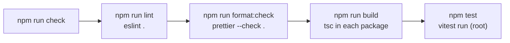

# Design: Project skeleton

## Overview
This design creates the minimal scaffold so that `npm run check` works from the repository root on Windows (PowerShell). It adds tooling and two placeholder packages. It adds no product features.

Terms used below:
- **Monorepo / npm workspaces**: one repository with several packages. npm installs them together and links them.
- **Flat config**: the current ESLint configuration format, a single `eslint.config.js` file.
- **Property-based test**: a test that checks a rule against many random inputs (library: fast-check).

Main decisions:
1. All tools are installed once, at the root. Packages have no dependencies of their own.
2. TypeScript is pinned to **6.0.3**, not the newest 7.0.2, because typescript-eslint does not support TypeScript 7 yet (see versions).
3. Tests run with **one** Vitest process from the root, not one per package.
4. Build runs `tsc` in each package through `npm run build --workspaces`.
5. No `clean` script (R7.2 only applies "if a script exists").

## Architecture

### File tree of the final scaffold
Files marked `(new)` are created by this spec. `(edit)` means an existing file changes.

```
haunted-repo/
├── .gitattributes                 (new)  R5
├── .gitignore                     (already has node_modules/ and dist/, no change)
├── .npmrc                         (new)  R6.6
├── .prettierignore                (new)  R3.6
├── .prettierrc.json               (new)  R3, R5
├── eslint.config.js               (new)  R3
├── package.json                   (new)  R1, R6, R7, R8
├── package-lock.json              (new, generated by npm install)  R6.2
├── tsconfig.base.json             (new)  R2.1
├── vitest.config.ts               (new)  R4
├── .kiro/steering/tech.md         (edit) R8
├── .kiro/steering/testing.md      (edit) R8
└── packages/
    ├── power/
    │   ├── package.json           (new)
    │   ├── tsconfig.json          (new)
    │   └── src/
    │       ├── index.ts           (new)  placeholder
    │       └── index.test.ts      (new)  unit + property test
    └── web/
        ├── package.json           (new)
        ├── tsconfig.json          (new)
        └── src/
            ├── index.ts           (new)  placeholder
            └── index.test.ts      (new)  unit test
```

### How the pieces connect

`check` chains the four steps with `&&`, so it stops at the first failure (R8.1).

## Components and Interfaces

### Versions
Checked on 10 Nov 2026 with `npm view <package> version`, `peerDependencies` and `engines`. Node on this computer is v24.20.0, npm 11.19.0.

| Package | Version | Why this version / source checked |
|---|---|---|
| typescript | 6.0.3 | Latest is 7.0.2, but `typescript-eslint@8.72.2` declares peer `typescript >=4.8.4 <6.1.0`. 6.0.3 is the newest 6.0.x and fits. npm registry (`peerDependencies`, `versions`). |
| eslint | 10.14.0 | Latest. Engines `^20.19 \|\| ^22.13 \|\| >=24` accepts Node 24. typescript-eslint peer includes `^10.0.0`. |
| @eslint/js | 10.0.1 | Latest. Peer `eslint ^10.0.0` matches. |
| typescript-eslint | 8.72.2 | Latest. Peers: eslint `^8.57 \|\| ^9 \|\| ^10`, typescript `<6.1.0`. |
| eslint-config-prettier | 10.1.8 | Latest. Peer `eslint >=7`. |
| prettier | 3.9.10 | Latest. Engines `node >=14`. |
| vitest | 5.1.0 | Latest. Engines `^22.12 \|\| ^24 \|\| >=26` accepts Node 24. Peer `vite` is **required** (not optional). |
| vite | 8.3.7 | Required peer of vitest 5 (`^6.4 \|\| ^7 \|\| ^8`). Latest. Engines `^20.19 \|\| >=22.12`. The web demo will use Vite later anyway. |
| fast-check | 4.10.2 | Latest. Engines `node >=12.17`. |
| @types/node | 24.19.2 | Latest 24.x. The newest (26.6.6) describes APIs that Node 24 does not have. Vitest peer `^22 \|\| >=24` accepts it. |

Before installing, the first task re-runs these checks (versions can move) and reads the current docs of ESLint flat config and Vitest config.

### Root `package.json`
```json
{
  "name": "haunted-repo",
  "private": true,
  "type": "module",
  "engines": { "node": ">=24" },
  "workspaces": ["packages/*"],
  "scripts": {
    "lint": "eslint .",
    "format": "prettier --write .",
    "format:check": "prettier --check .",
    "build": "npm run build --workspaces",
    "test": "vitest run",
    "check": "npm run lint && npm run format:check && npm run build && npm test"
  },
  "devDependencies": {
    "@eslint/js": "10.0.1",
    "@types/node": "24.19.2",
    "eslint": "10.14.0",
    "eslint-config-prettier": "10.1.8",
    "fast-check": "4.10.2",
    "prettier": "3.9.10",
    "typescript": "6.0.3",
    "typescript-eslint": "8.72.2",
    "vite": "8.3.7",
    "vitest": "5.1.0"
  }
}
```
- Scripts use only double quotes and `&&`. npm runs them with cmd.exe on Windows, and both work there (R7.1).
- `build` uses `--workspaces` (without `--if-present`) on purpose: a package that loses its `build` script makes the build fail instead of being skipped silently.

### Package files
`packages/power/package.json` (web is identical except for the name):
```json
{
  "name": "@haunted-repo/power",
  "version": "0.0.0",
  "private": true,
  "type": "module",
  "scripts": { "build": "tsc" }
}
```
`packages/power/tsconfig.json` (same in web):
```json
{
  "extends": "../../tsconfig.base.json",
  "compilerOptions": { "outDir": "dist", "rootDir": "src" },
  "include": ["src"]
}
```
`tsconfig.base.json`:
```json
{
  "compilerOptions": {
    "target": "ES2023",
    "module": "NodeNext",
    "moduleResolution": "NodeNext",
    "strict": true,
    "noUncheckedIndexedAccess": true,
    "esModuleInterop": true,
    "skipLibCheck": true,
    "forceConsistentCasingInFileNames": true,
    "types": ["node"]
  }
}
```
With `NodeNext`, relative imports need the `.js` extension (`import { add } from "./index.js"`), even though the file is `.ts`. This is the standard rule for Node ES modules.

Build output includes compiled test files in `dist/`. This is harmless: Vitest never reads `dist/` (see Tests) and ESLint and Prettier ignore it. The upside is that tests are type-checked by `npm run build` too.

### Placeholders
`packages/power/src/index.ts`:
```ts
export function add(a: number, b: number): number {
  return a + b;
}
```
`packages/web/src/index.ts`:
```ts
export function double(n: number): number {
  return n * 2;
}
```
These are neutral math helpers, not product logic (R1.3).

### ESLint (`eslint.config.js`)
```js
import eslint from "@eslint/js";
import { defineConfig, globalIgnores } from "eslint/config";
import prettier from "eslint-config-prettier";
import tseslint from "typescript-eslint";

export default defineConfig(
  globalIgnores(["**/dist/", "**/node_modules/"]),
  eslint.configs.recommended,
  tseslint.configs.recommended,
  prettier, // last: turns off every rule that fights with Prettier
);
```
- `tseslint.configs.recommended` is the non-type-aware set, so ESLint does not need a `tsconfig` for root files such as `vitest.config.ts`.
- `eslint-config-prettier` goes last so it overrides style rules (R3.5). Prettier does the formatting, ESLint finds bugs.
- The exact import names (`defineConfig`, `globalIgnores`) are confirmed against the ESLint 10 and typescript-eslint docs in the first task.

### Prettier
`.prettierrc.json`:
```json
{ "endOfLine": "lf" }
```
`.prettierignore`:
```
**/*.md
package-lock.json
dist/
node_modules/
```
Prettier does format Markdown by default, so the ignore is needed. I checked: with Prettier 3.9.10 and no ignore file, 15 files in this repo fail, and they are all Markdown. There are no other code or config files in the repo today, so nothing else needs excluding.

### Other root files
`.gitattributes`:
```
* text=auto eol=lf
```
`.npmrc`:
```
save-exact=true
```
`.gitignore` already contains `node_modules/`, `dist/` and does not mention `.kiro/` (R6.4). No change.

### Tests (`vitest.config.ts`, root)
```ts
import { defineConfig } from "vitest/config";

export default defineConfig({
  test: {
    include: ["packages/*/src/**/*.test.ts"],
  },
});
```
- `vitest run` runs once and exits (no watch mode) (R4.1).
- The `include` only matches `.ts` files under `src/`, so compiled `.js` tests in `dist/` are never found (edge case: stale `dist/`).
- Vitest exits with a non-zero code when it finds no test files (its `passWithNoTests` option is `false` by default). So deleting all tests fails `npm test` (edge case: zero test files). The first task proves this by running it.

Why one root run and not one per workspace:
- One process, one summary, one config. Simpler to read for a beginner.
- Per-workspace (`npm test --workspaces`) would need a config and a script in each package, with no benefit at this size.
- Later, if the web package needs a browser-like environment, Vitest "projects" can split it without changing the `npm test` command.

Test example, `packages/power/src/index.test.ts`:
```ts
import fc from "fast-check";
import { describe, expect, it } from "vitest";
import { add } from "./index.js";

describe("add", () => {
  it("adds two numbers", () => {
    expect(add(2, 3)).toBe(5);
  });

  // Feature: project-skeleton, Property 1: add is commutative
  it("gives the same result in any order", () => {
    fc.assert(
      fc.property(fc.integer(), fc.integer(), (a, b) => {
        expect(add(a, b)).toBe(add(b, a));
      }),
      { numRuns: 100 },
    );
  });
});
```
`packages/web/src/index.test.ts` has one example test: `double(4)` is `8`.

## Data Models
There is no data. The only "model" is the configuration above.

## Correctness Properties
*A property is a characteristic or behavior that should hold true across all valid executions of a system. Properties are the bridge between human-readable specs and machine-verifiable guarantees.*

Almost everything here is configuration and tooling, so property-based testing does not apply to it (see Testing Strategy). One property exists only to prove that fast-check is wired up (R4.3).

### Property 1: add is commutative
For any two integers `a` and `b`, `add(a, b)` equals `add(b, a)`.

**Validates: Requirements 4.3**

## Error Handling
These are the failure cases the scaffold must report with a non-zero exit code.

| Situation | Behavior | Requirement |
|---|---|---|
| Type error in any package | `tsc` fails, so `npm run build` fails (`--workspaces` stops at the first failing package) | R2.3 |
| A test fails | `vitest run` exits non-zero | R4.4 |
| No test files found | `vitest run` exits non-zero | edge case |
| Lint or format problem | `eslint .` or `prettier --check .` exits non-zero, and `check` stops there | R8.1 |
| Node older than 24 | npm prints an `EBADENGINE` warning. It is a warning, not an error, unless `engine-strict` is set. We do not set it. | R6.5 |

## Testing Strategy

### Automated
- **Unit tests** (Vitest): one per placeholder (R4.2).
- **Property-based test** (fast-check 4.10.2): Property 1, 100 runs, tagged with a comment `Feature: project-skeleton, Property 1: ...` (R4.3).
- The rest of the spec is tooling configuration. Property-based testing does not fit there, so the checks are the commands themselves: `npm run check` must exit 0 on a clean clone after `npm ci` (R6.3).

### Manual checks of the failure cases
Run these only after the code is committed. Run each from the repository root and undo it before the next one: restore only the file you changed (for example `git restore packages/power/src/index.ts`). For check 3, rename the files back by hand. Never use `git restore .`: it discards every uncommitted change in the repository.
1. **R2.3**: in `packages/power/src/index.ts`, change `return a + b;` to `return "x";`. Run `npm run build`. Expected: a TypeScript error and a non-zero exit code (`echo $LASTEXITCODE` in PowerShell shows a number other than 0).
2. **R4.4**: in `packages/power/src/index.test.ts`, change `toBe(5)` to `toBe(6)`. Run `npm test`. Expected: one failing test, non-zero exit code.
3. **Zero test files**: temporarily rename both `index.test.ts` files. Run `npm test`. Expected: non-zero exit code. This confirms the Vitest behavior assumed above.
4. **Stale `dist/`**: run `npm run build`, then `npm test`. Expected: only the 3 tests from `src/` run, no `dist/` files appear in the output.
5. **CRLF (R5.2)**: `git ls-files --eol` shows `i/lf` for the new files, and `npm run format:check` passes.

### External services
None. No AI, database, API or feed is involved, so the "test against the real service" rule does not apply to this spec.

### Demo durability
Nothing here adds a server, a key, a paid service or a database. The scaffold has no effect on the free demo that must stay online until 29 January 2027.

## Edge cases mapped to decisions

| Edge case (requirements) | Design decision |
|---|---|
| Windows CRLF checkouts | `.gitattributes` `* text=auto eol=lf` plus Prettier `endOfLine: "lf"` |
| Existing Markdown fails Prettier | `**/*.md` in `.prettierignore` (verified: 15 files, all Markdown) |
| Stale `dist/` | Vitest `include` is `packages/*/src/**/*.test.ts`; Prettier and ESLint ignore `dist/` |
| ESLint must ignore `dist/` and `node_modules/` | `globalIgnores(["**/dist/", "**/node_modules/"])` |
| Node version differences | `engines: { "node": ">=24" }` |
| Zero test files must not pass | Vitest default `passWithNoTests: false`, proven by manual check 3 |

## Requirements traceability

| Requirement | Design element |
|---|---|
| R1.1 private root, workspaces `packages/*` | Root `package.json` (`private`, `workspaces`) |
| R1.2 two packages with package.json, tsconfig, placeholder | `packages/power` and `packages/web` files |
| R1.3 no product logic | `add` and `double` placeholders |
| R2.1 shared strict base | `tsconfig.base.json`, packages `extends` it |
| R2.2 build compiles both, exit 0 | `build` script with `--workspaces`, `tsc` per package |
| R2.3 type error fails build | Error Handling table, manual check 1 |
| R3.1 ESLint flat + Prettier + TS | `eslint.config.js`, `.prettierrc.json`, typescript-eslint |
| R3.2 lint exit 0 | `lint` script |
| R3.3 format:check exit 0 | `format:check` script |
| R3.4 format fixes | `format` script |
| R3.5 no conflicts | `eslint-config-prettier` last in the config |
| R3.6 `.prettierignore` | `.prettierignore` file |
| R4.1 Vitest single run | `vitest run` |
| R4.2 test per package | Both `index.test.ts` files |
| R4.3 fast-check property | Property 1 in `packages/power/src/index.test.ts` |
| R4.4 failing test is non-zero | Manual check 2 |
| R5.1 `.gitattributes` | `.gitattributes` file |
| R5.2 format:check on Windows fresh checkout | `endOfLine: "lf"`, manual check 5 |
| R6.1 exact versions | Versions table, `save-exact` |
| R6.2 lockfile committed | `package-lock.json` in the commit |
| R6.3 `npm ci` then all pass | Testing Strategy, final verification task |
| R6.4 gitignore | Already correct, no change |
| R6.5 engines >=24 | Root `package.json`, `tech.md` edit |
| R6.6 `.npmrc` | `.npmrc` file |
| R7.1 no Unix-only scripts | Scripts use only `&&` and double quotes |
| R7.2 clean via Node tool | No clean script is created, so nothing to satisfy |
| R8.1 `check` | `check` script |
| R8.2 / R8.3 / R8.4 steering edits | Next section |

## Planned steering edits (R8)

### `.kiro/steering/tech.md`
Row in the Stack table:
- Before: `| Language | TypeScript (strict mode) on Node.js, current LTS version (to confirm when the project is created) |`
- After: `| Language | TypeScript 6.0 (strict mode) on Node.js v24 |`

Heading:
- Before: `## Layout (proposed)`
- After: `## Layout`

Commands:
- Before: `- Before every commit: lint, build and test must all pass.`
- After: `- Before every commit: run `npm run check` (lint, format check, build and test must all pass).`

Sentence removed completely:
- Before: `- Until the project scaffold exists (there is no `package.json` yet), these commands cannot run. Say so in the pull request instead of creating `package.json` outside an approved spec.`
- After: (line deleted)

Also add one line under Commands: `- Check everything at once: `npm run check``.

### `.kiro/steering/testing.md`
- Before: `- After every change, run lint, build and tests (commands in `tech.md`). Fix errors before saying a task is done.`
- After: `- After every change, run `npm run check` (lint, format check, build and tests; see `tech.md`). Fix errors before saying a task is done.`

Note: the Stack row says TypeScript 6.0 and not just "v24 and 6.0.3" so that patch updates do not need a steering edit.

## Size and commits
Estimated size, without `package-lock.json`: about 220 lines.
- Config files (root and packages): ~110
- Source and tests: ~45
- Steering edits: ~6 changed lines
- This spec's tasks file: not counted

That is under the 500-line limit, so **one pull request** (branch `feat/project-skeleton`). The lockfile is generated and excluded from the count.

Intended commits, one thing each:
1. Add root `package.json`, `.npmrc`, `.gitattributes` and install dependencies (lockfile).
2. Add `tsconfig.base.json` and the two packages with placeholders; `npm run build` passes.
3. Add Prettier config and `.prettierignore`; `format:check` passes.
4. Add ESLint flat config; `lint` passes.
5. Add Vitest config and the unit tests; `npm test` passes.
6. Add the fast-check property test.
7. Add the `check` script.
8. Update `tech.md` and `testing.md`.

## Contradictions and surprises found
1. **TypeScript 7 does not work with typescript-eslint.** TypeScript's newest release is 7.0.2, but typescript-eslint 8.72.2 only supports `<6.1.0`. The design pins 6.0.3. Requirements do not name a version, so nothing contradicts them. When typescript-eslint supports 7, a small spec can upgrade.
2. **Vitest 5 needs `vite` as a required dependency.** Not mentioned in the requirements. Added as an exact devDependency (R6.1 still holds).
3. **Prettier does format Markdown.** R3.6 is correct and needed. No contradiction.
4. **npm scripts on Windows.** R7.1 is right: npm uses cmd.exe, which supports `&&` and double quotes. Single quotes in a script would break, so none are used.
5. **Vitest with no test files.** I am relying on Vitest's default of failing with zero tests. I have not run Vitest 5.1.0 yet; manual check 3 verifies it and, if wrong, the fix is one line (`passWithNoTests: false`) in `vitest.config.ts`.
6. **R6.5 `engines >=24` vs Vitest.** Vitest 5 supports Node `^22.12 || ^24 || >=26`, so Node 25 would show a warning. Not a problem on Node 24.
7. **Build emits test files into `dist/`.** Chosen on purpose (tests get type-checked by `build`). If you prefer a clean `dist/`, a `tsconfig.build.json` that excludes tests is the alternative, at the cost of two tsconfig files per package.
8. **Notes for later specs.** (a) When the Power is packaged, compiled test files in `dist/` must not be shipped. (b) The web package will need DOM types instead of `types: ["node"]` from `tsconfig.base.json`.
