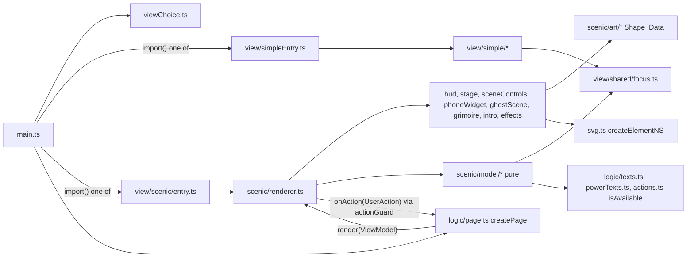
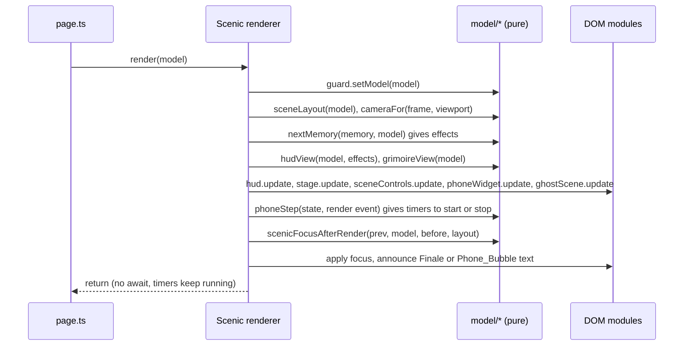
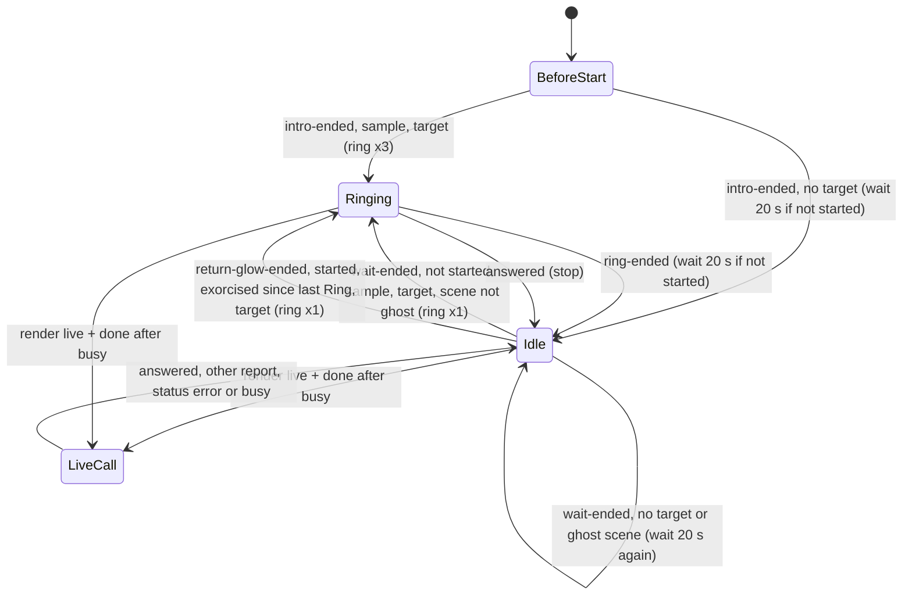

# Design Document

## Overview

This design adds the Scenic_Renderer in `packages/web/src/view/scenic/`. It draws the demo as a Halloween video-game scene: a cutaway haunted house in SVG built from plain data (Shape_Data), a game HUD in real HTML, a ringing Telephone, three ghost designs (Wisp, Lantern_Wraith, Chained_Brute) and a close-up exorcism room with a Grimoire panel. Animation is CSS only. The Logic_Layer, the committed data and Core do not change; only new English texts are added to `texts.ts` and `powerTexts.ts`.

Key decisions:

- **Pure decisions, thin DOM.** Every rule that can be decided without a browser lives in pure modules under `src/view/scenic/model/` (Scene_Layout, Camera, render memory, Telephone, Lightning clock, Reactions, focus rule, HUD and Grimoire views, action guard). They run in Vitest's Node environment with no jsdom (Requirement 23.1). The DOM modules only mount what these functions return.
- **Art is data.** Each SVG piece is a `ShapeNode` tree: shape kinds, numbers, class names and four allowed keywords. Colours come only from CSS classes that read `scenic-tokens.css` (Requirement 22).
- **No SVG or CSS filters anywhere.** Glows are radial gradients, the rim light is a separate stroke path, dimming is a Night overlay with opacity. This meets Requirement 20.2 by construction and keeps phones fast.
- **One Camera wrapper.** The SVG and an HTML overlay sit inside one `.world` element. The Camera is a CSS `transform` (translate + scale) on `.world`, computed by a pure function from viewBox rectangles. Controls that must stay readable when the Camera moves (floor buttons, Nameplates, "Back to the house") live outside the Camera in a scene-control layer.
- **Renderer choice by dynamic import.** `main.ts` calls a pure `chooseView(location.search)` and dynamically imports one renderer entry. Vite splits each entry and its CSS into separate chunks, so only the chosen renderer's CSS is ever loaded (Requirements 1.9, 1.10).
- **Timers, not loops.** Rings, Lightning and one-shot effects use `setTimeout` and CSS classes. There is no `requestAnimationFrame` and no `setInterval` (Requirement 20.3).
- **Fonts from Fontsource, woff2 only.** `@fontsource/creepster` 5.3.0 and `@fontsource/im-fell-english` 5.3.0, Latin 400 normal only, loaded with the `FontFace` API from `?url` imports, so only the two woff2 files reach `dist/`.
- **Tooling.** `npm run size` (gzip budget and external-address check on `dist/`, inside `npm run check`) and `npm run shots` (Playwright 1.65.1, hand-run, never in CI) with a dev-only Gallery page.
- **Split.** The work is about 10,000 changed lines. It is delivered in the four stages the director asked for, each stage being a stack of PRs of at most about 900 lines (section "PR Split"). Stage 1 ends with the vertical slice gate.

### Facts checked for this design

| Fact | Where | Effect |
| --- | --- | --- |
| `page.ts` builds `available` by walking `house.floors` (attic, middle floor, basement) and pushes `start-ghost` in that order | `src/logic/page.ts`, `available()` | The ViewModel does not carry report order across floors. Telephone_Target uses floor order, then report order inside a floor (decision Q3, Requirement 23.6). |
| `FloorView.ghosts` holds only that floor's Cards, in report order | `houseView.ts`, `buildFloors` | A Card's Variant is its index in `house.floors[i].ghosts`. |
| `ghostActions` gives no navigation action in the Ghost_Scene | `src/logic/exorcism.ts` | No floor button, back button or start control in the Ghost_Scene. |
| `focusAfterRender(prev, next, before)` returns `keep`, `ghost-heading`, `list-heading` or `key` | `src/view/simple/focus.ts` | Moved unchanged to `src/view/shared/focus.ts`; the scenic rule wraps it. |
| Core's client aborts each request after 10 s (`AbortSignal.timeout(10_000)`) and sends `X-GitHub-Api-Version` | `githubClient.ts` | The Shots_Script must take the "busy" shot within 10 s of holding the request; the header causes a CORS preflight that the script answers. |
| `reportArb` builds `fc.array(ghostArb)` with no maximum of 5 | `reportArb.testutil.ts` | Generators cap each floor at 5 Cards where a property needs it (decision Q4). |
| The strict fake GitHub has no imports and only erasable TypeScript | `fakeGitHub.testutil.ts` | Node 24 runs it directly from the Shots_Script with a `.ts` import. |
| Vitest includes only `packages/*/src/**/*.test.ts` | `vitest.config.ts` | Pure tooling code goes in `packages/web/src/tooling/` so its tests run; the scripts in `packages/web/scripts/` stay thin. |
| Test files in `src/` reference Node types, so Node's global `setTimeout` type is in the web `tsc` program | `source.test.ts`, `focus.test.ts` | Scenic code calls `window.setTimeout` and stores a `number`. |
| Current build: 23,916 B gzipped JS, 1,425 B CSS, 341 B HTML | measured on `packages/web/dist` | Leaves a large part of the 307,200-byte budget for the scenic code and the fonts. |
| Playwright `playwright` 1.65.1 is the latest release; the library package does not download browsers; `npx playwright install chromium` does | [npm registry](https://registry.npmjs.org/playwright/latest), [Playwright library docs](https://playwright.dev/docs/library) | `npm ci` in CI installs no browser. The Shots_Script names the install command when Chromium is missing. |
| `page.emulateMedia({ reducedMotion: "reduce" })` exists; `page.screenshot({ animations: "disabled" })` fast-forwards finite animations to their end and resets infinite ones to their start | [Playwright Page API](https://playwright.dev/docs/api/class-page) | Reactions and the Exorcised_Moment are captured at their end state; loops at a fixed point. |
| `route.fulfill` answers without the network; a cross-origin answer needs `Access-Control-Allow-Origin` | [Playwright network docs](https://playwright.dev/docs/network), [issue 12929](https://github.com/microsoft/playwright/issues/12929) | The interception adds CORS headers and answers `OPTIONS` itself. |
| `@fontsource/creepster` and `@fontsource/im-fell-english` are both at 5.3.0; each ships `latin-400.css` with `font-display: swap` and files `files/<name>-latin-400-normal.woff2` and `.woff` | [registry](https://registry.npmjs.org/@fontsource/creepster/latest), [file list](https://data.jsdelivr.com/v1/packages/npm/@fontsource/creepster@5.3.0?structure=flat), [latin-400.css](https://cdn.jsdelivr.net/npm/@fontsource/creepster@5.3.0/latin-400.css) | Importing `latin-400.css` would emit both woff2 and woff. Importing only the woff2 file with `?url` keeps one file per font: Creepster 28,120 B, IM Fell English 59,880 B. |
| Fontsource's IM Fell English `LICENSE` names only "Google Inc."; the upstream OFL names "Copyright (c) 2010, Igino Marini" | [Fontsource LICENSE](https://cdn.jsdelivr.net/npm/@fontsource/im-fell-english@5.3.0/LICENSE), [google/fonts OFL.txt](https://raw.githubusercontent.com/google/fonts/main/ofl/imfellenglish/OFL.txt) | Credits use the upstream holder; the copied OFL text is the upstream file. Creepster: "Copyright (c) 2011, Font Diner, Inc". |
| Vite builds only `<root>/index.html` unless more inputs are set; the dev server serves any HTML file under the root | [Vite build guide](https://vite.dev/guide/build), [Vite features](https://vite.dev/guide/features) | `packages/web/gallery.html` is served by `vite` and never built. |
| Vite extracts CSS imported by an async chunk into its own file and loads it with that chunk (`build.cssCodeSplit`, default true) | [Vite build options](https://vite.dev/config/build-options) | Each renderer's CSS loads only with its own dynamic import. |
| Vite's JS API has `createServer()` (with `listen()` and `close()`) and `preview()` (returns a `PreviewServer` with `httpServer`) | [Vite JS API](https://vite.dev/guide/api-javascript) | The Shots_Script runs both servers inside its own Node process, so no server process can be left behind on Windows. |
| Vite 8 default build target: Chrome/Edge 111, Firefox 114, Safari 16.4 | [Vite build options](https://vite.dev/config/build-options) | `inert`, `:focus-visible`, `aspect-ratio`, `dvh`, `FontFace` and `matchMedia(...).addEventListener` are all available. CSS nesting is not used. |

Content from the sources above was rephrased for compliance with licensing restrictions.

## Architecture

### Folder layout

```text
packages/web/
  gallery.html                      dev-only Gallery page (never built)
  index.html                        + <meta name="color-scheme" content="dark">
  public/
    sirv-license.txt                unchanged
    fonts/OFL-creepster.txt         full OFL text (Font Diner)
    fonts/OFL-im-fell-english.txt   full OFL text (Igino Marini)
    fonts/CREDITS.txt               one credit file for both fonts
  scripts/
    make-sample.ts                  unchanged
    size.ts                         Size_Check (I/O only)
    shots.ts                        Shots_Script (I/O only)
  src/
    main.ts                         wiring: chooseView + one dynamic import
    viewChoice.ts (+ .test.ts)      View_Choice, pure
    tooling/
      distRules.ts (+ .test.ts)     pure rules of the Size_Check
      shotList.ts (+ .test.ts)      pure list of shots and file names
    view/
      simpleEntry.ts                imports simple.css, re-exports createSimpleRenderer
      shared/
        focus.ts (+ .test.ts)       moved from simple/ unchanged
      simple/                       only the Scenic_View_Link and two import paths change
      scenic/
        entry.ts                    imports the scenic CSS and fonts, exports createRenderer
        renderer.ts                 orchestrates one render
        dom.ts                      el() for HTML, text via textContent
        svg.ts                      createSvgRoot(), mountShape() with createElementNS
        fonts.ts                    FontFace loading from ?url imports
        motion.ts                   matchMedia for reduced motion and the wide layout
        hud.ts  bestiary.ts         HUD and Bestiary DOM
        stage.ts                    Camera, house layers, slots, dims, effects classes
        sceneControls.ts            Scene_Heading, back, floor stair, Nameplates
        phoneWidget.ts              Answer_Button, RING! bubble, Phone_Bubble
        ghostScene.ts  grimoire.ts  close-up room and Grimoire DOM
        intro.ts  effects.ts        Intro, Lightning, Return_Glow and Finale timers
        model/                      PURE, no DOM (checked by the Source_Scan)
          actionGuard.ts  sceneLayout.ts  camera.ts  renderMemory.ts
          phoneBell.ts  lightningClock.ts  reactions.ts  scenicFocus.ts
          hudView.ts  grimoireView.ts
          viewModelArb.testutil.ts  *.test.ts  contrast.test.ts
        art/                        Shape_Data (pure data and builders)
          shapes.ts  sky.ts  house.ts  props.ts  ghosts.ts  room.ts
          art.test.ts
        styles/
          scenic-tokens.css  base.css  hud.css  stage.css
          ghosts.css  room.css  motion.css
        gallery/
          gallery.ts                dev-only, imported only by gallery.html
```

### Layers



Dependency rules, added to those of the web-demo design:

- `scenic/model/**` and `scenic/art/**` use no DOM name (`document`, `window`, `HTMLElement`) and import no CSS or asset. The Source_Scan checks it (Requirement 23.1).
- `scenic/**` imports from Core only with `import type` (existing rule, now asserted to include scenic files).
- `scenic/**` never imports from `view/simple/**`, and `view/simple/**` never imports from `view/scenic/**`. Both may import `view/shared/**`.
- Only `main.ts` imports a renderer entry and the controller.

### One render, step by step



`render` never waits. Timers started by a render check the newest model when they fire (Requirement 2.7, edge case).

### Renderer choice and CSS loading

`viewChoice.ts`:

```ts
export type ViewName = "scenic" | "simple";
/** Reads only the query string. Never changes the address. Stores nothing. */
export function chooseView(search: string): ViewName {
  return new URLSearchParams(search).get("view") === "simple" ? "simple" : "scenic";
}
```

`main.ts` (same `PageDeps` for both renderers, one `createPage` call, one renderer per load):

```ts
const entry = chooseView(window.location.search) === "simple"
  ? import("./view/simpleEntry.js")
  : import("./view/scenic/entry.js");
entry.then(
  ({ createRenderer }) => {
    const renderer = createRenderer(root, (action) => void page.dispatch(action));
    const page: PageController = createPage({ detect: (url) => detectGhosts(url), sample, script }, renderer);
    page.start();
  },
  () => { root.textContent = TEXTS.viewLoadFailed; },
);
```

- `src/view/simpleEntry.ts` holds `import "./simple/simple.css"` and `export { createSimpleRenderer as createRenderer } from "./simple/renderer.js"`. It is outside `src/view/simple/`, so Requirement 2.10 is kept.
- `src/view/scenic/entry.ts` imports the scenic CSS files, calls `loadScenicFonts()` and exports `createRenderer = createScenicRenderer`.
- Vite turns each `import()` into its own chunk and moves the CSS of that chunk into its own CSS file, linked only when the chunk loads. `main.ts` imports no CSS, so `dist/index.html` links no stylesheet. The Size_Check fails if it ever does (guard for Requirements 1.9 and 1.10).
- `index.html` gets `<meta name="color-scheme" content="dark">`, so the browser paints a dark canvas before a renderer's CSS arrives. This is not a CSS rule, so neither renderer leaks styles into the other.
- **Dark launch (director decision Q14).** In stages 1 to 3 `chooseView` returns `"scenic"` only for `?view=scenic` and the Simple_Renderer stays the default, so `main` never shows a half-built scene. PR 4b switches to the rule above (Requirement 1) in one small commit. The Scenic_View_Link of the Simple_Renderer points to `?view=scenic` until then, and to `./` afterwards.

### Purely visual state of the Scenic_Renderer

Everything below lives in the `createScenicRenderer` closure. None of it is stored in the browser (Requirement 1.8, 15.8, web-demo 9), none of it reaches the Logic_Layer.

| State | Type | Set by | Used for |
| --- | --- | --- | --- |
| `guard` (last model) | `ActionGuard` | every `render` | dispatch only actions in Available_Actions (2.7, 2.8) |
| `memory` | `VisualMemory` | `nextMemory` in every render | Haunt_Meter values of the last list render, Exorcised_Moments of this Ghost_Scene visit, Finale animation, previous model |
| `phone` | `PhoneState` | `phoneStep` | Opening_Rings, 20 s Rings, ring after Return_Glow, Live_Call, "started once" flag |
| `phoneTimer`, `ringTimer` | `number \| null` | phone effects | `setTimeout` handles |
| `phoneBubble` | `string \| null` | Answer_Button | caller's words or "The line is quiet." until the next Scene change or activation (9.11) |
| `intro` | `"pending" \| "playing" \| "done"` | first House_Scene render, any input, timer | Intro and the start of the Opening_Rings (D13) |
| `lightningOn` | `boolean` | load (true unless Reduced_Motion), toggle | Lightning (15.5 to 15.9) |
| `lightningTimer`, `nextFlashDue` | `number \| null` | `lightningClock` | flash schedule independent of renders (15.1) |
| `reducedMotion`, `wide` | `boolean` | `motion.ts` media listeners | timers, Intro skip, Camera numbers, layout |
| `vigour` | `Vigour` | `reactions.ts` | close-up ghost size and opacity (11.2 to 11.7) |
| `reaction` | `{ kind; timer } \| null` | `send()` of a ghost action | playing Reaction (11.10, 11.11) |
| `answerBox` | `{ key: string; el: HTMLTextAreaElement } \| null` | Grimoire render | keep the typed text for the same question (10.10) |
| `room` | `{ path: string; el: HTMLElement } \| null` | entering the Ghost_Scene | keep the close-up ghost across renders of one visit (12.9) |
| `slotSignature` | `string` | stage | rebuild the slot layer only when a Card's floor, position, Variant or state changes, so idle animations do not restart on every render |
| `bestiaryOpen` | `boolean` | Bestiary button (narrow screens) | fold state (D2) |

## Components and Interfaces

All interfaces below are TypeScript in `packages/web/src/`. Names in `code font` are exact; the Logic_Layer types are imported with `import type` from `../../logic/viewModel.js` and `../../logic/actions.js`.

### `view/shared/focus.ts` (moved)

`src/view/simple/focus.ts` and `focus.test.ts` move to `src/view/shared/` with no change to their code. Three imports change in `simple/renderer.ts`, `simple/house.ts` and `simple/ghost.ts` (`./focus.js` becomes `../shared/focus.js`), and the test's relative paths gain one `../`. The Simple_Renderer behaves the same (Requirements 17.10, 25.11).

### Simple_Renderer change (Scenic_View_Link)

`simple/renderer.ts` adds one link to its header, after the `h1`: `el("a", { class: "view-link", href: SCENIC_HREF }, [TEXTS.viewLinks.scenic])`, where `SCENIC_HREF` is `"?view=scenic"` during the dark launch and `"./"` from stage 4. `./` resolves to `/haunted-repo/` under the Vite base and drops every query parameter and the hash (Requirement 1.11 and its edge cases). `simple.css` needs no change; the link uses the existing `a` style.

### `scenic/model/actionGuard.ts`

```ts
export interface ActionGuard {
  setModel(model: ViewModel): void;
  current(): ViewModel | null;
  /** Forwards the action only when a model exists and isAvailable(model, action). Returns whether it was sent. */
  send(action: UserAction): boolean;
}
export function createActionGuard(onAction: ActionSink): ActionGuard;
```

Every control of the Scenic_Renderer, every timer and every Reaction goes through `send`. A timer that fires after a newer render is checked against the newest model (Requirement 2.7 edge case).

### `scenic/model/sceneLayout.ts` (Scene_Layout)

```ts
export type GhostType = "wisp" | "lantern-wraith" | "chained-brute";
export type VariantNumber = 0 | 1 | 2 | 3 | 4;
export interface Rect { x: number; y: number; w: number; h: number } // viewBox units

export const GHOST_TYPE_OF: Readonly<Record<Floor, GhostType>>; // attic wisp, middle floor lantern-wraith, basement chained-brute

export interface SlotPlacement {
  key: string;            // `${floor}#${index}`: a position, never the path
  floor: Floor;
  index: number;          // 0-based position among the Cards of this floor, report order
  variant: VariantNumber; // index % 5 (index <= 4 for every real report)
  ghostType: GhostType;
  path: string;
  state: GhostState;
  rect: Rect;             // inside the floor rectangle
  ghostScale: number;     // same for every slot of a floor, so sizes stay comparable
}

export interface FloorButtonView { floor: Floor; label: string; accessibleName: string }

export interface NameplateView {
  index: number; path: string; reason: string;
  scoreLine: string;      // TEXTS.scoreLine(score)
  stateLabel: string;     // TEXTS.ghostStateLabels[state]
  state: GhostState;
  lockedLine: string | null;
  hasStart: boolean;      // canStart and first Card with this path on this floor
  accessibleName: string; // TEXTS.nameplateName(...)
}

export type Frame =
  | { kind: "house" }
  | { kind: "floor"; floor: Floor }
  | { kind: "slot"; rect: Rect }; // the Ghost_Scene: zoom into the ghost's slot

export interface SceneLayout {
  heading: string;                     // Scene_Heading text (D1)
  slots: SlotPlacement[];              // [] when scene.kind is "ghost" or house is null
  emptyFloors: Floor[];                // floors whose emptyLine is not null: chained door
  dimmedFloors: Floor[];               // the two other floors in a Floor_Scene
  floorButtons: FloorButtonView[];     // one per go-to-floor entry of available, floor order
  backButton: boolean;                 // go-to-house is available
  nameplates: NameplateView[];         // only in a Floor_Scene, focused floor, report order
  emptyLine: string | null;            // focused floor's emptyLine in a Floor_Scene
  startControls: string[];             // paths with a start control (Floor_Scene only)
  telephoneTarget: string | null;      // first canStart Card: floor order, then report order
  finale: boolean;                     // Requirement 13.1
  frame: Frame;
  closeUp: { ghostType: GhostType; variant: VariantNumber } | null; // Ghost_Scene only (5.11)
}

export function sceneLayout(model: ViewModel): SceneLayout;
/** Slots of one floor for a given card count, used by sceneLayout and the Camera of the Ghost_Scene. */
export function slotRects(floor: Floor, count: number): Rect[];
```

Rules:

- **Slots:** for each `house.floors[i]` with `n` Cards, `slotRects(floor, n)[j]` is the rectangle of Card `j` (rule in "Data Models", slot layout). Placement is by position, so repeated paths still give one slot each (Requirement 23.2 edge case).
- **Variant:** `index % 5`. It reads nothing else from the Card (Requirements 5.8, 5.10).
- **Start controls:** only when `scene.kind === "floor"`, only for Cards of `scene.floor` with `canStart`, and for a repeated path only the first Card (Requirement 23.9).
- **Telephone_Target:** the first Card with `canStart`, walking `house.floors` in order and each floor in report order; `null` when `house` is `null` or none (Requirement 23.6).
- **Finale:** `house !== null && house.source === "sample" && no Card is "haunted" && some Card is "exorcised" && scene.kind !== "ghost"` (Requirement 13.1).
- **Heading:** `TEXTS.houseHeading(house.repoName)` in the House_Scene, `TEXTS.pageTitle` when `house` is `null`, the focused floor's `title` in a Floor_Scene, `TEXTS.ghostHeading(ghost.path)` in the Ghost_Scene.
- **Close-up:** the Ghost_Type of `ghost.floor` and the Variant of the first Card of that floor with `path === ghost.path` (Requirement 5.11); Variant 0 if no Card matches.
- **Floor buttons:** `label` is `house.floors[i].title`; `accessibleName` is `TEXTS.floorButtonName(title, TEXTS.actionLabels["go-to-floor"])`, for example "Attic. Go to this floor" (D1).

### `scenic/model/camera.ts`

```ts
export type ViewportClass = "wide" | "narrow"; // wide: matchMedia(WIDE_QUERY), WIDE_QUERY = "(min-width: 64rem)"
export interface CameraTransform {
  scale: number;
  txPercent: number;   // of the world box width (1600 units)
  tyPercent: number;   // of the world box height (1000 units)
  counterScale: number; // 1 / scale, for HTML pinned inside the world (phone widget)
}
export function frameRect(frame: Frame, viewport: ViewportClass): Rect;   // frame plus margin
export function sceneArea(frame: Frame, viewport: ViewportClass): Rect;   // where the frame must fit, in stage units
export function cameraFor(frame: Frame, viewport: ViewportClass): CameraTransform;
export function cssTransform(t: CameraTransform): string; // "translate(x%, y%) scale(s)"
```

With `F = frameRect(...)` and `A = sceneArea(...)`: `scale = min(A.w / F.w, A.h / F.h)`, `tx = A.x + A.w / 2 - scale * (F.x + F.w / 2)`, `ty = A.y + A.h / 2 - scale * (F.y + F.h / 2)`, `txPercent = tx / 16`, `tyPercent = ty / 10`. `.world` has `transform-origin: 0 0`, so a world point `p` lands at `t + scale * p` in stage units. Numbers are rounded to 4 decimals.

### `scenic/model/renderMemory.ts`

```ts
export interface MeterView { line: string; share: number; haunted: number; total: number }
export interface VisualMemory {
  prev: ViewModel | null;
  lastListMeter: MeterView | null;  // progress of the last House_Scene or Floor_Scene render
  hadListRender: boolean;
  visitMoments: string[];           // paths with an Exorcised_Moment in the open Ghost_Scene visit
}
export interface RenderEffects {
  meter: { view: MeterView; from: number | null } | null; // null hides the Haunt_Meter; from !== null animates
  exorcisedMoments: string[];   // start now (12.1)
  returnGlow: string[];         // windows to light up now (12.6)
  finale: { shown: boolean; animate: boolean; announce: boolean };
  sceneChanged: boolean;
}
export const EMPTY_MEMORY: VisualMemory;
export function nextMemory(memory: VisualMemory, model: ViewModel): { memory: VisualMemory; effects: RenderEffects };
export function meterScale(share: number): string; // "scaleX(0.6000)", share clamped to 0..1
```

- In a Ghost_Scene render, `meter.view` is `lastListMeter` (Requirements 4.3, 4.4). In a list render it is the model's progress, and `from` is the previous list share only when the render follows a Ghost_Scene with moments and the previous list progress was not `null` (12.6, 12.7).
- A moment starts for the first Card with path `p` when the previous model has the same `house.source`, a Card with path `p` in state `haunted`, and the new model has it `exorcised` (12.1, 12.2). It starts at most once per change because the next render compares with a model where `p` is already exorcised (12.8).
- `finale.shown` is `sceneLayout(model).finale`. `animate` is true only when the previous model had the same source and `shown` was false (13.7). `announce` is true whenever `shown` turns true (13.8).

### `scenic/model/phoneBell.ts`

```ts
export interface PhoneInputs {
  source: "sample" | "live" | null;   // null when house is null
  target: string | null;              // Telephone_Target
  scene: "house" | "floor" | "ghost";
  status: StatusKind;
  reportKey: string | null;           // source + every Card path, in order
}
export type PhoneEvent =
  | { type: "render"; inputs: PhoneInputs }
  | { type: "intro-ended" }           // or "no Intro": the first House_Scene is on screen
  | { type: "ring-ended" }
  | { type: "wait-ended" }
  | { type: "answered" }
  | { type: "ghost-started" }        // any start-ghost was dispatched, whatever control sent it (Answer_Button or start button)
  | { type: "exorcised-moment" }
  | { type: "return-glow-ended" };
export type PhoneEffect =
  | { type: "ring"; rings: 1 | 3 }   // 2 s per Ring
  | { type: "live-call" }            // ring without pause
  | { type: "stop" }
  | { type: "wait"; ms: 20_000 }
  | { type: "cancel-wait" };
export interface PhoneState {
  mode: "before-start" | "idle" | "ringing" | "live-call";
  started: boolean;                  // a start-ghost was dispatched or the Answer_Button was used, at least once in this load (9.3, 9.4)
  exorcisedSinceRing: boolean;
  last: PhoneInputs | null;
}
export function phoneStep(state: PhoneState, event: PhoneEvent): { state: PhoneState; effects: PhoneEffect[] };
export function callWaiting(state: PhoneState): boolean; // accessible name suffix (9.14)
```



`callWaiting` is true when the last inputs have `source === "sample"` and a target, or the mode is `live-call`.

The renderer sends `ghost-started` whenever it dispatches a `start-ghost`, from the Answer_Button or from a Nameplate start button, so the 20 s Rings stop after the first start of the page load, whatever started it (decision Q17). The post-exorcism Ring of 9.4 uses the same `started` flag. `answered` still yields `stop` and also sets `started`.

### `scenic/model/lightningClock.ts`

```ts
export const FLASH_MIN_MS = 10_000;
export const FLASH_MAX_MS = 15_000;
/** random is a number in [0, 1). Result is an integer in [10000, 15000]. */
export function nextFlashDelay(random: number): number; // FLASH_MIN_MS + Math.floor(random * 5001)
export function flashAllowed(input: {
  toggleOn: boolean; reducedMotion: boolean;
  scene: "house" | "floor" | "ghost"; introPlaying: boolean; finale: boolean;
  ringPlaying: boolean; exorcisedMomentPlaying: boolean;
}): boolean; // toggleOn && !reducedMotion && scene !== "ghost" && !introPlaying && !finale && !ringPlaying && !exorcisedMomentPlaying (D7, D8, Q7)
```

The renderer schedules the next due time from the previous due time (`due + nextFlashDelay(Math.random())`), never from a render (15.1). A due flash that is not allowed, including one that falls during a Ring or an Exorcised_Moment, is skipped and the next one is scheduled (15.2, decision Q7).

### `scenic/model/reactions.ts`

```ts
export type ReactionKind = "recoil" | "shudder" | "laugh" | "puzzle";
export interface Vigour { grow: 0 | 1 | 2 | 3; fade: 0 | 1 | 2 | 3 | 4 }
export const VIGOUR_START: Vigour; // { grow: 0, fade: 0 }
export const REACTION_MS: Readonly<Record<ReactionKind, number>>; // recoil 400, shudder 500, laugh 600, puzzle 700
export function reactionFor(action: UserAction): ReactionKind | null; // rate right/half-right/wrong, dont-know
export function vigourAfterAction(v: Vigour, action: UserAction): Vigour; // right: fade+1 (max 4); wrong: grow+1 (max 3); start-ghost, retry: VIGOUR_START
export function vigourAfterRender(v: Vigour, prev: ViewModel | null, next: ViewModel): Vigour; // entering "failed": VIGOUR_START (11.6)
export function vigourStyle(v: Vigour): { scale: number; opacity: number }; // 1 + 0.1 * grow, 1 - 0.15 * fade
```

The opacity therefore stays in 1.00, 0.85, 0.70, 0.55, 0.40 and the scale in 1.0, 1.1, 1.2, 1.3 (Requirements 11.2, 11.4). Only the `rate` action starts "shudder" (11 edge case: "Partly" of `self-check` does not).

### `scenic/model/scenicFocus.ts`

```ts
export type ScenicFocusTarget = { kind: "keep" } | { kind: "scene-heading" } | { kind: "key"; key: string };
export function scenicFocusAfterRender(
  prev: ViewModel | null, next: ViewModel, before: FocusBefore, layout: SceneLayout,
): ScenicFocusTarget;
```

1. `next.transition !== null` and `transition.from.kind === "ghost"`: the key `start-ghost:<path>` when that path is in `layout.startControls`, else `scene-heading` (17.7).
2. Any other `next.transition !== null`: `scene-heading` (17.7).
3. `transition === null`: `focusAfterRender(prev, next, before)` from `view/shared/focus.ts`, reading `ghost-heading` and `list-heading` as `scene-heading` (17.8).

After applying the target, the renderer checks a safety net: if `document.activeElement` is `body`, not connected, inside a `[hidden]` or `[inert]` element, it focuses the Scene_Heading (17.9). This also covers HUD controls that disappear, such as the `show-sample` button.

"Rebuilt part" (`FocusBefore.where === "main"`) means the scene-control layer and the Grimoire. The HUD, the Answer_Button and the Live_Plaque are never rebuilt, so focus on them is "outside" and is kept.

### `scenic/model/hudView.ts` and `scenic/model/grimoireView.ts`

Pure mappings, so the HUD and Grimoire rules are tested without a DOM:

```ts
export interface HudView {
  logo: string; tagline: string;
  meter: { line: string; scale: string; from: string | null } | null; // 4.3, 4.17
  icons: ("haunted" | "exorcised")[];                                  // 4.4: exorcised first
  plaque: { visible: boolean; submitEnabled: boolean };                 // 4.5, 4.6, 4.8
  statusText: string;                                                   // 4.10
  warnings: { lines: string[]; skippedTitle: string | null; skipped: { path: string; reason: string }[] } | null; // 4.13
  powerLine: string | null;                                             // 4.14
  showSample: boolean;                                                  // 4.15, 4.16
  licence: LicenceView | null;                                          // 4.11
}
export function hudView(model: ViewModel, effects: RenderEffects): HudView;

export type GrimoireBlock =
  | { kind: "judge-line"; text: string }
  | { kind: "reading"; title: string; text: string }
  | { kind: "question"; title: string; text: string }
  | { kind: "answer-box"; key: string; label: string }     // key = `${path}\n${questionNumber}`
  | { kind: "revealed"; title: string; text: string }
  | { kind: "prompt"; text: string }
  | { kind: "choices"; items: { action: UserAction; label: string; focusKey: string }[] }
  | { kind: "code"; text: string }
  | { kind: "licence"; licence: LicenceView };
export interface GrimoireView { heading: string; blocks: GrimoireBlock[]; litCandles: 0 | 1 | 2 | 3 }
export function grimoireView(model: ViewModel): GrimoireView | null; // null outside the Ghost_Scene
```

`blocks` follow the Simple_Renderer document order (10.12). `litCandles` follows 10.9. Labels come from `TEXTS.actionLabels` exactly as in `simple/ghost.ts` (10.4).

### Art modules (`scenic/art/`)

```ts
// shapes.ts
export const SVG_NS = "http://www.w3.org/2000/svg";
export type ShapeKind = "g" | "path" | "rect" | "circle" | "ellipse" | "polygon" | "polyline" | "line"
  | "defs" | "linearGradient" | "radialGradient" | "stop" | "clipPath";
export type Keyword = "transparent" | "currentColor" | "none" | "inherit";
export interface ShapeNode { /* see Data Models */ }
export function g(cls: string, children: ShapeNode[], extra?: Partial<ShapeNode>): ShapeNode; // and path(), rect(), circle(), ellipse(), poly()

// sky.ts, house.ts, props.ts, ghosts.ts, room.ts: builders that return ShapeNode trees
export function skyLayers(): ShapeNode;        // sky, moon, clouds, far and near hills
export function houseLayer(): ShapeNode;       // walls, roof, tower, rooms, telephone table, door
export function foregroundLayer(): ShapeNode;  // fence, gravestones, dead tree
export function weatherLayer(): ShapeNode;     // rain, fog
export function effectsLayer(): ShapeNode;     // lightning, search beam, dawn, bats, facade (Intro)
export function slotArt(slot: SlotPlacement): ShapeNode; // window + ghost | cloche | candle
export function chainedDoorArt(floor: Floor): ShapeNode;
export function telephoneArt(): ShapeNode;
export function ghostArt(type: GhostType, variant: VariantNumber, look: "haunted" | "locked"): ShapeNode;
export function roomArt(): ShapeNode;          // close-up room, three Question_Candles, light overlays, sparks
export const GHOST_TYPES: Readonly<Record<GhostType, GhostTypeSpec>>;
export const VARIANTS: Readonly<Record<GhostType, readonly [VariantSpec, VariantSpec, VariantSpec, VariantSpec, VariantSpec]>>;
```

`svg.ts` (DOM):

```ts
/** The only place that creates an <svg>: sets aria-hidden="true", focusable="false", viewBox and class. */
export function createSvgRoot(viewBox: Rect, className: string): SVGSVGElement;
/** document.createElementNS(SVG_NS, kind) for every node; attributes from numbers, keywords and class names only. */
export function mountShape(node: ShapeNode, idPrefix: string): SVGElement;
```

`mountShape` writes ids as `${idPrefix}${id}` and a `paint` reference as `fill="url(#${idPrefix}${paint})"`, so several SVGs on one page never share an id. It never sets `innerHTML` and never parses markup (Requirement 22.2, 22.3).

### DOM modules (`scenic/*.ts`)

| Module | Builds | Notes |
| --- | --- | --- |
| `renderer.ts` | `createScenicRenderer(root, onAction): Renderer` | Builds the shell once, owns the visual state, runs the render pipeline above. |
| `hud.ts` | header (logo `h1`, tagline, Haunt_Meter, Ghost_Icons, Lightning_Toggle, Simple_View_Link), aside (Live_Plaque, Status_Region, `show-sample`, Power line, warnings, Bestiary), `footer` (Licence_Notice), Scenic_Announcer | Built once; `update(hudView)` changes text, `hidden` and `disabled` only. The URL field is never replaced (4.9). |
| `bestiary.ts` | three entries with a small SVG (Variant 0, Haunted look, no idle animation) and HTML texts | On narrow screens a real `button` with `aria-expanded` folds the list (D2). |
| `stage.ts` | `.stage` > `.world` (Camera) > house `svg` + `.world-overlay`; dim overlays; slot layer; effect classes | Sets `data-scene`, `data-floor`, `data-finale`, `data-busy` on `.stage`; sets `style.transform` and `--cam-counter` on `.world`. |
| `sceneControls.ts` | Scene_Heading (`h2 tabindex="-1"`), "Back to the house", floor stair, Nameplate list or empty-floor line | Rebuilt every render (the "rebuilt part" of the focus rule). |
| `phoneWidget.ts` | `.phone-widget`: RING! bubble (`aria-hidden`), Answer_Button, Phone_Bubble | Lives in `.world-overlay` for the house and middle-floor frames, in `.scene-dock` for attic and basement frames (D14). Hidden and out of the tab order in the Ghost_Scene (9.7). |
| `ghostScene.ts` | `.room` layer: room `svg`, close-up ghost (`.ghost-vigour` > `.ghost-react` > `.ghost-idle` > art), Question_Candles, light overlays, sparks | Created on entering the Ghost_Scene, kept for the visit, removed on leaving after the fade. |
| `grimoire.ts` | Grimoire `section` from `grimoireView` | Keeps the Answer_Box element while its key is unchanged; never reads `.value` and adds no `input` or `change` listener. |
| `intro.ts` | facade doors, input swallowing | See Requirement 16 notes under "Animation Catalogue". |
| `effects.ts` | Lightning timer, Return_Glow timer, Finale class timing, Search_Beam class | Uses `window.setTimeout` only. |
| `motion.ts` | `watchMedia(query, onChange)` for `(prefers-reduced-motion: reduce)` and `WIDE_QUERY` | Applies changes within the same task (18.9). |
| `fonts.ts` | `loadScenicFonts()` | `new FontFace(family, \`url("${url}") format("woff2")\`, { weight: "400", style: "normal", display: "swap" })`, `document.fonts.add(face)`, `face.load().catch(() => undefined)`. A failed font only leaves the fallback stack (21.7). |

The shell, in document order (this is also the tab order of Requirement 17, with the footer last):

```html
<div class="scenic" data-scene="house">
  <header class="hud-top">h1 logo, p tagline, Haunt_Meter, Ghost_Icons, Lightning_Toggle (+ reason), Simple_View_Link</header>
  <aside class="hud-side">Live_Plaque form, p.status (role=status, aria-live=polite), show-sample button,
    p.power-line, div.report-warnings, section.bestiary</aside>
  <p class="announcer" aria-live="polite"></p>                       (Scenic_Announcer, visually hidden)
  <main class="stage" data-scene data-floor>
    <div class="scene-bar">h2.scene-heading, button "Back to the house"</div>
    <div class="world"> svg.house (aria-hidden) + div.world-overlay (phone widget when pinned) </div>
    <div class="scene-dock"> phone widget when docked </div>
    <nav class="floor-stair"> floor buttons </nav>
    <ul class="nameplates"> li > article.nameplate[data-ghost-state] </ul>
    <div class="finale-banner" hidden></div>
    <div class="room" hidden> svg.room + section.grimoire </div>
  </main>
  <footer class="hud-foot">Licence_Notice</footer>                  (last in the DOM, drawn bottom left on wide screens by grid areas)
</div>
```

### New texts

Added to `TEXTS` in `src/logic/texts.ts` (additions only, Requirement 2.2):

```ts
tagline: "Your repo is haunted. Let's fix that.",
viewLinks: { simple: "Simple view", scenic: "Scenic view" },
phone: {
  answer: "Answer the phone",
  answerWaiting: "Answer the phone, a call is waiting",
  quiet: "The line is quiet.",
  ring: "RING!",
},
lightning: {
  on: "Lightning: on",
  off: "Lightning: off",
  reducedReason: "Off because your system asks for less motion",
},
finaleDone: "The demo is complete.",
bestiary: {
  title: "Bestiary",
  names: { attic: "Wisp", "middle floor": "Lantern Wraith", basement: "Chained Brute" },
  ranges: { attic: "0 to 33", "middle floor": "34 to 66", basement: "67 to 100" },
  rangeLine: (range: string) => `Difficulty ${range}`,
},
floorButtonName: (title: string, action: string) => `${title}. ${action}`,
nameplateName: (path: string, floor: string, score: number, state: string, lockedLine: string | null) =>
  `${path}, ${floor}, difficulty ${score} of 100, ${state}${lockedLine === null ? "" : `, ${lockedLine}`}`,
viewLoadFailed: "The page could not be loaded. Please reload it.",
```

Added to `POWER_TEXTS` in `src/logic/powerTexts.ts`:

```ts
finaleOtherGhosts: "The other ghosts are waiting for your own Kiro with the Haunted Repo Power.",
```

The texts of the Gallery (dev only) are plain strings in `gallery.ts`; they never reach `dist/`.

## Data Models

### Shape_Data (`ShapeNode`)

```ts
export interface ShapeNode {
  kind: ShapeKind;
  cls?: string;          // class names: /^[a-z][a-z0-9-]*( [a-z][a-z0-9-]*)*$/
  id?: string;           // only on defs children (gradients, clip paths); prefixed at mount
  part?: string;         // semantic part for tests ("outline", "horns", "tail-spiral"...); written as data-part
  d?: string;            // path data: /^[MmLlHhVvCcSsQqTtAaZz0-9.,\s-]+$/ only
  points?: readonly number[];
  x?: number; y?: number; width?: number; height?: number; rx?: number; ry?: number;
  cx?: number; cy?: number; r?: number; fx?: number; fy?: number;
  x1?: number; y1?: number; x2?: number; y2?: number; offset?: number;
  transform?: { translate?: readonly [number, number]; rotate?: number; scale?: number };
  units?: "userSpaceOnUse" | "objectBoundingBox"; // gradients
  paint?: string;        // id of a gradient in the same svg, written as fill="url(#prefix-id)"
  clip?: string;         // id of a clipPath in the same svg
  fill?: Keyword;        // only the four keywords; real colours come from CSS classes
  stroke?: Keyword;
  children?: readonly ShapeNode[];
}
```

There is no field that can hold a colour, an address, text or an event handler. `stop` elements get their `stop-color` and `stop-opacity` from CSS classes. The art test walks every tree the code can build and checks the regexes above, the allowed kinds, that ids are unique per tree, and that every `paint` or `clip` points to an id in the same tree.

### World geometry (viewBox `0 0 1600 1000`)

The house SVG uses one viewBox for the whole scene. The world box always keeps the 16:10 ratio of the viewBox; HTML inside `.world-overlay` is placed with percentages of it (`left: x / 16 %`, `top: y / 10 %`).

| Piece | Rectangle or point (x, y, w, h) | Notes |
| --- | --- | --- |
| HUD quiet band, top (wide) | 0, 0, 1600, 110 | Only sky is drawn here. |
| HUD quiet column, left (wide) | 0, 110, 400, 890 | Far hills, fence and gravestones only. |
| Nameplate rail (wide, Floor_Scene) | 400, 720, 1200, 280 | Stage area below the framed floor. |
| House outline | 540, 125, 790, 835 | Includes tower and basement. |
| Roof | eaves (560, 380) and (1180, 380), ridge (790, 170) | Ridge left of the house centre (asymmetry). |
| Chimney | 640, 250, 40, 90 | On the left slope. |
| Attic oculus (round window) | centre (790, 262), r 24 | Window flicker (cut list). |
| Tower | 1150, 125, 150, 635, rotated 3° clockwise about (1225, 760) | Spire tip at about (1240, 125). |
| **Attic floor** | 590, 330, 560, 170 | Rafters, trunk, cobwebs. |
| Attic slot band | 630, 395, 480, 97 | Under both roof slopes. |
| **Middle floor** | 560, 500, 620, 260 | |
| Entrance_Hall | 560, 500, 200, 260 | Left part. |
| Front door | 575, 610, 80, 150 | |
| Telephone table | 668, 700, 80, 60 | Table top at y 700. |
| Telephone | centre (708, 676), 70 × 50 | |
| Answer_Button anchor | (708, 620) | Bottom centre of the pinned phone widget. |
| Parlour | 760, 500, 420, 260 | Fireplace 1040, 630, 110, 130; shelves 790, 540, 90, 160. |
| Middle slot band | 770, 545, 400, 207 | Keeps the telephone corner free. |
| **Basement** | 580, 760, 580, 180 | Stone walls, boiler, pipes, chains. |
| Basement slot band | 600, 790, 540, 142 | |
| Cut ground line | y 760, from x 380 to x 1330, jagged | Ground surface elsewhere. |
| Moon | centre (1210, 175), r 64 | The one main light of the house scenes. |
| Search_Beam origin | (440, 860) | Lantern on the last fence post. |
| Lightning bolt | inside 420, 110, 110, 310 | Between the HUD column and the house. |
| Floor stair (wide, stage units) | buttons centred at x 1460, y 415 (attic), 630 (middle floor), 850 (basement) | Outside the Camera; same place in every Scene. |
| Scene dock (wide, stage units) | 1340, 930 | Phone widget when docked (D14). |

### Slot layout rule (Requirement 23.3)

For a floor with slot band `B` and `n` Cards (`n >= 1`), with gap `G = 8`:

```text
cell = B.w / n
slot j = { x: B.x + j * cell + G / 2, y: B.y, w: cell - G, h: B.h }   for j = 0 .. n - 1
```

Every slot lies inside `B`, and `B` lies inside its floor rectangle, so every slot is inside its floor. Two slots of one floor share at most an edge of width 0 (they are `G` apart). The ghost on a slot is drawn at its natural size times its Variant scale times one floor factor `k = min(1, (cell - G) / (1.08 * W), B.h / (1.08 * H))`, where `W × H` is the largest box of that floor's Ghost_Type. The same `k` is used for every slot of a floor, so the Variant sizes stay comparable. With `n = 5`: attic slots 88 × 97, middle 72 × 207, basement 100 × 142.

Each slot also has a window in the back wall: a rectangle 30 × 40 (attic), 34 × 48 (middle floor) or 32 × 36 (basement) centred on the slot, top at `slot.y + 4`. The window is unlit (Slate glass, Mist frame) for Haunted and Locked Cards and lit (Candle glass plus a warm-orange halo) for Exorcised Cards (Requirement 12.5).

A floor with no Card draws a chained door centred in its slot band: 70 wide, band height minus 10 (Requirement 8.6).

### Camera frames

| Frame | Frame rectangle (margin included) | Scene area, wide stage (1600 × 1000) | Scene area, narrow stage (1600 × 1600) |
| --- | --- | --- | --- |
| House | wide: 0, 0, 1600, 1000 (identity, scale 1); narrow: 510, 95, 850, 895 | 0, 0, 1600, 1000 | 40, 40, 1520, 1520 |
| Attic | 560, 300, 620, 230 | 400, 110, 1200, 610 | 40, 40, 1520, 1520 |
| Middle floor | 530, 470, 680, 320 | 400, 110, 1200, 610 | 40, 40, 1520, 1520 |
| Basement | 550, 730, 640, 240 | 400, 110, 1200, 610 | 40, 40, 1520, 1520 |
| Slot (Ghost_Scene) | slot rectangle plus 20 on each side | 400, 110, 1200, 610 | 40, 40, 1520, 1520 |

Resulting scales: wide attic 1.94, middle floor 1.76, basement 1.88; narrow house 1.70, attic 2.45, middle floor 2.24, basement 2.38. The wide stage has the viewBox ratio (16:10) and is sized `width: min(100vw, 160dvh)`; at 1440 × 900 it fills the viewport exactly. The narrow stage is square (`aspect-ratio: 1`), full width.

### Ghost types (natural size, Variant 0)

| | Wisp (attic) | Lantern_Wraith (middle floor) | Chained_Brute (basement) |
| --- | --- | --- | --- |
| Box W × H (units) | 56 × 88 | 72 × 96 | 96 × 88 |
| Width : height | 0.64 | 0.75 | 1.09 |
| Eye height / body height | 4 / 88 = 4.5 % | 7 / 96 = 7.3 % | 6 / 88 = 6.8 % |
| Outline parts | tall gothic spectre: narrow head, sleeves sweeping out, ragged tail of 4 Bezier tatters; no hood, no horns | pointed hood leaning forward, body narrowing into a spiral tail that curls left (1.25 turns) | broad hunched body, 2 horns curving up and out, lower edge with 4 hanging drips |
| Part only this type has | `tail-ragged` (ragged tail, no hood) | `hood`, `tail-spiral` | `horns` |
| Other parts | 2 small slanted Night eye sockets with glowing cold-white cores, no mouth, `cobweb` on the left sleeve (3 threads and 1 arc), 2 cloth folds | 2 slit eyes in a Night face opening, `lantern` (18 × 24, Brass frame, Candle glass) held at the front right at 60 % height, Candle light gradient on the lower face | heavy brow, 2 Pumpkin eyes with a warm glow, `chain` of 7 links across the body to a shackle on one wrist |
| Idle animation | `wisp-float`, 5.6 s | `wraith-sway`, 4.2 s | `brute-heave`, 3.2 s |

At every Variant number the three types use the same scale (table below), so the order of sizes (Wisp smallest, Chained_Brute widest) holds for every Variant (Requirement 5.6).

### Variants (Requirement 5.9)

| # | Scale | Tilt | Wisp eyes / accessory | Lantern_Wraith eyes / accessory | Chained_Brute eyes / accessory |
| --- | --- | --- | --- | --- | --- |
| 0 | 1.00 | 0° | round / none | slits / none | narrow / none |
| 1 | 0.90 | −6° | wide / spider on the cobweb | round / scarf | angry / iron ball on the chain |
| 2 | 1.08 | 5° | sleepy / dust puff | half-lidded / key ring | three eyes / broken shackle |
| 3 | 0.95 | 9° | wink / moth | one glint / book | squint / rusty nail in the shoulder |
| 4 | 1.04 | −3° | spiral (dizzy) / old key | star / hourglass | wide / cracked horn |

Every pair of Variants of a type differs in scale, so all five look different; eyes and accessory make the difference easy to see.

### Shots (Requirement 24.4, 24.5, 24.10)

File name: `<state>-<width>x<height>.png` in `packages/web/shots/`, sizes `1440x900` and `390x844`.

| State id | What is on screen |
| --- | --- |
| `01-house` | House_Scene of the sample after the Intro and the Opening_Rings |
| `02-floor-attic`, `03-floor-middle`, `04-floor-basement` | Floor_Scenes (basement empty in the sample) |
| `05-ghost-explaining`, `06-ghost-asking` | Ghost_Scene of `bench/static.js` |
| `07-reaction-got-it`, `08-reaction-partly`, `09-reaction-missed-it`, `10-reaction-dont-know` | end state of each Reaction |
| `11-ghost-failed` | step `failed` |
| `12-exorcised-moment` | end state of the Exorcised_Moment (step `self-check`) |
| `13-finale` | Floor_Scene after both Scripted_Ghosts are exorcised |
| `14-live-busy` | live analysis running (request held) |
| `15-live-report` | live report of the fake `lukeed/sirv` |
| `16-reduced-house`, `17-reduced-floor-attic`, `18-reduced-ghost-asking` | the same with Reduced_Motion on |
| `19-gallery` | the Gallery page (dev server) |

That is 19 states × 2 sizes = 38 PNG files.

## Art System

- **One SVG for the house.** `stage.ts` mounts one `svg.house` with layers in this order (back to front): `sky`, `moon-clouds`, `hills-far`, `hills-near`, `house` (walls, rooms, telephone table, door), `slots`, `dims` (floor dim overlays), `telephone`, `weather` (rain, fog), `foreground`, `effects` (search beam, lightning, dawn, bats, facade). Each layer is a `g` with a class; the slot layer is rebuilt only when `slotSignature` changes.
- **HTML pinned to the art.** `.world-overlay` has the same box as the SVG and holds only the phone widget when the frame is the house or the middle floor. Its CSS is `transform: translate(-50%, -100%) scale(var(--cam-counter))`, so it keeps its CSS size while the Camera scales the world, and it moves with the art during a Camera move (both use the camera duration and easing).
- **HTML outside the Camera.** Scene_Heading, back button, floor stair, Nameplates, docked phone widget and Finale banner are positioned in the stage, not in the world, so they never leave the screen when the Camera zooms (Requirements 8.13, 9.7, D14).
- **Dimmed floors.** A `rect.dim` per floor (Night, `opacity: var(--sc-dim)` = 0.65) over the floor rectangle, visible on the two other floors in a Floor_Scene. A Night overlay at 0.65 leaves roughly 35 % of the brightness (D3).
- **Ghost wrapper structure.** `g.slot` > `g.ghost-glow` (static) + `g.ghost-idle` (idle animation) > ghost parts. In the Ghost_Scene: `div.ghost-vigour` (scale and opacity from `vigourStyle`) > `div.ghost-react` (Reaction keyframes) > `svg` > `g.ghost-idle` > parts. Each animated element has a single job, so animations never fight over one `transform`.
- **Rim light.** A separate `path.rim` that follows only the moon-facing edge (upper right) of a silhouette, `fill: none`, stroke from `--sc-rim`, width 2 units on the house and ghosts and 1.5 on the foreground, `opacity: var(--sc-rim-opacity)` = 0.6, round caps. No filter (Requirement 20.2).
- **Glows.** `radialGradient` stops from CSS (`.stop-cold-0 { stop-color: var(--sc-cold-blue); stop-opacity: 0.55 }`, `.stop-cold-1 { stop-opacity: 0 }`). A glow never animates on its own; it moves with its parent.
- **Close-up room.** `svg.room` with viewBox `0 0 800 800`, `preserveAspectRatio="xMidYMid meet"`, inside `.room`, which covers the whole stage with a Night backdrop. The house stays behind it, inert, hidden (`visibility: hidden` after the room has faded in) and with its animations paused.

## Style Guide

### Palette (Scenic_Tokens, `styles/scenic-tokens.css`)

| Token | Value | Role |
| --- | --- | --- |
| `--sc-night` | `#0B111B` | Deep shadow, sky top, foreground, every HUD backing |
| `--sc-slate` | `#202D3B` | Lit walls, sky at the horizon, raised panels (Grimoire page) |
| `--sc-mist` | `#6F7F92` | Clouds, far hills, frames, muted text (only on Night) |
| `--sc-bone` | `#D5D0C5` | Body text, moon, rim on ghosts, candle wax |
| `--sc-spectral` | `#B9CCE6` | Ghost bodies, rim light on the house, links |
| `--sc-candle` | `#E6A25C` | Headings, lit windows, candle flames, lantern glass |
| `--sc-pumpkin` | `#FF7A1A` | Game accent: buttons, focus ring, RING!, Chained_Brute eyes |
| `--sc-brass` | `#C47B3D` | Plaques, frames, telephone details, padlock |
| `--sc-rust` | `#6E2A1E` | Doors, chained door, basement boiler, dawn mid band |
| `--sc-cold-blue` | `#6E9BD8` | Named cold blue: Haunted glow, cold room light, Haunt_Meter fill |
| `--sc-warm-orange` | `#F59A45` | Named warm orange: Exorcised light, lit window halo, warm room light |
| `--sc-dawn` | `#E9894A` | Finale horizon |

Role tokens (also in the tokens file, all `var(...)` of the palette): `--sc-text` (Bone), `--sc-text-heading` (Candle), `--sc-text-muted` (Mist, only on Night), `--sc-text-link` (Spectral), `--sc-backing` (Night), `--sc-backing-raised` (Slate), `--sc-border` (Brass), `--sc-accent` (Pumpkin), `--sc-focus-ring` (Pumpkin), `--sc-focus-halo` (Night), `--sc-rim` (Spectral on the house, Bone on ghosts through `--sc-rim-ghost`).

Opacity tokens: `--sc-depth-cloud: 0.35`, `--sc-depth-hill-far: 0.45`, `--sc-depth-hill-near: 1`, `--sc-rim-opacity: 0.6`, `--sc-fg-rim-opacity: 0.35`, `--sc-dim: 0.65`, `--sc-rain: 0.35`, `--sc-rain-still: 0.25`, `--sc-fog: 0.4`, `--sc-fog-still: 0.35`, `--sc-locked: 0.45`.

Colour meaning: cold blue means code you do not understand yet (Haunted glow, unlit windows, Haunt_Meter fill, cold room light). Warm orange means code that is yours (lit windows, Exorcised candle, warm room light, the Ghost_Icon of an Exorcised ghost). The Chained_Brute's Pumpkin eyes are an accent required by Requirement 5.3, not a meaning (decision Q30).

### Depth layers (back to front)

| Layer | Content | Fill | Opacity | Lighter and bluer? |
| --- | --- | --- | --- | --- |
| L0 Sky | full rect | linear gradient Night (top 0 %) to Slate (horizon 70 %) | 1 | darkest at top |
| L1 Moon and clouds | moon disc, halo, 3 long cloud bands | moon Bone, halo radial Spectral 0.35 to 0, clouds Mist | clouds 0.35 | farthest, palest and bluest |
| L2 Far hills | one rolling line, y 640 to 700 | Mist | 0.45 | pale blue-grey |
| L3 Near hills | rising to the right, y 700 to 760 | Slate | 1 | darker |
| L4 House | walls Slate, shadow sides and room backs Night, rim Spectral | see house | 1 | mid tones, warm accents |
| L5 Foreground silhouettes | fence and 3 gravestones left (x 0 to 520), dead tree right (x 1380 to 1600, branches up to y 300) | Night | 1, rim 0.35 | darkest |

The rim light is drawn on the edge facing the moon (upper right), on the roof, the tower, the ghosts and the foreground. The moon is the one main light of the House_Scene and the Floor_Scenes; the Ghost_Scene's main light is the window light of the room (cold, then warm).

### House composition

- **Proportions.** Above-ground body 620 wide; attic 170 high under a roof 210 high; middle floor 260 high; basement 180 high below the cut ground line. The ridge stands at x 790, left of the body centre (870). The crooked tower on the right is 150 wide and leans 3° outwards.
- **Attic:** three rafters (Night lines over a Slate slope), the round oculus under the ridge, cobwebs in both upper corners (Bone at 0.4), an old trunk on the floor at the right (Rust with Brass bands).
- **Middle floor:** the Entrance_Hall on the left with the front door (Rust, Brass knob, a small Candle transom window) and the telephone table (Night top, Slate legs) with the Telephone; the Parlour on the right with a fireplace (Slate stones, Night opening, a faint Candle ember), two shelves of books (Slate spines with Mist and Rust) and a faded portrait frame (Brass).
- **Basement:** stone walls (Slate blocks with Night joints), an old boiler at the left (Rust body, Brass gauge), two pipes along the ceiling (Mist), two chains hanging at the right (Mist links), the cut ground line drawn as a jagged Night edge.
- **Asymmetry:** ridge off-centre, tower and dead tree on the right, chimney and fence on the left, moon upper right, hills rising to the right.
- **Shadow budget:** the sky's top third, the ground band outside the basement, the foreground and the shadow sides of the house are Night; together they cover about half of the House_Scene and at least 40 % of each Floor_Scene. The room of the Ghost_Scene has a Night floor and a vignette and keeps at least 40 % Night.

### The Wisp, Variant 0 (the vertical-slice ghost)

Local coordinates, box 56 × 88, origin top left. Redrawn on 18 Nov after the art review of the Vertical Slice Gate (director's decision, `docs/decisiones.md`): a tall gothic spectre, not cute.

- Outline: narrow head, sleeves that sweep out to (0, 40) and (56, 42), and a ragged tail of 4 quadratic Bezier tatters down to (34, 88); class `ghost-body`, part `outline` and `tail-ragged`. The exact path data is in `art/ghosts.ts`.
- Body paint: a vertical linear gradient, cold white (`--sc-cold-white`) at 0.95, Spectral at 0.7 halfway, cold blue at 0 at the tail.
- Folds: 2 Mist strokes down the body, width 1.2, opacity 0.35.
- Eyes: Night ellipses rx 3.6, ry 2 (height 4) at (22, 19) and (34, 19), tilted 14° and −14°, each with a cold-white core r 0.8 and a cold-blue radial glow r 5. No mouth.
- Cobweb: on the left sleeve, 3 threads from (9, 30) and 1 arc; Bone 0.6 wide at 0.45 opacity; part `cobweb`.
- Rim: along the right side of the head and sleeve, Bone, width 2, opacity 0.6.
- Glow: ellipse centre (28, 40), rx 46, ry 58, radial cold blue 0.55 to 0; part `glow`.
- Floor shadow: ellipse (28, 96), rx 16, ry 3, Night at 0.5; the Wisp floats 8 units above it.
- Idle `wisp-float`: translateY 0 → −8 → 0 with rotate −1.5° → 1.5° → −1.5°, 5.6 s, ease-in-out, infinite. Each slot gets `ghost-phase-<index mod 4>`, which starts the loop 1.4 s later per phase (negative delay), so neighbours never float in step.

The Lantern_Wraith and the Chained_Brute follow the table in "Data Models" with the same layering (body, shade, eyes, parts, rim, glow, shadow). Their idle animations: `wraith-sway` rotates −4° ↔ 4° about the hood tip with translateX ±4, 4.2 s ease-in-out infinite alternate; `brute-heave` scales (1, 1) → (1.03, 0.97) → (1, 1) with translateY 2, 3.2 s ease-in-out infinite.

### Ghost states

- **Haunted:** body Spectral, cold-blue glow, idle animation (Requirements 6.1, 6.2).
- **Locked:** same Ghost_Type and Variant with class `look-locked` (body and eyes Mist, whole ghost at `--sc-locked` 0.45, no glow, no idle) inside the Cloche: a bell-jar dome 1.25 × the ghost box wide and 1.3 × high (glass fill Spectral at 0.12, a Bone highlight streak at 0.4 on the upper left, outline Mist), a Brass base plate, and a Brass padlock (body 14 × 12, Bone shackle) centred on the plate. The Cloche is the same for every Locked Card, scaled to the slot (6.3).
- **Exorcised:** no ghost (6.7). A lit candle (Bone wax 10 × 22, Candle flame teardrop with a Pumpkin core) at the slot bottom, a warm-orange radial light r 40, and the slot window lit (6.8, 12.5).

### Props and panels

| Piece | Look |
| --- | --- |
| Telephone | Original antique rotary desk telephone, no logo, no character: Night trapezoid base 70 × 28 with a Slate top bevel and a Brass trim line; rotary dial r 13 at the front (Brass ring, Bone face, 10 finger holes r 1.6 in Night); two Brass cradle prongs; dog-bone handset 64 × 14 (Slate, Brass ends) resting across the prongs; curly cord of 7 loops (Mist, width 2) from the handset's left end to the base. |
| Ring | Handset rattle, 3 vibration arcs on each side (Bone), Pumpkin radial glow behind, and the HTML "RING!" bubble (Pumpkin text, Night backing, Pumpkin 2 px border, jagged-corner shape from `clip-path` polygon). |
| Question_Candles | Three tall candles on a shelf at the lower right of the room (Bone wax, Brass holders). Unlit: black wick and a thin still Mist smoke line. Lit: Candle flame with a Pumpkin core and a warm glow r 30. |
| Chained door | Rust door with two Mist chains crossing in an X and a black iron hook; no padlock, so it is never confused with a Locked ghost. |
| Nameplate | HTML: Night backing, Brass 2 px border with notched corners, path in `--font-code` (Bone), difficulty line (Candle), state label (Spectral when Haunted, Candle when Exorcised, Mist when Locked), reason (Bone, small), locked line (Spectral), start button. |
| Grimoire | HTML book page: Slate backing, Brass corner pieces, IM Fell English headings in Candle, body text Bone; choices are full-width rows with a Pumpkin triangle marker drawn with `clip-path` (no text content). Code_Block: Night backing, Bone text, `--font-code`. |
| HUD panels | Solid Night (opacity 1) with a Brass 1 px line; never translucent (4.18). |
| Haunt_Meter | Health bar: Night track inside a Brass 2 px frame, cold-blue fill scaled with `transform: scaleX(share)` from the left; text line above in Bone. |
| Ghost_Icons | 5 tiny SVGs (`aria-hidden`): an Exorcised ghost is a Candle flame; a haunted one is a Spectral Wisp head. Exorcised icons first. |
| Bestiary | Panel titled "Bestiary" (`h2`); three rows: small SVG (Variant 0, Haunted look, still), name in body font bold, floor title and "Difficulty 0 to 33" in small text. |
| Live_Plaque | Brass plaque: Night backing, Brass border, label in Brass (5.63:1), Night input with Bone text and a Mist border, submit button with Night text on Pumpkin. |
| Phone_Bubble | Speech bubble: Bone backing, Night text, tail pointing to the Telephone. |
| Finale banner | Night backing, Candle 2 px border, line 1 in IM Fell English Candle, line 2 in the body font Bone. |
| Search_Beam | A long fan from the lantern at (440, 860): linear gradient Candle 0.5 to 0, sweeping across the house. |
| Lightning | A bolt path (Bone) in the sky plus a full-world Bone rect at 0.35, both in one group whose opacity flashes. |
| Dawn (Finale) | A horizon band: linear gradient Dawn (bottom) to Rust (middle) to transparent (top), over L0. |

### Typography

| Token | Value |
| --- | --- |
| `--font-logo` | `"Creepster", Impact, "Arial Black", sans-serif` |
| `--font-title` | `"IM Fell English", Georgia, "Times New Roman", serif` |
| `--font-body` | `system-ui, -apple-system, "Segoe UI", Roboto, "Helvetica Neue", Arial, sans-serif` (as in the Simple_Renderer) |
| `--font-code` | `ui-monospace, "Cascadia Mono", Consolas, Menlo, "Liberation Mono", monospace` (as in the Simple_Renderer) |
| Sizes | `--sc-text-logo: 2.25rem` (narrow 1.75rem), `--sc-text-tagline: 1.0625rem`, `--sc-text-h2: 1.5rem`, `--sc-text-h3: 1.125rem`, `--sc-text-banner: 1.75rem`, `--sc-text-body: 1rem`, `--sc-text-small: 0.875rem`, `--sc-text-code: 0.875rem`, `--sc-leading-body: 1.5`, `--sc-leading-title: 1.15` |
| Weights | display fonts 400 only (the only weight bundled); body 400, button labels 600 |

Creepster is used only by `.hud-logo` and `.hud-tagline`; IM Fell English by every `h1` to `h3` except the logo, and by the first Finale banner line; all other text uses `--font-body`; Code_Block and every path use `--font-code` (Requirement 21, D11). The `FontFace` objects use `display: "swap"`, so text is visible in the fallback stack until the font arrives (21.7).

### Game-feel rules

1. **Every action answers within 100 ms.** Buttons get a pressed look on `:active` (transform 80 ms); the Logic_Layer renders synchronously inside `dispatch`, so the new state is on screen in the same frame; Reactions start in that render.
2. **One eye-catching anomaly at a time.** Anomalies are the Intro, a Ring, the Live_Call, the Search_Beam, the Exorcised_Moment, the Return_Glow and the Finale change. They are queued: the Opening_Rings start after the Intro (D13); the Ring after an exorcism starts after the Return_Glow (9.4); the Finale change starts after a Return_Glow of the same render (animation delay of 0.8 s; a delayed start still counts as shown, decision Q8). Rain, fog, idle animations and Lightning are ambience, not anomalies; a flash that falls due during a Ring or an Exorcised_Moment is skipped and counting goes on (decision Q7).
3. **At least 40 % deep shadow** in every Scene (see composition).
4. **Nothing symmetric** (see composition).
5. **One main light per scene:** the moon outside, the window light in the room.
6. **Cold blue = not understood, warm orange = yours** (see palette).

## Animation Catalogue

Every animation animates only `transform` and `opacity` (Requirement 20.1). Every `transition` names its properties. Animation and transition declarations appear only inside `@media (prefers-reduced-motion: no-preference)` or `@media (prefers-reduced-motion: reduce)` blocks of `motion.css`, so nothing moves by accident under Reduced_Motion (Source_Scan rule, Requirement 18). RM means Reduced_Motion on.

| Name | Element | Property | Duration | Easing | Loop | RM |
| --- | --- | --- | --- | --- | --- | --- |
| camera (transition) | `.world` | transform | 700 ms | `cubic-bezier(0.65, 0, 0.35, 1)` | one-shot | none: instant cut |
| counter-scale (transition) | `.world-overlay .phone-widget` | transform | 700 ms | same | one-shot | none |
| floor dim (transition) | `rect.dim` | opacity | 700 ms | same | one-shot | 150 ms fade |
| `rain-fall` | `g.rain` | transform: translate(−40, 200) | 800 ms | linear | infinite | none; drawn still at 0.25 |
| `fog-drift` | `g.fog` (both bands) | transform: translateX ±60 | 24 s | ease-in-out | infinite alternate | none; still at 0.35 |
| `bats-fly` | `g.bats` | transform: translate across the sky | 22 s (8 s off screen) | linear | infinite | none; bats hidden |
| `window-flicker` | `.oculus-light` | opacity 0.5 ↔ 0.9 | 3.2 s | steps(4) | infinite | none; still at 0.8 |
| `wisp-float` | `.ghost--wisp .ghost-idle` | transform | 5.6 s | ease-in-out | infinite | none |
| `wraith-sway` | `.ghost--lantern-wraith .ghost-idle` | transform | 4.2 s | ease-in-out | infinite alternate | none |
| `brute-heave` | `.ghost--chained-brute .ghost-idle` | transform | 3.2 s | ease-in-out | infinite | none |
| `flame-flicker` | `.flame` (Exorcised slot, lit Question_Candle) | transform: scaleY 1 ↔ 1.08 | 1.6 s | ease-in-out | infinite alternate | none |
| `phone-rattle` | `.phone-handset` | transform: translateY −5, rotate ±7 | 2 s per Ring (shaking in the first 1.2 s) | linear | 1, 3, or infinite (Live_Call) | none |
| `phone-buzz` | `.phone-lines` | opacity | 2 s per Ring | steps(10) | same | none; lines hidden |
| `phone-glow` | `.phone-glow` | opacity 0 → 0.75 → 0.35 | 2 s per Ring | ease-in-out | same | none; still at 0.6 while Ringing |
| `ring-pop` | `.ring-bubble` | transform scale 0.6 → 1.08 → 1, opacity | 250 ms | `--sc-ease-out` | one-shot per Ring | none; shown still while Ringing |
| `bubble-in` | `.phone-bubble` | opacity | 200 ms | ease-out | one-shot | same (opacity only) |
| room enter (transition) | `.room` | opacity 0 → 1, delay 200 ms | 500 ms | ease-out | one-shot | 150 ms fade, no delay |
| room leave (transition) | `.room` | opacity 1 → 0 | 300 ms | ease-in | one-shot | 150 ms fade |
| candle light (transition) | `.qcandle .flame-wrap` | opacity | 300 ms | ease-out | one-shot | 150 ms |
| `react-recoil` | `.ghost-react` | transform: translateX(18) scale(0.94) and back | 400 ms | `--sc-ease-out` | one-shot | `react-fade`: opacity 1 → 0.7 → 1, 200 ms |
| `react-shudder` | `.ghost-react` | transform: rotate ±4°, translateX ±4 | 500 ms | linear | one-shot | `react-fade` |
| `react-laugh` | `.ghost-react` | transform: scale 1 → 1.12 → 0.96 → 1.04 → 1 | 600 ms | ease-in-out | one-shot | `react-fade` |
| `react-puzzle` | `.ghost-react` | transform: rotate −12° and back | 700 ms | ease-in-out | one-shot | `react-fade` |
| `smoke-question` | `.smoke-q` | opacity 0 → 1 → 0, transform translateY −20 | 700 ms | ease-out | one-shot | opacity 0 → 1 → 0 in 200 ms |
| vigour (transition) | `.ghost-vigour` | transform, opacity | 300 ms | ease-out | one-shot | opacity 200 ms; scale instant |
| `exorcise-spiral` | `.ghost-vigour` (close-up ghost) | transform: translateY −180, rotate 540°, scale 0.4; opacity 1 → 0 | 600 ms, delay 400 ms | `--sc-ease-in` | one-shot | `ghost-fade-out`: opacity → 0, 200 ms |
| `exorcise-sparks` | `g.sparks` (12 diamonds) | transform scale 0.2 → 1.4, opacity 1 → 0 | 400 ms, delay 1000 ms | ease-out | one-shot | none; sparks hidden |
| `room-warm` | `.room-light-warm` (over `.room-light-cold`) | opacity 0 → 1 | 1200 ms from the render | ease-in-out | one-shot | 200 ms fade |
| `window-light-up` | `.slot.is-returning .window-lit` | opacity 0 → 1 | 800 ms | ease-out | one-shot | 200 ms fade |
| meter (transition) | `.meter-fill` | transform scaleX | 800 ms | ease-out | one-shot | none: instant |
| `beam-sweep` | `g.search-beam` | transform: rotate −18° ↔ 12° about the lantern | 2.5 s per sweep | ease-in-out | infinite alternate | none; fixed at −3° |
| `lightning-flash` | `g.lightning` | opacity 0, 1, 0.15, 0.8, 0, 0 at 0, 8, 20, 32, 50, 100 % | 600 ms | linear | one-shot per flash | never shown |
| `finale-rain-stop` | `g.rain-wrap` | opacity 1 → 0 | 1200 ms (delay 800 ms after a Return_Glow) | ease-out | one-shot | 200 ms fade |
| `finale-clouds-left`, `finale-clouds-right` | `g.clouds-left`, `g.clouds-right` | transform translateX −160 / +180 | 2000 ms | `--sc-ease-out` | one-shot | none: end position at once |
| `finale-dawn` | `g.dawn` | opacity 0 → 1 | 2000 ms | ease-in-out | one-shot | 200 ms fade |
| `banner-in` | `.finale-banner` | opacity, transform translateY 8 → 0 | 400 ms | ease-out | one-shot | 200 ms opacity |
| `intro-door-left`, `intro-door-right` | `g.facade-left`, `g.facade-right` | transform: scaleX 1 → 0 with skewY ±6°, origin at the outer edge | 1500 ms | ease-in-out | one-shot | Intro skipped |
| press (transition) | `button:active` | transform translateY(1 px) scale(0.98) | 80 ms | ease-out | one-shot | none (a Pumpkin border change shows the press) |
| slot point (transition) | `.slot.is-pointed .slot-ring` | opacity | 150 ms | ease-out | one-shot | instant |

Notes:

- **D6, order inside the room:** "Got it" on the third question starts `react-recoil` (0 to 400 ms), then `exorcise-spiral` (400 to 1000 ms), then `exorcise-sparks` (1000 to 1400 ms). `room-warm` starts in the same render and lasts 1200 ms. The Reaction ends within 1000 ms (11.10) and the room light change within 1.0 to 1.4 s (12.4).
- **Jumping to an end state** (11.11, 12.9, 18.9): the renderer removes the one-shot class and applies the end classes (`is-gone`, `is-warm`, `is-lit`). Every one-shot keyframe ends on the element's resting style, so removing the class is the end state. A new Reaction on the same element restarts by removing the class, reading `getBoundingClientRect()` once, and adding the class again.
- **Ghost_Scene pause:** `.stage[data-scene="ghost"] .world *` gets `animation-play-state: paused`, so the house's loops are not "running" behind the room (Requirement 20.4).
- **Intro input:** while the Intro plays, capture-phase listeners on `window` for `keydown`, `keyup`, `pointerdown`, `mousedown` and `click` call `preventDefault()` and `stopImmediatePropagation()`, end the Intro at once (facade removed in the same task) and keep swallowing the matching `keyup` or `click` of that same input. So the input does not activate a control, move focus, type text or submit the Live_Plaque (16.3). The scene controls are `inert` while it plays (16.4). `render` keeps updating the HUD during the Intro (16.5).

## Accessibility Design

### Structure

- Every control is a real HTML element outside every `svg` (17.1). `createSvgRoot` is the only function that creates an `svg`, and it always sets `aria-hidden="true"` and `focusable="false"` (17.2). Shape_Data has no kind for links, buttons or text, so nothing focusable can appear inside an SVG.
- The logo is the page `h1`. The Scene_Heading is an `h2` with `tabindex="-1"` (focus target, not a Tab stop). Grimoire section titles and the Bestiary title are `h3` and `h2`.
- Status_Region: `p.status` with `role="status"` and `aria-live="polite"`, present from the first render, text = `status.text` (empty for `none`), written by `hud.update` only (4.10).
- Scenic_Announcer: a separate visually hidden `p` with `aria-live="polite"`. The renderer writes the Phone_Bubble text (9.11) and the Finale banner text (13.8) there: it empties the element, then sets the text in a `setTimeout(…, 50)`, so the same sentence is announced again when it repeats.
- `inert`: on `.world`, `.scene-dock`, `.floor-stair`, `.nameplates` and `.scene-bar` while the Ghost_Scene is shown (10.13, 17.14); on `.world`, `.scene-dock` and `.floor-stair` while the Intro plays (16.4). The HUD is never inert.

### Tab order per Scene (document order)

| Scene | Order |
| --- | --- |
| House | HUD (Lightning_Toggle, Simple_View_Link, Live_Plaque field and button, `show-sample` button if shown, Bestiary button on narrow screens) → Answer_Button → floor buttons (attic, middle floor, basement) → Licence_Notice link of the footer (17.4) |
| Floor | HUD → "Back to the house" → Answer_Button (pinned or docked) → floor buttons of the dimmed floors → start buttons of the focused floor in report order → Licence_Notice link of the footer (17.5) |
| Ghost | HUD (Lightning_Toggle, Simple_View_Link, Bestiary button) → Grimoire heading (focus target only) → Answer_Box → ghost-action buttons → Code_Block (`tabindex="0"`) → Licence_Notice link of the Grimoire → Licence_Notice link of the footer (17.6) |

The HUD footer is the last element of the shell in the DOM, so its Licence_Notice link is the last Tab stop in every Scene, as Requirements 17.4 to 17.6 say (decision Q16). On wide screens it is drawn at the bottom left and on narrow screens under the stage, so tab order follows visual order. Grid areas, not DOM order, place the footer.

### Accessible names

| Control | Visible label | Accessible name |
| --- | --- | --- |
| Floor button | floor title ("Attic") | `TEXTS.floorButtonName(title, "Go to this floor")` = "Attic. Go to this floor" (3.6, D1) |
| Back | "Back to the house" | same |
| Answer_Button | "Answer the phone" | "Answer the phone" or "Answer the phone, a call is waiting" through `aria-label` (9.14), updated in the same render |
| Start button | "Start the exorcism" | same, plus `aria-describedby` pointing to the Nameplate's path |
| Nameplate | `article` with `aria-label` | `TEXTS.nameplateName(path, floor, score, state, lockedLine)`, for example "bench/static.js, attic, difficulty 7 of 100, haunted" (17.3, 6.5) |
| Lightning_Toggle | "Lightning: on" / "Lightning: off" | same, with `aria-pressed`; under Reduced_Motion `disabled` and `aria-describedby` = the visible reason (15.9) |
| Grimoire choices | `TEXTS.actionLabels[...]` | same |
| Bestiary button (narrow) | "Bestiary" | same, with `aria-expanded` and `aria-controls` |

### Focus

- The pure rule is `scenicFocusAfterRender` (Components). The Simple_Renderer keeps using `focusAfterRender` from `view/shared/focus.ts`, unchanged.
- Focus ring: `outline: var(--sc-focus-width) solid var(--sc-focus-ring)` (2 px Pumpkin), `outline-offset: 2px` and `box-shadow: 0 0 0 6px var(--sc-focus-halo)` (Night halo). The ring always has Night on both sides, whatever lies behind (art, Brass, a Lightning flash), so it keeps 7.25:1 (17.11).

### Contrast pairs (WCAG 2.1 relative luminance, computed from the hex values)

| Text or UI | Backing | Ratio | Use | Pass |
| --- | --- | --- | --- | --- |
| Bone | Night | 12.30 | HUD text, Nameplates, Code_Block, Finale line 2 | text ≥ 4.5 |
| Bone | Slate | 9.11 | Grimoire body | text |
| Candle | Night | 8.73 | headings, difficulty line, Finale line 1 | text |
| Candle | Slate | 6.46 | Grimoire headings | text |
| Spectral | Night | 11.57 | links, Haunted state label, locked line | text |
| Spectral | Slate | 8.56 | links in the Grimoire | text |
| Pumpkin | Night | 7.25 | secondary button labels, RING! | text |
| Pumpkin | Slate | 5.37 | Grimoire choice markers and labels | text |
| Night | Pumpkin | 7.25 | primary button label on a Pumpkin fill | text |
| Night | Bone | 12.30 | Phone_Bubble | text |
| Brass | Night | 5.63 | Live_Plaque label | text |
| Mist | Night | 4.62 | muted small text (Locked state label) | text, only on Night |
| Mist | Slate | 3.42 | not allowed for text | fails 4.5 |
| Brass | Slate | 4.17 | borders only, never text | UI ≥ 3 |
| Brass border | Night | 5.63 | plaque and panel borders | UI |
| Pumpkin focus ring | Night halo | 7.25 | focus ring | UI |
| Cold-blue fill | Night track | 6.61 | Haunt_Meter fill against its track | UI |
| Candle icon / Spectral icon | Night | 8.73 / 11.57 | Ghost_Icons | UI |

`contrast.test.ts` reads `scenic-tokens.css`, takes the hex values, and checks every text pair of this table at ≥ 4.5 and every UI pair at ≥ 3 with the WCAG formula. Every text sits on a solid backing (4.18), so a Lightning flash or the dawn sky never changes these ratios.

### Touch targets and narrow screens

Every button and every link that is not inside a sentence has `min-width` and `min-height` of `--sc-touch` (2.75rem = 44 px at the default font size) (17.13). The pinned phone widget is counter-scaled, so it keeps that size at every Camera scale. The Licence_Notice links are inside a sentence and exempt. Long paths use `overflow-wrap: anywhere`; only the Code_Block scrolls horizontally (19.4).

## Performance Design

### Size budget (gzipped, 307,200 bytes)

| Part | Estimate (gzipped) | Basis |
| --- | --- | --- |
| Entry chunk: `main.ts`, Logic_Layer, Core, `report.json`, `files.json`, `demo-script.json` (inlined with `?raw`) | about 22,000 B | the current bundle is 23,916 B and also holds the Simple_Renderer |
| Simple_Renderer chunk + `simple.css` | about 3,500 B | current CSS 1,425 B plus about 2 KB of view code |
| Scenic chunk: renderer, model, art data | about 34,000 B | about 110 KB of minified code and path data |
| Scenic CSS | about 9,000 B | about 1,500 lines before minifying |
| `creepster-latin-400-normal.woff2` | about 28,200 B | 28,120 B; woff2 is already compressed |
| `im-fell-english-latin-400-normal.woff2` | about 60,000 B | 59,880 B |
| **Total** | **about 157,000 B** | about 150,000 B left; the `.woff` files are never emitted |

Only the Latin subset at weight 400, normal style, is bundled. Text outside Latin (rare in paths) falls back to the system stack.

### Running animations per Scene (limit 15, Requirement 20.4)

| Scene | Steady loops | Extra at worst | Worst total |
| --- | --- | --- | --- |
| House or Floor (sample) | rain 1, fog 1, bats 1, oculus flicker 1, slots up to 5 (idle or candle flame) = 9 | Ring 4 (rattle, buzz, glow, bubble), Lightning 1, Camera 1 | 15 |
| House or Floor during the Finale change | 9 minus rain (stopped) | Finale 4 (rain fade, clouds 2, dawn), Return_Glow 2 (window, meter) | 15 |
| House or Floor, busy | 9 | Search_Beam 1, Camera 1 (no Ring: no Telephone_Target while busy) | 11 |
| Ghost_Scene | room window rain 1, close-up idle 1, lit Question_Candles up to 3 | Reaction 2 (incl. smoke "?"), Exorcised_Moment 3, vigour 1, room fade 1 | 12 |
| Any Scene with Reduced_Motion | 0 loops | fades of 200 ms or less | well under 15 |

The house's loops are paused in the Ghost_Scene, Bestiary drawings are still, clouds are still until the Finale, and rain and fog are each one animated group. The Shots_Script checks the count in every captured state; it turns Lightning off first (24.6), so its real worst case is 14.

### Other choices

- No filter, no blur, no `mix-blend-mode`: compositing stays cheap on phones.
- The slot layer is rebuilt only when `slotSignature` changes; navigation renders only change classes and the Camera transform.
- The house SVG is built once per page load; the room SVG once per Ghost_Scene visit.

## Tooling

### Size_Check (`npm run size`)

- Files: `packages/web/scripts/size.ts` (I/O) and `packages/web/src/tooling/distRules.ts` (pure, tested). `distRules.ts` has no relative import and no Node import, so the script can import it as `../src/tooling/distRules.ts` under Node's type stripping, like `make-sample.ts` does with `makeSample.ts`. `hasExternalAddress` and `SVG_NAMESPACES` move from `source.test.ts` into `distRules.ts`; `source.test.ts` imports them, and its existing self-check cases stay unchanged.
- Root `package.json`: `"size": "node packages/web/scripts/size.ts"` and `"check": "npm run lint && npm run format:check && npm run build && npm run size && npm test"` (20.5).
- Steps: resolve `packages/web/dist` from the script's own URL; if it does not exist, print `packages/web/dist was not found. Run npm run build first.` and exit 1 (20.6). Walk it with `readdirSync(dist, { recursive: true })` and `statSync`. For each file with a counted extension (`.js .css .svg .woff2 .woff .png .jpg .jpeg .gif .webp .avif .ico`) compute `gzipSync(bytes).length` at the default level (20.7). Read `.html`, `.css` and `.svg` files as text for the address check (20.9).
- `checkDist(files)` returns `{ total, limit: 307200, counted, problems }`. Problems: total ≥ 307,200; an external address in an HTML, CSS or SVG file (same rule as the Source_Scan, SVG namespaces allowed); a file name containing `gallery` or a counted or HTML file containing the marker `data-scenic-gallery` (guard for 24.9); `index.html` containing `rel="stylesheet"` (guard for 1.9, 1.10).
- Output, pass or fail (20.8): `Size check: 157,342 bytes gzipped (limit 307,200).`, then one line per counted file (largest first), then each problem. Exit 0 when there is no problem, 1 otherwise.
- Only Node built-ins (`node:fs`, `node:path`, `node:url`, `node:zlib`); no shell command, no network (20.10, 25.10).

### Shots_Script (`npm run shots`)

- Dependency: `playwright` **1.65.1** (exact), root `devDependencies`, `package-lock.json` updated in the same commit (24.2). The browser is installed by hand once: `npx playwright install chromium`. No `@playwright/browser-chromium` helper is added, so `npm ci` (CI, the deploy job and the director's machine) never downloads a browser. Browsers are installed only by hand with `npx playwright install chromium`; the command is documented for the director in the PR 1f body and in the message the script prints when Chromium is missing (decision Q27).
- Root script (D12): `"shots": "npm run build -w @haunted-repo/core && npm run build -w @haunted-repo/web && node packages/web/scripts/shots.ts"`. The build always runs first, so screenshots never show an old `dist/`. If the script is started directly and `dist/` is missing, it stops with a message that names `npm run build`.
- Files: `packages/web/scripts/shots.ts` (Playwright and servers) and `packages/web/src/tooling/shotList.ts` (pure: states, sizes, file names; tested).
- **Servers, in process.** `preview({ root: webDir, configFile, preview: { port: 4179, strictPort: true } })` for the built page and `createServer({ root: webDir, configFile, server: { port: 5179, strictPort: true } })` plus `listen()` for the Gallery. Both run inside the script's own Node process. A `try/finally` closes the browser, `devServer.close()` and the preview `httpServer` (`closeAllConnections()` then `close()`), on success and on failure; a `SIGINT` handler runs the same cleanup. No child server process exists, so nothing is left running on Windows (24.15).
- **No real GitHub, no network.** `context.route` handles every request whose origin is not `http://localhost:4179` or `http://localhost:5179`:
  - `https://api.github.com/...`: `OPTIONS` gets 204 with `Access-Control-Allow-Origin: *`, `Access-Control-Allow-Methods: GET`, `Access-Control-Allow-Headers: accept, x-github-api-version` (what GitHub answered in the web-demo check). Other requests go to Core's strict fake `createFakeGitHub([{ owner: "lukeed", repo: "sirv", files: texts }])`, where `texts` comes from the committed `src/sample/files.json`. The handler adds `User-Agent: playwright-shots` only when the browser's request headers lack one, as `fakeDetect.testutil.ts` does, and fulfils with the fake's status, headers and body plus `Access-Control-Allow-Origin: *` and `Access-Control-Expose-Headers: x-ratelimit-remaining, x-ratelimit-reset, retry-after`.
  - Any other address: `route.abort()`.
  - For `14-live-busy` the handler waits on a promise before answering; the script takes the shot and then resolves it. Core aborts after 10 s, so the hold is always shorter (decision Q21).
- **Flow per viewport** (one browser context per size; `reducedMotion: "no-preference"`): open `/haunted-repo/?view=scenic` (stage 4: `/haunted-repo/`), press `Shift` once to end the Intro, activate the Lightning_Toggle (off), wait for the Opening_Rings to end, then: house; attic, middle floor, basement; attic; start `bench/static.js`: explaining; Continue: asking; I don't know (`10`), Continue; Show the model answer + Missed it (`09`); Show + Partly (`08`); Show + Missed it on question 3: failed (`11`); Try again, Continue, Show + Got it (`07`); Show + Got it twice: self-check and Exorcised_Moment (`12`); Yes; start `builder.js`, exorcise it the same way, Yes: Finale (`13`); type `https://github.com/lukeed/sirv` in the Live_Plaque, hold the request: busy (`14`); release: live report (`15`). Then a second context with `reducedMotion: "reduce"` for `16` to `18`, and the Gallery page for `19`.
- **Stable frames.** Before each shot the script waits until no finite animation or transition is running (`page.waitForFunction` over `document.getAnimations()`), runs the checks below, then calls `page.screenshot({ path, animations: "disabled" })`, which ends finite animations and resets loops to their first frame (24.6).
- **Checks in every captured state.** Required: at most 15 `document.getAnimations()` with `playState === "running"` (20.4); for every element whose computed `filter` is not `none` or that has a `filter` attribute, `el.getAnimations({ subtree: true }).length === 0` (20.2). Reported as warnings: any `svg` without `aria-hidden="true"`, any focusable element inside an `svg`, any button or non-inline link smaller than 44 × 44, horizontal page scroll at 390 px.
- **Timeouts and errors** (24.13): `page.setDefaultTimeout(10_000)`; every step runs in `step(name, fn)`, which on failure prints `Shots failed at step "<name>": <message>`, runs the cleanup and exits 1. PNG files already written stay. A missing Chromium prints `Chromium for Playwright is not installed. Run: npx playwright install chromium`.
- **End** (24.12): the script prints `Wrote 38 PNG files to packages/web/shots/` and exits 0 when every shot was saved and every required check passed; it exits 1 when a required check failed, after writing all files (Requirement 24.12 as amended, decision Q13).
- `packages/web/shots/` is added to `.gitignore` and `.prettierignore`; ESLint only lints JavaScript and TypeScript, so PNG files never affect `npm run lint` (24 edge case).

### Gallery (dev only)

- `packages/web/gallery.html` (head plus `<div id="gallery" data-scenic-gallery></div>` and `<script type="module" src="/src/view/scenic/gallery/gallery.ts">`). Vite serves it at `/haunted-repo/gallery.html` in dev and never builds it, because the build input stays `index.html` (24.8, 24.9).
- `gallery.ts` imports the scenic CSS and fonts and draws a grid of 3 Ghost_Types × 5 Variants × 3 states (Haunted, Locked in its Cloche, Exorcised candle) with HTML labels. The Gallery adds `data-motion="still"`, which stops idle animations, so every cell is drawn in its resting pose.
- The Source_Scan scans `gallery.html` with the presentation rules (no storage, no raw HTML, no external address, no inline style, no "Power").

## Correctness Properties

*A property is a characteristic or behavior that should hold true across all valid executions of a system-essentially, a formal statement about what the system should do. Properties serve as the bridge between human-readable specifications and machine-verifiable correctness guarantees.*

Reflection: criteria that state one rule are merged. 3.5, 10.13 (slots), 12.5 and 23.2 are one slot rule (P1). 3.10, 6.6, 8.4, 8.5 and 23.4 are one start-control rule (P3). 5.8, 5.10, 5.11 and 23.5 are one Variant rule (P4). 9.9 and 23.6 are one target rule (P5). 13.1, 13.2, 13.6 and 23.7 are one Finale rule (P6). 3.6, 8.2, 8.7, 8.13 and 14.3 are one navigation rule (P7). 6.4, 6.5, 6.9, 8.3, 8.6 and 17.3 are one Nameplate rule (P8). The HUD criteria that map the model to text or visibility are P9. The Haunt_Meter criteria over several renders are P10. The one-shot triggers over several renders are P11. The other properties each check one rule.

### Generators

- `viewModelArb` (new, `scenic/model/viewModelArb.testutil.ts`). It builds a `ViewModel` with the real Logic_Layer builders: a report from `reportArb` (Core) or `uniquePathReportArb` (web), with an option `maxPerFloor` that keeps the first 5 Cards of each floor; `house` from `buildLiveHouse(report)` or `buildSampleHouse(report, { progress, step, scripted, startAllowed })` with `progressArb(report.ghosts)` (Core), `fc.subarray` of the paths, `fc.constantFrom` of the 8 steps and `fc.boolean()`; `house: null` in about 1 run in 20; `scene` from `fc.oneof` of house, floor (any floor) and ghost (a Card's floor and path, or any floor and string); `available` built with the same rules as `page.ts` (and `ghostActions` for the ghost scene); `status.kind` from the 5 kinds. `fc.statistics` in one test logs the share of each source, Scene kind and GhostState, and an assertion checks each appears (Requirement 23.8).
- `pageRunArb` (new, same file). It runs the real `createPage` with the committed `report.json`, `files.json` and either the committed `demo-script.json` or `fullScriptFor(report)`, a recording renderer, and a `detect` that returns a live report from `uniquePathReportArb`, an error or a throw. Each choice from `choicesArb` (Core) picks one action of `model.available` (with a fixed URL for `submit-live`). It yields the list of consecutive models, so properties see real sequences: entering and leaving ghosts, exorcisms, live reports and "Show the sample again".
- `actionArb` (new): `fc.oneof` over the 13 `UserAction` types, with paths from the model and free strings, the 3 floors, ratings, self-check answers and free URLs.

Every property is one `it` with `{ numRuns: 100 }` or more and the comments `// Feature: scenic-web, Property N: <title>` and `// **Validates: Requirements ...**`.

### Property 1: Every Card gets exactly one Ghost_Slot on its own floor

*For any* ViewModel with a non-null `house` and `scene.kind` `"house"` or `"floor"`, `sceneLayout(model).slots` has exactly one slot per Card position (`floor`, index in `house.floors[i].ghosts`), each slot's `floor` equals the Card's `floor`, its `path` and `state` equal the Card's, and its window is lit exactly when the state is `"exorcised"`. *For any* ViewModel with `scene.kind` `"ghost"` or `house` null, `slots` is empty.

Generator: `viewModelArb` with `reportArb` (repeated paths allowed).

**Validates: Requirements 3.5, 10.13, 12.5, 23.2**

### Property 2: Ghost_Slots fit their floor and never overlap

*For any* floor and any card count `n` from 1 to 5, every rectangle of `slotRects(floor, n)` lies inside that floor's rectangle, and the intersection area of any two of them is 0.

Generator: `fc.constantFrom` of the 3 floors and `fc.integer({ min: 1, max: 5 })`, plus `viewModelArb` with `maxPerFloor: 5` to check the same through `sceneLayout`.

**Validates: Requirements 23.3**

### Property 3: Start controls exist only for startable Cards of the focused floor

*For any* ViewModel built from `uniquePathReportArb`: when `scene.kind` is `"floor"`, `startControls` (and the `hasStart` flags of the Nameplates) are exactly the paths of the Cards of `scene.floor` with `canStart` true; when `scene.kind` is `"house"` or `"ghost"`, `startControls` is empty and there are no Nameplates; a Locked Card never has a start control.

**Validates: Requirements 3.10, 6.6, 8.4, 8.5, 23.4**

### Property 4: The Variant depends only on the floor position

*For any* ViewModel, each slot's `variant` equals its index among the Cards of its floor (modulo 5). *For any* ViewModel and any change of the Cards' `path`, `score`, `reason`, `state` and `canStart` that keeps their floors and order, the Variants are the same. With at most 5 Cards per floor, the Variants of one floor are all different. In a Ghost_Scene, `closeUp.variant` equals the Variant of the first Card of `ghost.floor` with `ghost.path`.

Generator: `viewModelArb` with `maxPerFloor: 5`, and a mapper that rewrites the Card fields.

**Validates: Requirements 5.8, 5.10, 5.11, 23.5**

### Property 5: The Telephone_Target is the first startable Card

*For any* ViewModel built from `uniquePathReportArb` with a non-null `house`, `telephoneTarget` is the path of the first Card with `canStart` true, walking `house.floors` in order and each floor in report order, or `null` when there is none; when it is not `null`, `{ type: "start-ghost", path: telephoneTarget }` is in `available`. When `house` is `null`, it is `null`.

**Validates: Requirements 9.9, 23.6** (floor order, then report order inside each floor)

### Property 6: The Finale depends only on the current ViewModel

*For any* ViewModel, `sceneLayout(model).finale` is true exactly when `house` is non-null, `house.source` is `"sample"`, no Card is `"haunted"`, at least one Card is `"exorcised"` and `scene.kind` is `"house"` or `"floor"`; and two deep-equal ViewModels give the same value.

Generator: `viewModelArb`, biased so that about a third of the sample houses have every Card Locked or Exorcised.

**Validates: Requirements 13.1, 13.2, 13.6, 23.7**

### Property 7: Navigation controls follow Available_Actions

*For any* ViewModel with `scene.kind` `"house"` or `"floor"`, `floorButtons` holds one entry per `go-to-floor` entry of `available`, in floor order, each with `label` equal to that floor's `title` and `accessibleName` equal to `TEXTS.floorButtonName(title, TEXTS.actionLabels["go-to-floor"])`; `backButton` is true exactly when `go-to-house` is in `available`; `dimmedFloors` is the two other floors in a Floor_Scene and empty otherwise. This holds whether `live.busy` is true or false.

**Validates: Requirements 3.6, 8.2, 8.7, 8.13, 14.3**

### Property 8: Nameplates show every Card of the focused floor

*For any* ViewModel with `scene.kind` `"floor"`, `nameplates` has one entry per Card of `scene.floor` in report order, with the Card's `path` unchanged, its `reason`, `TEXTS.scoreLine(score)`, `TEXTS.ghostStateLabels[state]`, `state` (written as `data-ghost-state`) and `lockedLine`; its `accessibleName` equals `` `${path}, ${floor}, difficulty ${score} of 100, ${state}` `` followed by `` `, ${lockedLine}` `` for a Locked Card. `emptyLine` equals the focused floor's `emptyLine`, and `emptyFloors` lists exactly the floors whose `emptyLine` is not null.

**Validates: Requirements 6.4, 6.5, 6.9, 8.3, 8.6, 17.3**

### Property 9: The HUD view follows the ViewModel

*For any* ViewModel, `hudView(model, effects)` has `statusText` equal to `status.text` (empty for `"none"`); `plaque.visible` equal to `live.formVisible`; `plaque.submitEnabled` true exactly when `submit-live` is in `available`; `showSample` true exactly when `show-sample` is in `available`; `powerLine` equal to `house?.powerLine ?? null`; and `warnings` with every line of `house.warnings.lines` in order and every skipped entry with its path and reason, or `null` when there is nothing to show.

**Validates: Requirements 4.8, 4.10, 4.13, 4.14, 4.15, 4.16, 14.4**

### Property 10: The Haunt_Meter shows the last list values while a ghost is open

*For any* run from `pageRunArb`, feeding its models in order to `nextMemory`: in every House_Scene or Floor_Scene render with non-null progress, the meter shows that render's `line`, `haunted`, `total` and `share`, and `meterScale(share)` gives a scale within 0.01 of `share`; in every Ghost_Scene render it shows the values of the last House_Scene or Floor_Scene render; when progress is null, there is no meter and no icon; a meter animation (`from !== null`) happens only in the first list render after a Ghost_Scene with at least one Exorcised_Moment and only when the previous list progress was not null; the icons count `haunted` haunted and `total - haunted` exorcised.

**Validates: Requirements 4.3, 4.4, 4.17, 12.6, 12.7**

### Property 11: One-shot moments start once and only on a real change

*For any* run from `pageRunArb`: an Exorcised_Moment starts for path `p` in render `k` exactly when render `k - 1` has the same `house.source`, a Card with path `p` in `"haunted"` and render `k` has it `"exorcised"`; no path gets two moments for one change; the Finale animates in render `k` exactly when the Finale is shown in `k`, was not shown in `k - 1`, and both have the same `house.source`.

**Validates: Requirements 12.1, 12.2, 12.8, 13.7**

### Property 12: The view is simple only for an exact first value

*For any* query string built from random parameters (names from `view`, `View`, `x`; values from `simple`, `SIMPLE`, `simple `, ``, `scenic` and `fc.string()`; repeated `view` parameters in any order; optional leading `?`), `chooseView(search)` is `"simple"` exactly when `new URLSearchParams(search).get("view") === "simple"`, and `"scenic"` otherwise.

**Validates: Requirements 1.1, 1.2, 1.3**

### Property 13: The renderer sends only available actions

*For any* sequence of `setModel` calls and `send(action)` calls (from `viewModelArb` and `actionArb`), the guard forwards an action exactly when a model was set and `isAvailable(lastModel, action)` is true, and forwards nothing before the first model.

**Validates: Requirements 2.7, 2.8, 11.1**

### Property 14: The close-up ghost stays within its size and opacity limits

*For any* sequence of `UserAction` values applied with `vigourAfterAction`, `vigourStyle` gives an opacity in [0.40, 1.00] and a scale in [1.0, 1.3]; "Got it" never raises opacity and lowers it unless it is already 0.40; "Missed it" never shrinks and grows unless it is already 1.3; "Partly" (`rate` `half-right`) and "I don't know" change nothing; `start-ghost` and `retry` restore scale 1.0 and opacity 1.00.

**Validates: Requirements 11.2, 11.3, 11.4, 11.5, 11.7**

### Property 15: After the first start the Telephone rings only for an exorcism

*For any* sequence of `PhoneEvent` values (renders with random inputs, timer ends, answers, ghost starts, exorcised moments, return-glow ends): before the first `answered` or `ghost-started`, a `wait-ended` gives a one-Ring effect exactly when the last inputs have `source` `"sample"`, a target and a scene other than `"ghost"`; after the first `answered` or `ghost-started`, no `wait-ended` gives a Ring and every one-Ring effect follows a `return-glow-ended` that had an `exorcised-moment` since the previous Ring and a target, and there is at most one such Ring per `return-glow-ended`; an `answered` event always yields `stop`.

**Validates: Requirements 9.3, 9.4, 9.12**

### Property 16: Lightning flashes are 10 to 15 seconds apart

*For any* number `r` in [0, 1), `nextFlashDelay(r)` is an integer from 10,000 to 15,000 inclusive.

**Validates: Requirements 15.1, 15.3**

### Property 17: Grimoire choices follow Available_Actions

*For any* Ghost_Scene ViewModel, the `choices` block of `grimoireView` holds exactly the ghost actions of `available` (all but `submit-live`, `show-sample`, `go-to-floor`, `go-to-house` and `start-ghost`), in the order of `available`, each labelled `TEXTS.actionLabels[type]`, `TEXTS.actionLabels.rate[rating]` or `TEXTS.actionLabels["self-check"][answer]`; and the blocks appear in the order judge line, reading, question, Answer_Box, revealed answer, prompt, choices, code, licence.

Generator: `viewModelArb` restricted to Ghost_Scenes, plus every step of a real `pageRunArb` run.

**Validates: Requirements 10.4, 10.12**

### Property 18: The Size_Check fails exactly on budget or address problems

*For any* list of generated dist files (random names with extensions from the counted list, `.html`, `.txt` and `.map`, random gzipped sizes, and texts that may contain `https://`, a protocol-relative `//` in `url(...)`, or the SVG namespace), `checkDist` reports a budget problem exactly when the sum of the gzipped sizes of the counted files is 307,200 or more, and an address problem exactly for the `.html`, `.css` and `.svg` files whose text has an external address by `hasExternalAddress`; `.js`, `.txt` and `.map` files never get an address problem.

**Validates: Requirements 20.7, 20.9**

## Error Handling

| Situation | What happens |
| --- | --- |
| The renderer chunk fails to load (network, old deploy) | `main.ts` writes `TEXTS.viewLoadFailed` into `#root` with `textContent`. |
| A font file fails or is slow | The text stays in the fallback stack (`display: swap`); `face.load()` errors are caught and ignored (21.7). |
| `house` is `null` (sample broken) | Cutaway_House without slots or floor buttons, heading `TEXTS.pageTitle`, Status_Region shows `status.text`, Answer_Button gives "The line is quiet." (3.9, 9.10). |
| A control, timer or Reaction tries an action not in Available_Actions | `guard.send` drops it; no Reaction, no Ring change (2.7). |
| A timer fires after a newer render | It reads `guard.current()`, so it acts on the newest model or does nothing. |
| A new Transition arrives during a Camera move | The new `transform` replaces the old target; the CSS transition starts from the current position (8.11). |
| A render arrives during the Exorcised_Moment | Same Scene: the room is kept and the moment continues. New Scene: one-shot classes are removed and end classes set (12.9). |
| The element with focus is removed, hidden or made inert | The safety net focuses the Scene_Heading before `render` returns (17.9). |
| Reduced_Motion changes while open | `motion.ts` updates the state at once: one-shots jump to their end, loops stop through the media query, Lightning stops and its toggle is disabled (18.9, 15.9). |
| The viewport crosses the 64rem breakpoint | The Camera is recomputed for the new viewport class without animation. |
| More than 5 Cards on a floor (not produced by Core) | Slots still fit (thinner cells), Variants repeat modulo 5 (decision Q4). |
| Live analysis errors | The Logic_Layer's status texts are shown in the Status_Region; the Search_Beam stops when `live.busy` is false; no Live_Call starts. |
| Size_Check: `dist/` missing, over budget, external address, Gallery code in `dist/`, stylesheet linked from `index.html` | Clear message, exit 1. |
| Shots_Script: Chromium missing, port busy, step timeout, required check failed | Message naming the cause or step, both servers and the browser closed, PNG files kept, exit 1. |

## Testing Strategy

### Tools and rules

- Vitest 5.1.0 in the Node environment and fast-check 4.10.2 (already pinned). No jsdom or happy-dom. Pure modules are tested directly; DOM modules are covered by `npm run build` (type check), the Source_Scan, the hand-run Shots_Script and the manual checklist.
- Property tests: one `it` per property, at least 100 runs, tagged `// Feature: scenic-web, Property N: <title>`.
- No snapshot files. Tests that read files (`contrast.test.ts`, `source.test.ts`, the fonts test) start with `/// <reference types="node" />`.
- Web tests that build a controller stub `fetch` to throw in `beforeEach`, as the existing tests do.
- External services: the scenic view adds none. The only network use is the existing live form, already covered by the web-demo checks. The Shots_Script uses Core's strict fake and aborts every other request, so it never calls GitHub.

### Test files

| File | Covers |
| --- | --- |
| `src/viewChoice.test.ts` | P12; examples `?view=SIMPLE`, `?view=`, `?view=simple&view=scenic`, `?view=scenic&view=simple`, hash and other params (1.1 to 1.3, 1.7). During the dark launch the interim rule has its own examples; stage 4 replaces them. |
| `src/view/scenic/model/actionGuard.test.ts` | P13. |
| `src/view/scenic/model/sceneLayout.test.ts` | P1 to P8; unit tests: 23.9 (repeated path, first wins), headings (3.8, 8.12, D1), close-up Variant fallback, Ghost_Type per floor (5.5). |
| `src/view/scenic/model/camera.test.ts` | Every frame of the table, for both viewport classes, maps its floor (or the whole house) inside the scene area (8.1, 8.8, 3.1, 19.2 geometry); identity on the wide house frame; the camera duration token is 700 ms (8.1). |
| `src/view/scenic/model/renderMemory.test.ts` | P10, P11; examples: "Show the sample again" with exorcised Cards shows them lit without a moment or meter move (12 edge case), "Not yet" keeps the Card Exorcised and still gives a Return_Glow. |
| `src/view/scenic/model/phoneBell.test.ts` | P15; examples for 9.2 (Opening_Rings after `intro-ended`), 9.3 (the 20 s Rings stop after a `ghost-started` that did not come from the Answer_Button), 9.5 (Live_Call starts on busy → done with a live report; stops on answer, other report, error or busy; not on Scene changes), 9.12, 9.14 (`callWaiting`), first render without target (no Opening_Rings). |
| `src/view/scenic/model/lightningClock.test.ts` | P16; `flashAllowed` table (15.2, 18.5, D7, D8, Ring and Exorcised_Moment skips). |
| `src/view/scenic/model/reactions.test.ts` | P14; `reactionFor` (only `rate` and `dont-know`), `vigourAfterRender` reset on entering `failed` (11.6), `REACTION_MS` all ≤ 1000 (11.10). |
| `src/view/scenic/model/scenicFocus.test.ts` | Real controller (as `focus.test.ts`): house → floor gives the Scene_Heading; ghost → floor after `leave-ghost` gives `start-ghost:<path>`; after an exorcism gives the Scene_Heading; transition `null` delegates to `focusAfterRender` (17.7, 17.8). |
| `src/view/scenic/model/hudView.test.ts` | P9; logo and tagline (4.2), licence (4.11), toggle texts and `aria-pressed` values for on, off and Reduced_Motion (15.5, 15.9). |
| `src/view/scenic/model/grimoireView.test.ts` | P17; for every ghost step reached by the committed script: texts and titles (10.2), Answer_Box (10.3), code (10.6), licence after code (10.7, 25.5), lit candles (10.9), Answer_Box key rule (10.10). |
| `src/view/scenic/model/scenicTexts.test.ts` | Bestiary: three entries in order with names, floor titles and ranges (7.1, 7.2); for each range `floorOf(low)` and `floorOf(high)` return its floor (7.3); every new `TEXTS` key exists and every `POWER_TEXTS` addition contains "Power". |
| `src/view/scenic/model/contrast.test.ts` | The nine palette hex values are exact (22.4); the named cold-blue, warm-orange and dawn tokens exist; text pairs ≥ 4.5 and UI pairs ≥ 3 (17.11, 17.12); every font token ends with a generic family (21.6); the duration tokens match the catalogue (12.4: 1200 ms; 16.1: 1500 ms; reduced fades ≤ 200 ms). |
| `src/view/scenic/art/art.test.ts` | Every Shape_Data tree that `skyLayers`, `houseLayer`, `foregroundLayer`, `weatherLayer`, `effectsLayer`, `telephoneArt`, `roomArt`, `chainedDoorArt` and `slotArt` (3 types × 5 Variants × 3 states) build passes the Shape_Data rules (22.1, 17.1); Ghost_Type parts (5.1 to 5.3, 5.6); size and eye-share order at every Variant (5.6); the 5 Variants of each type differ (5.9); the Cloche subtree is the same for every Locked slot up to its scale (6.3); a Haunted slot has a `glow` part, an Exorcised slot has no ghost and has a candle and a warm light (6.1, 6.7, 6.8); the room has three Question_Candles (10.8); the house layers are not a mirror image (3.4); the Bestiary uses Variant 0 in the Haunted look (5.12, 7.4). |
| `src/view/shared/focus.test.ts` | Moved test, same assertions (17.10, 25.11). |
| `src/tooling/distRules.test.ts` | P18; missing-dist message names `npm run build` (20.6); the report line prints total and limit (20.8); Gallery marker and file name are problems (24.9); `index.html` with `rel="stylesheet"` is a problem (1.9). |
| `src/tooling/shotList.test.ts` | 19 states × 2 sizes = 38 unique file names, each containing its state id and its size (24.4, 24.5, 24.10). |
| `src/source.test.ts` (extended) | See the next list. |

### Source_Scan additions (`src/source.test.ts`, additions only, Requirement 2.9)

1. `src/view/scenic/` has at least one `.ts` and one `.css` file, and every scenic file is in `viewFiles` (22.8, 2.6).
2. The raw-HTML pattern adds `DOMParser`, `createContextualFragment` and `setHTMLUnsafe` for every scanned file, with self-check cases (22.3, 22.9).
3. No `.svg` file under `src/view/scenic/` (22.11).
4. The Simple_Renderer CSS rules (colour, size, font) run on every scenic CSS file except `styles/scenic-tokens.css`; the tokens file exists, is skipped, and would break the colour rule (22.5, 22.6).
5. No non-test scenic TypeScript string literal holds a hex colour, a colour function or is exactly a CSS named colour; `transparent`, `currentColor`, `none`, `inherit` and names like `"ghost--red-eyes"` pass (22.7, 22.9).
6. Every `@keyframes` block in scenic CSS sets only `transform` and `opacity`; every `transition` and `transition-property` names its properties, only `transform` or `opacity`, never `all` (20.1).
7. No `requestAnimationFrame` and no `setInterval` in non-test scenic TypeScript (20.3).
8. `animation` and `transition` declarations appear only inside `@media (prefers-reduced-motion: no-preference)` or `@media (prefers-reduced-motion: reduce)` blocks; inside `reduce` blocks they use only keyframes that animate `opacity`, a duration token whose value is 200 ms or less, and no `infinite` (18.4, 18.6).
9. No `filter`, `backdrop-filter` or `mix-blend-mode` declaration other than `none` in scenic CSS (design choice that keeps 20.2 trivially true).
10. `scenic/model/**` and `scenic/art/**` use no DOM name and import no CSS or `?url` asset (23.1).
11. The three idle `@keyframes` (`wisp-float`, `wraith-sway`, `brute-heave`) exist and their bodies differ (5.7).
12. `font-family` with `var(--font-logo)` appears only in rules for `.hud-logo` and `.hud-tagline` (21.1, 21.3); `h1, h2, h3` and `.finale-banner .line-1` use `var(--font-title)` (21.2).
13. Every `@fontsource/` specifier in `src/` is one of the two `files/<name>-latin-400-normal.woff2?url` paths (21.4).
14. The Answer_Box rules: no `.value` read and no `input` or `change` listener in `grimoire.ts`; no scenic file reads `answerBox.value` or listens to it (10.11, 25.1).
15. No scenic file imports `view/assets/` or `view/simple/`, and no simple file imports `view/scenic/` (22.10, dependency rules).
16. No `fetch(` in scenic files (25.8).
17. `gallery.html` joins the presentation files for storage, raw HTML, external address, inline style and "Power" (25.2 to 25.4).
18. The CSS media query for the wide layout equals the TypeScript constant `WIDE_QUERY`.

### Requirement to test map

| Req | Automated | By hand (Shots_Script screenshots and checklist) |
| --- | --- | --- |
| 1 | P12, viewChoice examples, Size_Check stylesheet guard | Network tab: `?view=simple` loads no scenic CSS and the default loads no simple CSS (1.9, 1.10); both links |
| 2 | P13, Source_Scan items 1, 15 | PR checklist: `git diff --stat <base> -- packages/web/src/logic packages/web/src/sample packages/core packages/web/public/sirv-license.txt` shows only `texts.ts` and `powerTexts.ts` |
| 3 | P1, P7, heading tests, art tests | `01-house` |
| 4 | P9, P10, hudView tests, contrast test | `01`, `13`, `15` |
| 5 | P4, art tests, Source_Scan 11 | `19-gallery`, `01` to `04` |
| 6 | P1, P3, P8, art tests | `02`, `13`, Gallery |
| 7 | scenicTexts test, art test | `01`; narrow fold |
| 8 | P3, P7, P8, camera tests | `02` to `04`; Camera timing by eye |
| 9 | P5, P15, phoneBell tests | Checklist: rings at load and every 20 s, answer, ring after exorcism, Live_Call |
| 10 | P17, grimoireView tests, Source_Scan 14 | `05`, `06`, `11` |
| 11 | P14, reactions tests | `07` to `10` |
| 12 | P10, P11 | `12`, return to the floor |
| 13 | P6, P11 | `13`, `15` (Finale gone), "Show the sample again" |
| 14 | P7, P9 | `14`, `15` |
| 15 | P16, lightningClock and hudView tests | Checklist: flashes, toggle, Reduced_Motion |
| 16 | — | Checklist: Intro once, key / click / tap ends it without effect |
| 17 | P8, scenicFocus, contrast, focus tests | Keyboard-only run in every Scene; screen reader spot check; Shots warnings |
| 18 | Source_Scan 8, flashAllowed | `16` to `18`; system setting toggled while open |
| 19 | camera geometry | 19.5: screenshots at 1440 × 900 and 390 × 844, browser at 360 px |
| 20 | Source_Scan 6, 7, 9; P18; distRules tests | Shots checks for 20.2 and 20.4 |
| 21 | Source_Scan 12, 13; contrast test (stacks); credits test | DevTools: block the font files, text stays visible |
| 22 | Source_Scan 2 to 5, 15; art and contrast tests | — |
| 23 | P1 to P6, 23.9 unit test, Source_Scan 10, generator coverage check | — |
| 24 | shotList test, Gallery guard in distRules | Run `npm run shots` |
| 25 | existing tests unchanged, Source_Scan, distRules | Offline run of the sample; `?view=simple` behaves as before |

## PR Split

`git-workflow.md` asks for a warning above about 500 changed lines and a proposal to split. The whole spec is about **10,000 changed lines** (excluding `package-lock.json` and the two copied OFL texts of about 95 lines each). Four PRs of at most about 900 lines would hold only about 3,600, so the four stages the director asked for cannot each be one PR within that limit. The split keeps the four stages, in the requested order, and makes each stage a stack of PRs of at most about 900 lines, merged in order with "Create a merge commit", as for web-demo (decision of 14 Nov). The director chose this split (decision Q1): 13 stacked PRs, 1a to 4b, merged in order. Reviews happen per stage, not per PR.

| Stage | PR (branch) | Content | Estimate | Breakdown |
| --- | --- | --- | --- | --- |
| **1. Skeleton, choice, layout, house, tokens, tooling** | 1a `feat/scenic-web-1a` | Renderer choice and HUD shell | ~850 | `viewChoice` + test 85, `main.ts` 45, `simpleEntry.ts` 5, Scenic_View_Link 12, texts 30, entry, renderer shell, `dom.ts`, announcer 230, `actionGuard` + test 85, `hud.ts` 190, `hudView` + test 170 |
| | 1b `feat/scenic-web-1b` | Tokens, base and HUD CSS, fonts, Source_Scan rules | ~880 | tokens 170, `base.css` + `hud.css` 330, `fonts.ts`, deps, credits 50, contrast test 80, Source_Scan items 1 to 9, 12, 13, 15 to 18: 250 |
| | 1c `feat/scenic-web-1c` | Scene_Layout and Camera with properties | ~860 | `sceneLayout` 180, `camera` 90, generators 160, tests (P1 to P8, headings) 340, camera test 70, Source_Scan item 10: 20 |
| | 1d `feat/scenic-web-1d` | Art system and the house | ~900 | `shapes.ts` 110, `svg.ts` 70, `sky.ts` 260, `house.ts` 380, art test (rules, asymmetry) 80 |
| | 1e `feat/scenic-web-1e` | Stage, slots and the finished Wisp | ~820 | `stage.ts` 160, window and chained door 60, Wisp in `ghosts.ts` 120, `stage.css` 220, Wisp CSS 50, rain, fog and Wisp motion 90, art test 60, renderer wiring 60 |
| | 1f `feat/scenic-web-1f` | Size_Check, Shots_Script, Gallery | ~800 | `distRules` + test 170, `size.ts` 70, `shotList` + test 110, `shots.ts` 300, Gallery 100, scripts and ignores 15, Source_Scan 30 |
| | | **Stage 1 total** | **~5,100** | |
| **2. Ghosts, Variants, states, Floor_Scene, Camera, Telephone** | 2a `feat/scenic-web-2a` | Ghost_Types, Variants, states, Bestiary | ~850 | rest of `ghosts.ts` 260, Cloche and candle 70, `bestiary.ts` 80, `ghosts.css` 150, idle motion 40, art tests 120, texts test 60, texts 20, Gallery grid 20, HUD 30 |
| | 2b `feat/scenic-web-2b` | Floor_Scene, Camera moves, Nameplates, focus | ~700 | `sceneControls` 170, focus move 15, `scenicFocus` + test 185, Camera wiring 80, floor CSS 150, renderer 60, shots 40 |
| | 2c `feat/scenic-web-2c` | Telephone | ~690 | `telephoneArt` 100, `phoneWidget` 140, `phoneBell` + test 410, phone motion 40 |
| | | **Stage 2 total** | **~2,240** | |
| **3. Exorcism scene, Grimoire, Reactions, Exorcised_Moment** | 3a `feat/scenic-web-3a` | Room and Grimoire | ~900 | room art 160, `ghostScene` 150, `grimoire` 170, `grimoireView` + test 220, `room.css` 180, Source_Scan item 14: 20 |
| | 3b `feat/scenic-web-3b` | Reactions, Exorcised_Moment, Return_Glow, Haunt_Meter rules | ~780 | `reactions` + test 180, `renderMemory` + test 380, motion 100, renderer and effects 80, shots 40 |
| | | **Stage 3 total** | **~1,680** | |
| **4. Finale, live, Lightning, Intro, Reduced_Motion, responsive, accessibility** | 4a `feat/scenic-web-4a` | Finale, live analysis, Lightning | ~490 | `effects.ts` 130, `lightningClock` + test 85, dawn, bolt, beam, bats art 60, motion 90, toggle 40, texts 10, shots 30, renderer 40 |
| | 4b `feat/scenic-web-4b` | Intro, Reduced_Motion audit, responsive polish, default switch | ~480 | `intro.ts` 110, `motion.ts` 50, facade art 40, reduce blocks 80, responsive CSS 80, Source_Scan item 8: 50, default switch + tests 30, full shot list and checks 40 |
| | | **Stage 4 total** | **~970** | |

Every PR body carries the size warning and the line count measured with `git diff --shortstat` (lockfile excluded). Tests are never cut to fit.

**Model note for the tasks:** PRs 1d, 1e, 2a, 2c and 3a (art and the trickiest state) are built with Opus; the others may use Auto.

**Time check:** if stage 2 is not merged by 23 Nov 2026, apply cuts 1 to 3 of the Cut List at once (the director already agreed). Cut 4 still needs a new decision.

### Requirements per stage

| Stage | Fully met at the end of the stage | Partly met (finished later) |
| --- | --- | --- |
| 1 | 2 (for the files touched so far), 3.1 to 3.5 and 3.8 to 3.10, 20, 21, 22, 23 | 1 (dark launch: scenic only at `?view=scenic` until stage 4); 3.6, 3.7 (floor buttons come with the Floor_Scene in 2b); 4 (no Bestiary, Haunt_Meter without the Return_Glow, no Lightning_Toggle until 4a); 5 and 6 (only the Wisp, Variant 0, Haunted); 17 and 18 for the house only; 19 house only; 24 (shots `01`, `16`, `19` with the Wisp only); 25 |
| 2 | 3, 5, 6, 7, 8, 9 except 9.4 (needs the Exorcised_Moment of stage 3), 17.10 | 4.3, 4.4 (frozen values come with stage 3); 17; 18; 24 (shots `01` to `04`, `16`, `17`, full Gallery) |
| 3 | 9.4, 10, 11, 12 | 4 (Lightning_Toggle of 4.12 comes in 4a); 18; 24 (adds `05` to `12`, `18`) |
| 4 | 1, 4, 13, 14, 15, 16, 17, 18, 19, 24 (all 38 files), 25 | — |

**Accepted by the director (decision Q2):** Requirements 24.4 (18 states), 24.8 (3 × 5 × 3 Gallery) and 24.12 (exit 0 only when every shot is saved) are fully met only after stage 4. In stages 1 to 3, `shotList.ts` lists only the states that exist, and each PR body lists the shots it adds.

## Vertical Slice Gate

Stage 1 must end (PR 1f) with:

- the House_Scene complete at the final quality of this style guide: sky, moon, clouds, hills, house with every room and its contents, cut ground line, foreground, rain and fog, rim light, palette, typography, HUD shell;
- **one finished Wisp** (Variant 0, Haunted look, cold glow, rim light, cobweb, `wisp-float` idle) drawn in the attic slots;
- the screenshots of `npm run shots` for that stage: `01-house` and `16-reduced-house` at 1440 × 900 and 390 × 844, and the Gallery with the Wisp.

Luis Miguel reviews those screenshots before stage 2 starts. Changes to the look are cheapest at that point, because every later ghost, prop and Scene reuses the same tokens, layering and rim-light rules. Until stage 2a, every attic Card draws Variant 0 and the middle-floor and basement slots show only their window; this temporary state exists only behind `?view=scenic` (decision Q15).

## Cut List

If time runs short before the code freeze (27 Nov 2026), cut in this order:

| Order | Cut | Criteria affected | Director decision and `docs/decisiones.md` entry? |
| --- | --- | --- | --- |
| 1 | Variants 1 to 4 of the Lantern_Wraith and the Chained_Brute (they reuse Variant 0) | 5.9 (5 Variants per type) and the "different look" part of 23.5 for the middle floor and basement; the Variant numbers still differ, so P4 still passes. The sample is not affected (1 middle-floor ghost, 0 basement); only live reports with 2 or more ghosts on those floors. The Gallery shows repeated cells. | Yes: it changes approved criteria. |
| 2 | Bats and window flicker | None (decoration outside the requirements); the animation budget gets 2 more slots. | No requirement change; note it in the PR body. |
| 3 | Intro | None: Requirement 16 is "WHERE the Intro is built". 18.2 and the Intro part of 17.14 become empty. D13: the Opening_Rings start at the first House_Scene render. Shots lose nothing. | A director "yes" and a short `docs/decisiones.md` line (scope choice), no requirement text change. |
| 4 | Fallback "one ghost body with three costumes": one shared body outline per type size, with the costume parts (cobweb; hood, spiral tail and lantern; horns, drips and chains) on top | 5.6 can still be met because the costume parts are part of each outline; the "different outlines" intent of the 16 Nov decision ("un diseño de fantasma distinto para cada planta") is weakened. 5.1 to 5.3 stay met. | Yes: it softens a recorded decision, so it needs a new row in `docs/decisiones.md`. |

Cuts 1 to 3 are pre-approved by the director for the 23 Nov time check (see "PR Split"); the `docs/decisiones.md` lines for cuts 1 and 3 are still written when they are applied. Cut 4 needs a new decision.

## Decisions Left to the Design (D1 to D14)

| Item | Decision | Reason |
| --- | --- | --- |
| D1 | Heading with `house` null: `TEXTS.pageTitle`. Floor button accessible name: `TEXTS.floorButtonName(title, TEXTS.actionLabels["go-to-floor"])` = "Attic. Go to this floor". | As answered by the director; the full stop makes screen readers pause between the two parts. |
| D2 | Bestiary ranges are literal texts in `TEXTS.bestiary.ranges`, checked against `floorOf`. Below 64rem the Bestiary folds behind a `button` "Bestiary" with `aria-expanded` (closed at load); at 64rem and above it is always open and the button is not shown. Drawings `aria-hidden`, texts visible. | Saves about 200 px of height on phones; on wide screens there is room in the HUD column. |
| D3 | All Camera moves (house, floors, into and out of the Ghost_Scene) last 700 ms with `cubic-bezier(0.65, 0, 0.35, 1)`. Dimmed floors get a Night overlay at 0.65 opacity (about 35 % brightness). | One timing feels consistent; an overlay is cheaper than a brightness filter and needs no filter (20.2). |
| D4 | Search_Beam: one sweep in 2.5 s (`rotate(-18deg)` to `rotate(12deg)`), `infinite alternate` while `live.busy`. | As answered. |
| D5 | A render during the Exorcised_Moment lets it play; a Scene change jumps it to the end. Haunt_Meter move 800 ms. Named tokens `--sc-cold-blue` and `--sc-warm-orange`. Windows are lit in House and Floor Scenes. | As answered. |
| D6 | "Got it" Reaction first (0 to 400 ms), then spiral (400 to 1000 ms) and sparks (1000 to 1400 ms); the warm room light runs 0 to 1200 ms from the render. | The judge sees the hit, then the ghost leaving; both limits hold (11.10, 12.4). |
| D7 | Lightning only in House and Floor Scenes, never during the Intro or in the Ghost_Scene. | As answered. |
| D8 | No Lightning while the Finale is shown: a due flash is skipped and counting goes on. | The storm is over when the rain stops and dawn comes; it also keeps one anomaly at a time. Requirement 15.1 and 15.2 list the Finale as an exception (decision Q20). |
| D9 | Under Reduced_Motion rain is drawn still at 0.25 opacity and fog at 0.35. | As answered. |
| D10 | Below 64rem (1024 px) the Grimoire goes under the drawing. | Under 1024 px a 45 % wide Grimoire column would be too narrow for the Code_Block; 64rem is also the HUD breakpoint, so there is one breakpoint. |
| D11 | Code and paths `--font-code`; only Latin 400 normal of each font; other scenic text body stack, except headings and the first Finale banner line (IM Fell English). | As answered. |
| D12 | `npm run shots` runs `npm run build -w @haunted-repo/core && npm run build -w @haunted-repo/web` first; the script itself also stops with a message naming `npm run build` if `dist/` is missing. | Screenshots never show an old build; the guard covers a direct `node` run. |
| D13 | The Opening_Rings wait for the Intro to end (or start at the first House_Scene render when there is no Intro or Reduced_Motion is on). | One eye-catching anomaly at a time. |
| D14 | In the attic and basement frames the phone widget moves from the world overlay to the scene dock (bottom right of the stage, beside the floor stair on wide screens; in the control row under the stage on narrow ones). Same element, same label and name, same place in the tab order. | The Telephone is outside those frames; docking keeps the Answer_Button shown and reachable (9.7, 17.5). |

## Decisions on open questions

Each item records the director's answer. The sections above already carry the changes.

1. **Q1 PR size.** Decided: 13 stacked PRs (1a to 4b), merged in order with "Create a merge commit"; reviews happen per stage, not per PR.
2. **Q2 Shots list vs PR order.** Decided: intermediate PRs ship a partial shot list, and each PR body lists the shots it adds.
3. **Q3 Telephone_Target order.** Decided: floor order (attic, middle floor, basement), then report order inside each floor; 23.6, 23.9, the edge case and the glossary say so.
4. **Q4 More than 5 Cards on a floor.** Decided: Variant = index modulo 5; the "different" part of P4 runs with `maxPerFloor` 5; 23.5 says Core never returns more than 5 ghosts.
5. **Q5 Filters vs rim light.** Decided: resolved, no filters; the rim light is a stroke path.
6. **Q6 15-animation limit.** Decided: resolved by the budget table (worst case 15 in House and Floor Scenes, 14 in the shots).
7. **Q7 Lightning vs "one anomaly at a time".** Decided: rain, fog, idle loops and Lightning are ambience; a flash due during a Ring or an Exorcised_Moment is skipped and counting goes on (15.2).
8. **Q8 Finale and Return_Glow in the same render.** Decided: a start delayed by 0.8 s counts as "shown".
9. **Q9 HUD over the scene on narrow screens.** Decided: the HUD overlays the stage edges on wide screens and stacks above and below it under 64rem.
10. **Q10 "Relative path" for fonts.** Decided: 21.5 now says "same-site path, never `http:`, `https:` or `//`".
11. **Q11 IM Fell English copyright.** Decided: the credits file and the copied OFL use the upstream text (Igino Marini).
12. **Q12 OFL texts hold `http://scripts.sil.org/OFL`.** Decided: accepted; the `.txt` files are not scanned.
13. **Q13 Shots exit code.** Decided: exit 1 when a required check (20.2, 20.4) fails, after writing every file; 24.12 says so.
14. **Q14 Dark launch.** Decided: scenic only at `?view=scenic` until PR 4b switches the default.
15. **Q15 Temporary art in stage 1.** Decided: accepted; only visible behind `?view=scenic`.
16. **Q16 Tab order vs visual order.** Decided: the Licence_Notice link of the HUD footer is last in the tab order in every Scene; 17.4 to 17.6 say so.
17. **Q17 Endless Rings.** Decided: the 20 s Rings stop after the first `start-ghost` of the page load, whatever started it; 9.3, 9.4 and Property 15 say so.
18. **Q18 Exorcised_Moment outside the Ghost_Scene.** Decided: accepted; only the Return_Glow plays for that Card.
19. **Q19 "About 35 % brightness".** Decided: accepted; the Night overlay at 0.65 opacity is the reading.
20. **Q20 D8 narrows 15.1.** Decided: D8 accepted; the Finale is an exception in 15.1 and 15.2.
21. **Q21 Busy shot and Core's timeout.** Decided: accepted; the script takes the shot at once and releases the request.
22. **Q22 Fit at 1440 × 900.** Decided: accepted; the HUD column scrolls inside itself for large live reports.
23. **Q23 Floor button name punctuation.** Decided: accepted; "Attic. Go to this floor".
24. **Q24 Ghost_Icons order.** Decided: accepted; exorcised icons first.
25. **Q25 Telephone "not drawn" in the Ghost_Scene.** Decided: accepted; the group is `visibility: hidden` and the world is inert there.
26. **Q26 Disabled Lightning_Toggle.** Decided: accepted; it is `disabled` under Reduced_Motion and its reason stays visible.
27. **Q27 Playwright in CI.** Decided: accepted; `npm ci` never downloads a browser, and browsers are installed only by hand with `npx playwright install chromium`, documented for the director.
28. **Q28 Extra Size_Check guards.** Decided: accepted as additions to Requirement 20.
29. **Q29 Node timer types.** Decided: accepted; scenic code uses `window.setTimeout`.
30. **Q30 Chained_Brute eyes.** Decided: accepted; the Pumpkin eyes are a small accent and the glow stays cold blue.
31. **Q31 Bestiary entry names.** Decided: accepted; entry names are `strong` in a list, only "Bestiary" is an `h2`.
32. **Q32 New error text.** Decided: accepted; `TEXTS.viewLoadFailed`.
33. **Q33 Where the other two Ghost_Types are seen.** Decided: accepted as described in the sample flow.
## Durability (until 29 January 2027)

- The demo stays static files on GitHub Pages: no server code, no database, no key, no environment variable, no paid API.
- Fonts are bundled woff2 files under the site's own base path; nothing comes from a CDN (21.5, 25.3), and the Size_Check fails on any external address in built HTML, CSS or SVG.
- The sample still needs no network: the scenic view adds no request of its own (25.6, 25.8).
- Playwright and the Gallery are development tools only; they are never deployed and never run in CI, and `npm ci` downloads no browser (decision Q27).
- The deploy workflow is unchanged; `npm run check` (now with `npm run size`) runs before every deploy.
- Before the code freeze (27 Nov 2026): open the public link in a clean browser, at both default and `?view=simple`, with Reduced_Motion on and off.

## Sources

- Playwright release on npm: https://registry.npmjs.org/playwright/latest (1.65.1)
- Playwright library and browser install: https://playwright.dev/docs/library
- Playwright routing and fulfilment: https://playwright.dev/docs/network
- Playwright `emulateMedia` and `screenshot({ animations })`: https://playwright.dev/docs/api/class-page
- Cross-origin fulfilment needs CORS headers: https://github.com/microsoft/playwright/issues/12929
- Fontsource Creepster 5.3.0: https://registry.npmjs.org/@fontsource/creepster/latest, files: https://data.jsdelivr.com/v1/packages/npm/@fontsource/creepster@5.3.0?structure=flat, CSS: https://cdn.jsdelivr.net/npm/@fontsource/creepster@5.3.0/latin-400.css
- Fontsource IM Fell English 5.3.0: https://registry.npmjs.org/@fontsource/im-fell-english/latest, files: https://data.jsdelivr.com/v1/packages/npm/@fontsource/im-fell-english@5.3.0?structure=flat
- IM Fell English upstream licence: https://raw.githubusercontent.com/google/fonts/main/ofl/imfellenglish/OFL.txt
- Vite build, multi-page, preload errors: https://vite.dev/guide/build
- Vite features (HTML in dev, CSS code splitting): https://vite.dev/guide/features
- Vite build options (`cssCodeSplit`, target): https://vite.dev/config/build-options
- Vite JavaScript API (`createServer`, `preview`): https://vite.dev/guide/api-javascript
- WCAG 2.1 relative luminance and contrast ratio: https://www.w3.org/TR/WCAG21/#dfn-relative-luminance

Content was rephrased for compliance with licensing restrictions.
