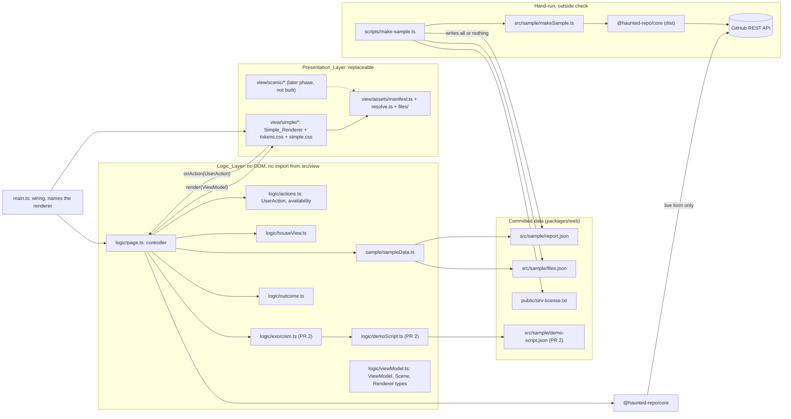
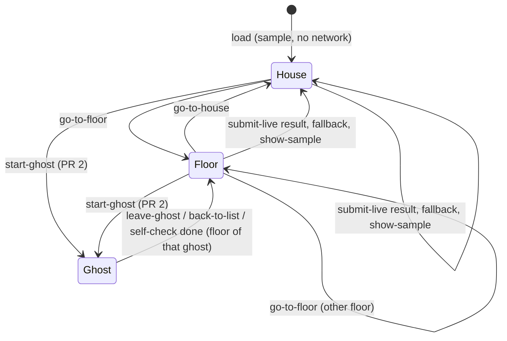
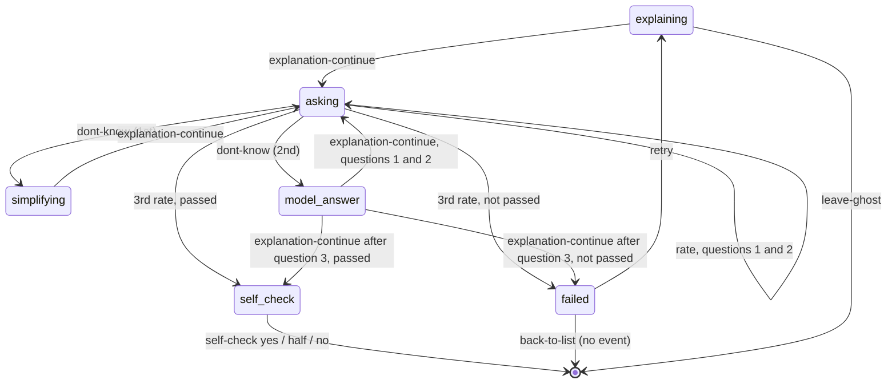

# Design Document

## Overview

`packages/web` becomes the real demo page. It opens on a committed report of `lukeed/sirv` at the Sample_SHA `1135207e92c40354543cbd15c763c7a61d79d432`, with no network call. A form runs `detectGhosts` live on any public GitHub URL. In PR 2 the judge can exorcise the sample ghosts, driven by the real engine of Core (`startSession`, `advance`) and by Tutor texts written in advance (the Demo_Script). Nothing is saved.

This version ships a temporary sober look: three sections (Attic, Middle floor, Basement), simple cards, no house drawing. A later phase will replace it with an immersive haunted house where the interface is part of the scene. This design keeps that later phase possible by changing only presentation files (see "Readiness for a scenic UI").

Key decisions:

- **Two layers.** The Logic_Layer (`src/logic/`, `src/sample/`) is pure TypeScript with no `document` or `window`, and it imports nothing from `src/view/`. The Presentation_Layer (`src/view/`) turns data into DOM nodes and sends user actions back. `main.ts` connects them. All logic tests run in plain Node; no jsdom or happy-dom is added.
- **One View_Model.** The Logic_Layer describes everything on screen in one plain-data object: which report is shown, the current scene, every ghost and its state, the open ghost session and its texts, the available actions, messages, warnings, busy flag and progress. It has no functions and no DOM nodes, so it survives `JSON.stringify` and `JSON.parse` unchanged.
- **Scenes as data.** Navigation (house overview, one floor, one ghost open) is a `Scene` value in the controller state, never a DOM state. Each render carries the scene change (`transition: { from, to }`), so a renderer can animate it. Logic never waits for an animation.
- **Named user actions.** The renderer sends `UserAction` values (`start-ghost`, `rate`, `submit-live`, `go-to-floor` and others) through one callback. How an action is triggered (a button, a door, an object in a room) is the renderer's business. The controller ignores any action that the current View_Model does not list as available, and it never sends the engine an event that `ALLOWED_EVENTS` refuses for the current step.
- **One Renderer interface.** `render(model: ViewModel): void`. The Simple_Renderer of this spec is one implementation in `src/view/simple/`. A scenic renderer replaces it by adding its own folder and changing one import in `main.ts`.
- **One asset manifest.** Every graphic slot (scene backgrounds, ghost sprites by state, door, candle) is declared in `src/view/assets/manifest.ts` with ordered layers and a fallback. In this spec every slot is empty and every renderer uses the fallback. No graphic asset is added.
- **Sample data from a real run.** A hand-run script `npm run sample:make` calls `detectGhosts` with `ref` set to the Sample_SHA, then downloads the ghost texts and the licence with a **second Core GitHub client** (its own budget of 8 requests). It writes three files only after everything succeeded.
- **Node runs the script directly.** Node 24 strips TypeScript types by default (stable since 24.12; this machine has v24.20.0). No `tsx` or other new dependency. See [Node.js: Running TypeScript Natively](https://nodejs.org/learn/typescript/run-natively) and [Node.js TypeScript API docs](https://nodejs.org/api/typescript.html). Only erasable syntax is allowed, and no type checking happens at run time, so a separate `tsc` pass checks the script.
- **One outcome table.** `OUTCOME_BY_CODE: Record<ErrorCode, Outcome>` maps every Core error code to "show message" or "fallback". The `Record` type makes a missing code a compile error.
- **Single flight through availability.** While a live analysis runs, `submit-live` is not an available action, so a second submit is ignored. The busy flag lives in the controller closure and is reset in `finally`, the same pattern as `checkButton.ts`. `checkButton.ts` and its test are deleted.
- **One Sample_Session in memory**, kept apart from any live report. "Show the sample again" shows it with its progress.
- **The Demo_Script is parsed at load** by a strict parser that never throws. A ghost without valid content is a Locked_Ghost.
- **Look:** the Simple_Renderer has one tokens file, system fonts, no images. A test rejects literal colours and literal sizes in the Simple_Renderer CSS outside its tokens file.
- **No new dependency.** Vite 8.3.7, Vitest 5.1.0, fast-check 4.10.2 and @types/node 24.19.2 are already root devDependencies.

### Facts checked in the code

| Fact | Where | Effect on the design |
| --- | --- | --- |
| `DetectOptions.ref` is marked "TEST ONLY" | `detectGhosts.ts` | The script uses it and says why in a comment. Core is not touched. |
| One client stops after `MAX_REQUESTS = 8` | `githubClient.ts` | `detectGhosts` builds its own client. The script builds a second one for the downloads (up to 6 requests). |
| The client sends `Accept` and `X-GitHub-Api-Version`, **no `User-Agent`** | `githubClient.ts` | Node's `fetch` adds `User-Agent: node`; browsers add their own. The page never tries to set it, so the problem of `docs/frictions.md` (12 Nov) does not block the call. |
| The strict fake answers 400 when `User-Agent` is missing | `fakeGitHub.testutil.ts` | Web tests wrap the fake and add `User-Agent` the way Node and browsers do. The fake itself stays unchanged (same as the current `checkButton.test.ts`). |
| The fake accepts commit SHAs listed in `shas` for trees and `contents?ref=` | `fakeGitHub.testutil.ts` | The script test can use `ref` with the fake. |
| `parseReport(jsonText)` takes text and never throws | `parseReport.ts` | The page imports the report as raw text (`?raw`) and parses it. |
| `ALLOWED_EVENTS: Record<ExorcismStep, event type[]>` is exported by Core; `advance` refuses any event not in it | `event.ts`, `engine.ts`, `exorcism/index.ts` | The controller checks it before calling `advance`, and the ghost actions of each step are derived so that their events are always in it. |
| `failed` accepts `retry-ghost` and `pick-ghost`, not `leave-ghost`; `self-check` accepts only `self-check-answered` | `event.ts` | Matches Requirements 6.17 to 6.19. |
| `current.explanation` is `""` until the first explanation is done and is kept across `retry-ghost` | `engine.ts`, `types.ts` | The ghost view shows the retry explanation when `current.explanation !== ""`. |
| `classifyFileKind(text, language)` needs the language | `fileKind.ts` | The content test passes `ghost.language` from the report. |
| `suggestGhost`: lowest score, then smallest path | `suggest.ts` | Same order picks the 2 easiest ghosts (Requirement 7.1). |
| `hauntedShare(report, progress)` returns 0..1, 0 for no ghosts | `progress.ts` | Feeds the progress share of the View_Model. |
| `Rating` is `"right" \| "half-right" \| "wrong"`; `SelfCheck` is `"yes" \| "half" \| "no"`; `Floor` is `"attic" \| "middle floor" \| "basement"` | `exorcism/types.ts`, `ghost-detection/types.ts` | `UserAction` reuses these types. |
| The sirv licence file is `license` (lower case, 1122 bytes) at the Sample_SHA | GitHub contents API | The script downloads path `license`. |
| Vite `import.meta.glob(pattern, { query: "?url", import: "default", eager: true })` returns a map of file path to built URL; arguments must be literals | [Vite: Glob Import](https://vite.dev/guide/features.html#glob-import) | The asset resolver finds the files of the manifest with one literal glob. No file means an empty map, and every slot falls back. |

### The live call in the browser

GitHub answered a CORS preflight (`OPTIONS`, origin `https://devcaos.github.io`, checked on the day of this design) with `Access-Control-Allow-Origin: *`, `X-GitHub-Api-Version` in `Access-Control-Allow-Headers`, and `X-RateLimit-Remaining`, `X-RateLimit-Reset` and `Retry-After` in `Access-Control-Expose-Headers`. So the browser can send Core's headers and Core can read the rate-limit headers. `Accept: application/vnd.github.raw+json` is a CORS-safelisted header. Because Core sets no `User-Agent`, the browser neither drops a header nor fails; it sends its own. This is still a risk until it is seen working on the deployed page, so it is checked by hand (Requirement 15.2).

## Architecture



Data flow on load: `main.ts` imports the raw JSON texts, `sampleData.ts` parses them, `page.ts` builds the first View_Model, and the renderer draws it. No `fetch` runs. The licence link is a relative link to `sirv-license.txt`, which Vite copies from `public/` to the root of `dist/`, so it resolves to `/haunted-repo/sirv-license.txt` on GitHub Pages.

Data flow on input: the renderer calls `onAction(action)`. `main.ts` passes it to `page.dispatch(action)`. The controller checks the action against the last View_Model, updates its state (and calls Core if needed), builds a new View_Model and calls `render` again. The renderer never changes logic state by itself.

### Dependency rules

- `src/logic/**` and `src/sample/**` never import from `src/view/**` and never use `document`, `window` or DOM types.
- `src/view/**` imports from `@haunted-repo/core` only with `import type`. A renderer never calls the engine or detection.
- `src/view/**` may import values from `src/logic/texts.ts`, `src/logic/powerTexts.ts` and `src/logic/actions.ts` (labels and action helpers), and types from `src/logic/viewModel.ts`.
- `main.ts` is the only file that imports both a renderer and the controller.

A test checks the first three rules by scanning source text.

### Scenes



- `house`: the overview of the shown report. The Simple_Renderer draws the three sections here.
- `floor`: one floor in focus. The Simple_Renderer draws the same three sections (Requirement 3.1 still holds); it does not offer `go-to-floor` or `go-to-house`. A scenic renderer can draw only that floor as a room.
- `ghost`: one ghost open, only for the sample. The Simple_Renderer draws the Exorcism_Panel.

A new report (live result, fallback or "Show the sample again") always sets the scene to `house`, because the floors of the old scene may not exist in the new report. A message-only error (`show-message` outcome) keeps the scene. When `house-clean` is reached the scene is `house` and the View_Model carries the house-clean line.

"Busy" is not a scene: the scene stays, `live.busy` is `true`, and `submit-live`, `show-sample` and every `start-ghost` are not available.

### Ghost session steps (PR 2)



`asking`, `simplifying` and `model-answer` also have `leave-ghost`. The engine decides every step; the controller never guesses one.

## Components and Interfaces

All page text is English. Types come from `@haunted-repo/core` unless written here.

### `src/logic/texts.ts` and `src/logic/powerTexts.ts` (PR 1)

```ts
// powerTexts.ts: the ONLY place that mentions the Kiro Power (Requirement 4.13).
export const POWER_TEXTS = {
  liveReport:
    "To exorcise the ghosts of this repository, use your own Kiro with the Haunted Repo Power.",
  lockedGhost: "Exorcise it in your own Kiro with the Power", // PR 2
} as const;

// texts.ts: every other page text, in one object, so wording changes in one place.
export const TEXTS = {
  floorTitles: { attic: "Attic", "middle floor": "Middle floor", basement: "Basement" },
  emptyFloor: "No ghosts on this floor.",
  busy: "Looking at the repository. This can take a few seconds.",
  liveDone: (owner: string, repo: string, n: number) =>
    `Found ${n} ${n === 1 ? "ghost" : "ghosts"} in ${owner}/${repo}.`, // "Found 1 ghost", "Found 3 ghosts"
  fallback:
    "GitHub allows only 60 requests per hour without an account, and it did not answer this time. Here is the sample again. Please try again later.",
  partial: "The analysis is incomplete: GitHub stopped answering before every file was read.",
  truncated: "This repository is very big, so only part of its files was looked at.",
  skippedTitle: "Files that were skipped:",
  skippedReason: { TOO_LARGE: "too large", NOT_TEXT: "not text" },
  sampleBroken: "The sample could not be loaded. Please reload the page.",
  formLabel: "Public GitHub repository URL",
  // Labels of user actions. Any renderer may use them as button text or accessible names.
  actionLabels: {
    "submit-live": "Find the ghosts",
    "show-sample": "Show the sample again",
    "go-to-house": "Back to the house",
    "go-to-floor": "Go to this floor",
    "start-ghost": "Start the exorcism", // PR 2 from here
    "explanation-continue": "Continue",
    "show-model-answer": "Show the model answer",
    "dont-know": "I don't know",
    rate: { right: "Got it", "half-right": "Partly", wrong: "Missed it" },
    "self-check": { yes: "Yes", half: "Partly", no: "Not yet" },
    retry: "Try again",
    "back-to-list": "Back to the list",
    "leave-ghost": "Leave this ghost",
  },
  // PR 2
  judgeLine: "In the real tool, your own Kiro reads your answer and judges it. Here you judge it yourself.",
  selfCheck: "Do you feel you understand this file now?",
  stillHaunted: "This ghost is still here. You can try again.",
  houseClean: "Every ghost is exorcised. The house is clean.",
  progress: (haunted: number, total: number) => `${haunted} of ${total} ghosts still haunting`,
  engineError: "Something went wrong in the demo. You are back at the list.",
} as const;
```

The exact wording may be polished during implementation, as long as each line keeps its meaning. A test checks that no file under `src/` other than `powerTexts.ts` and tests contains the word `Power`. `go-to-house` and `go-to-floor` have labels for a later renderer; the Simple_Renderer does not show them.

### `src/logic/outcome.ts` (PR 1)

```ts
import type { ErrorCode } from "@haunted-repo/core";

export type Outcome = "show-message" | "fallback";

export const OUTCOME_BY_CODE: Readonly<Record<ErrorCode, Outcome>> = {
  INVALID_URL: "show-message",
  REPO_NOT_FOUND: "show-message",
  EMPTY_REPO: "show-message",
  NO_SUPPORTED_FILES: "show-message",
  RATE_LIMITED: "fallback",
  NETWORK_ERROR: "fallback",
  INVALID_REPORT: "fallback", // detectGhosts never returns it (Requirement 5.3)
};

export function outcomeOf(code: ErrorCode): Outcome;
```

A thrown exception is not an `ErrorCode`; `page.ts` treats it as `"fallback"` (Requirement 5.2).

### `src/logic/viewModel.ts` (PR 1; ghost part filled in PR 2)

Types only. Every field is a string, number, boolean, `null`, a plain object or an array. No `undefined`, no function, no `Date`, no DOM node.

```ts
import type { ExorcismStep, Floor } from "@haunted-repo/core";
import type { AvailableAction } from "./actions.js";

export type Scene =
  | { kind: "house" }
  | { kind: "floor"; floor: Floor }
  | { kind: "ghost"; floor: Floor; path: string }; // PR 2

/** Set only in the render where the scene changed; null otherwise and on the first render. */
export interface SceneTransition {
  from: Scene;
  to: Scene;
}

export type GhostState = "haunted" | "exorcised" | "locked";

export interface GhostCardView {
  path: string;
  floor: Floor;
  score: number; // difficultyScore
  reason: string;
  state: GhostState;
  canStart: boolean; // true exactly when { type: "start-ghost", path } is in `available`
  lockedLine: string | null; // PR 2: POWER_TEXTS.lockedGhost when state is "locked"
}

export interface FloorView {
  floor: Floor;
  title: string; // "Attic" | "Middle floor" | "Basement"
  ghosts: GhostCardView[]; // report order
  emptyLine: string | null; // TEXTS.emptyFloor when ghosts is empty, else null
}

export interface WarningsView {
  lines: string[]; // partial, message, truncated, in this order; only those that apply
  skippedTitle: string | null; // TEXTS.skippedTitle when skipped is not empty
  skipped: { path: string; reason: "too large" | "not text" }[];
}

export interface ProgressView {
  line: string; // "N of M ghosts still haunting"
  haunted: number;
  total: number;
  share: number; // hauntedShare(report, progress), 0..1
}

export interface HouseView {
  source: "sample" | "live";
  repoName: string; // "owner/repo"
  floors: [FloorView, FloorView, FloorView]; // attic, middle floor, basement
  warnings: WarningsView;
  powerLine: string | null; // POWER_TEXTS.liveReport only for live
  progress: ProgressView | null; // PR 2: only for sample
  houseClean: string | null; // PR 2: TEXTS.houseClean when the step is house-clean
}

export type ReadingKind = "explanation" | "retry-explanation" | "simpler" | "model-answer";

/** PR 2. Non-null exactly when scene.kind is "ghost". */
export interface GhostView {
  path: string;
  floor: Floor;
  step: Exclude<ExorcismStep, "choosing" | "house-clean">;
  code: string | null; // full Ghost_Text in explaining, asking, simplifying, model-answer; else null
  licenceNextToCode: boolean; // true whenever code is not null (Requirement 10.2)
  judgeLine: string; // TEXTS.judgeLine (Requirement 6.22)
  reading: { kind: ReadingKind; text: string } | null;
  questionNumber: 1 | 2 | 3 | null;
  question: string | null; // in asking
  revealedAnswer: string | null; // in asking, after show-model-answer
  showAnswerBox: boolean; // in asking
  prompt: string | null; // TEXTS.selfCheck in self-check, TEXTS.stillHaunted in failed
}

export interface LicenceView {
  copyright: string; // from files.json, taken from the Licence_Text
  href: "sirv-license.txt"; // relative: works under the Vite base path
  linkText: "Read the MIT licence of lukeed/sirv";
}

export type StatusKind = "none" | "busy" | "done" | "error" | "fallback";

export interface ViewModel {
  scene: Scene;
  transition: SceneTransition | null;
  house: HouseView | null; // null only when the sample failed to load
  ghost: GhostView | null;
  live: { formVisible: boolean; busy: boolean };
  status: { kind: StatusKind; text: string }; // text "" when kind is "none"
  licence: LicenceView | null; // null only when the sample failed to load
  available: AvailableAction[];
}

/** What every renderer implements. */
export interface Renderer {
  render(model: ViewModel): void;
}
```

`StatusKind` lets a scenic renderer react to state (for example a candle that flickers while busy) without parsing text. The Simple_Renderer shows `status.text` in the Status_Region and ignores the kind.

### `src/logic/actions.ts` (PR 1; ghost actions in PR 2)

```ts
import type { Floor, Rating, SelfCheck } from "@haunted-repo/core";

export type UserAction =
  | { type: "submit-live"; url: string }
  | { type: "show-sample" }
  | { type: "go-to-house" }
  | { type: "go-to-floor"; floor: Floor }
  | { type: "start-ghost"; path: string } // PR 2 from here
  | { type: "explanation-continue" }
  | { type: "show-model-answer" }
  | { type: "rate"; rating: Rating }
  | { type: "dont-know" }
  | { type: "self-check"; answer: SelfCheck }
  | { type: "retry" }
  | { type: "back-to-list" }
  | { type: "leave-ghost" };

/** Same as UserAction, but submit-live is listed without a URL: any URL is allowed. */
export type AvailableAction =
  | Exclude<UserAction, { type: "submit-live" }>
  | { type: "submit-live" };

export type ActionSink = (action: UserAction) => void;

/** True when the action matches an entry of model.available (same type and same parameters; the URL is free). */
export function isAvailable(model: ViewModel, action: UserAction): boolean;
```

No action carries the Answer_Box text, so the Logic_Layer cannot receive it (Requirement 6.23).

Available actions, decided in `page.ts` from the controller state:

| State | Available |
| --- | --- |
| Sample failed to load | none |
| `house` or `floor` scene, not busy | `submit-live`; `go-to-floor` for every floor except the one in focus; `go-to-house` in `floor`; `show-sample` when the live report is shown; `start-ghost` for each sample card with `canStart` (PR 2) |
| `house` or `floor` scene, busy | `go-to-floor`, `go-to-house` as above. No `submit-live`, `show-sample` or `start-ghost` |
| `ghost` scene, `explaining` | `explanation-continue`, `leave-ghost` |
| `ghost` scene, `asking`, not revealed | `show-model-answer`, `dont-know`, `leave-ghost` |
| `ghost` scene, `asking`, revealed | `rate` × 3 ratings, `dont-know`, `leave-ghost` |
| `ghost` scene, `simplifying` | `explanation-continue`, `leave-ghost` |
| `ghost` scene, `model-answer` | `explanation-continue`, `leave-ghost` (no `dont-know`) |
| `ghost` scene, `self-check` | `self-check` × 3 answers (no `leave-ghost`) |
| `ghost` scene, `failed` | `retry`, `back-to-list` |

`canStart` rule (PR 2): true only for `haunted` sample cards when the session step is `choosing` or `failed` (both accept `pick-ghost`), the scene is not `ghost`, and busy is false. In the `failed` step the scene is `ghost` until `back-to-list`, so starting another ghost always goes through the list. The order of `available` is the order of the table; renderers may show them in any order.

Navigation actions (`go-to-floor`, `go-to-house`) change only the scene. They never call Core and are allowed while busy, so a scenic renderer can let the judge walk around while GitHub answers.

### `src/logic/houseView.ts` (PR 1; card state extended in PR 2)

```ts
export function buildWarnings(overview: Overview): WarningsView;

/** Live report: every card "haunted", canStart false, no progress. */
export function buildLiveHouse(report: HauntedReport): HouseView;

/** Sample report. In PR 1 `exorcism` is null: every card "haunted", canStart false. */
export function buildSampleHouse(
  report: HauntedReport,
  exorcism: {
    progress: ExorcismProgress;
    step: ExorcismStep;
    scripted: ReadonlySet<string>; // paths with Ghost_Content
    startAllowed: boolean; // not busy and scene is not "ghost"
  } | null,
): HouseView;
```

Card state rule (PR 2): `exorcised` if the progress entry is `exorcised`; else `locked` if the path has no Ghost_Content; else `haunted`. The busy flag never changes the card state. An exorcised Scripted_Ghost has `canStart` false and no locked line.

Warnings (Requirement 17): `TEXTS.partial` if `overview.partial`; `overview.message` as is if it is not `null`; `TEXTS.truncated` if `overview.truncated`; one skipped entry per `overview.skipped` item, with `TOO_LARGE` → "too large" and `NOT_TEXT` → "not text". The same function runs for sample and live reports.

### `src/logic/page.ts` (PR 1; ghost actions added in PR 2)

```ts
import type { HauntedReport, Result, startSession, advance } from "@haunted-repo/core";

/** Narrow on purpose: `(url) => detectGhosts(url)` is assignable to it. */
export type DetectFn = (url: string) => Promise<Result<HauntedReport>>;

/** The two engine functions, injectable so tests can count calls. Defaults to Core's. */
export interface EngineFns {
  startSession: typeof startSession;
  advance: typeof advance;
}

export interface PageDeps {
  detect: DetectFn;
  sample: Result<SampleData, string>; // from loadSample
  script: DemoScript | null; // PR 2; null in PR 1 or when the script is invalid
  engine?: EngineFns;
}

export interface PageController {
  start(): void; // first render; no network
  dispatch(action: UserAction): Promise<void>; // resolves after the last render of this action
  current(): ViewModel; // the last rendered model (tests and wiring)
}

export function createPage(deps: PageDeps, renderer: Renderer): PageController;
```

Controller state (in the `createPage` closure only):

```ts
interface PageState {
  scene: Scene;
  lastRenderedScene: Scene | null; // to compute the transition
  shown: "sample" | "live";
  live: HauntedReport | null;
  busy: boolean;
  status: { kind: StatusKind; text: string };
  // PR 2
  session: SessionState; // the Sample_Session
  revealed: boolean; // model answer shown in asking
}
```

`dispatch(action)`:

1. If `isAvailable(current(), action)` is false, return at once: no state change, no render, no Core call.
2. Otherwise handle the action:
   - `go-to-floor`, `go-to-house`: change `scene`, render.
   - `show-sample`: `shown = "sample"`, scene `house`, status none, render.
   - `submit-live` (single flight): set `busy = true` and status busy **before** the first `await`, render; `await deps.detect(url)` with the URL as typed (Core trims and validates it; `INVALID_URL` covers blank input). `ok` → `shown = "live"`, scene `house`, status `TEXTS.liveDone(...)`. Error with `outcomeOf(code) === "show-message"` → status error with Core's `error.message`; shown report and scene unchanged. Error with `"fallback"`, or `detect` throws → `shown = "sample"`, scene `house`, status fallback with `TEXTS.fallback`. `finally`: `busy = false`, render.
   - Ghost actions (PR 2): `eventFor(action, session, content)` gives the engine event, or `null` for `show-model-answer` and `back-to-list`. If the event type is not in `ALLOWED_EVENTS[session.step]`, ignore the action (this cannot happen when the table above is right; P1 and a unit test check it). Else `engine.advance(session, event)`. On `ok` the new state replaces the old one and `revealed` is reset. Scene: `ghost` while the step is one of the six ghost steps; the floor of that ghost after `leave-ghost`, `back-to-list` or a self-check answer that leads to `choosing`; `house` on `house-clean`.
   - `start-ghost`: `{ type: "pick-ghost", path, text: sample.texts[path] }`, scene `{ kind: "ghost", floor, path }`.
3. Every render computes `transition`: `null` on the first render or when the scene equals `lastRenderedScene`; else `{ from: lastRenderedScene, to: scene }`.

Because `submit-live` is not available while busy, a double click or a second submit returns at step 1. The Sample_Session is never touched by `submit-live` (Requirement 4.11). The form is hidden in the `ghost` scene (`live.formVisible` false) and `submit-live` is not available there (Requirement 4.10).

On `advance` error (should never happen, see P1): status error `TEXTS.engineError`, then `engine.startSession(sample.report, { progress: session.progress })`, so exorcised ghosts stay exorcised and the step is valid again, and scene `house` (Requirement 6.26).

If `deps.sample` is not ok, the first model has `house: null`, `licence: null`, `available: []` and status error `TEXTS.sampleBroken`. `live.formVisible` stays true but `submit-live` is not available, so the form cannot send anything; the renderer may disable it.

The controller never awaits the renderer. `render` returns `void`; any animation runs after it returns. A renderer that receives a new model during an animation must end on the new model.

### `src/sample/sampleData.ts` (PR 1)

```ts
import type { HauntedReport, Result } from "@haunted-repo/core";
// The constants are defined in makeSample.ts and only imported here.
export { SAMPLE_REPO_URL, SAMPLE_SHA } from "./makeSample.js";

export interface SampleData {
  report: HauntedReport;
  texts: Readonly<Record<string, string>>; // one Ghost_Text per ghost path
  copyright: string;
}

/** Strict, never throws. Rejects a files.json that is not { copyright: string; texts: Record<string, string> }. */
export function parseSampleFiles(jsonText: string): Result<{ copyright: string; texts: Record<string, string> }, string>;

/** Parses both committed texts. Never throws. */
export function loadSample(reportJson: string, filesJson: string): Result<SampleData, string>;
```

`main.ts` does `import reportJson from "./sample/report.json?raw"` and `import filesJson from "./sample/files.json?raw"`. The `?raw` suffix makes Vite (and Vitest) give the file text as a string, which goes straight to `parseReport`. The types for `?raw` come from `/// <reference types="vite/client" />` in `src/vite-env.d.ts`, the standard Vite way.

`loadSample` also rejects data where the text keys are not exactly the ghost paths. That makes a broken commit fail at load as well as in the test.

### `src/sample/makeSample.ts` (PR 1, pure part of the script)

```ts
import type { HauntedReport, Result } from "@haunted-repo/core";

// The single definition of the sample. sampleData.ts imports these from here.
export const SAMPLE_REPO_URL = "https://github.com/lukeed/sirv";
export const SAMPLE_SHA = "1135207e92c40354543cbd15c763c7a61d79d432";

export interface SampleOutput {
  reportJson: string; // JSON.stringify(report, null, 2) + "\n"
  filesJson: string; // JSON.stringify({ copyright, texts }, null, 2) + "\n"
  licenceText: string; // the Licence_Text, unchanged
}

/** First line whose trimmed text starts with "Copyright" (any case), trimmed; null if none. */
export function copyrightLineOf(licenceText: string): string | null;

/**
 * Runs detection at the Sample_SHA and downloads every ghost text and the licence.
 * Returns an error and no output if any step fails. Never writes files.
 */
export async function makeSample(opts: { fetch?: typeof fetch }): Promise<Result<SampleOutput, string>>;
```

Steps:

1. `detectGhosts(SAMPLE_REPO_URL, { ref: SAMPLE_SHA, fetch: opts.fetch })`. The comment above this line says: "`ref` is documented in Core as TEST ONLY. This hand-run script needs a fixed commit so the committed sample never changes; Core is not changed." (Requirement 1.2.)
2. A second client: `createGitHubClient({ fetch: opts.fetch })`. For each ghost path, `getFileText("lukeed", "sirv", SAMPLE_SHA, path)`; then `getFileText(..., "license")`. At most 5 + 1 = 6 requests, under its own limit of 8.
3. `copyrightLineOf(licence)` must not be `null`.
4. Any Core error, thrown error or missing copyright line → `{ ok: false, error: <English message> }`.

Why a second Core client and not plain fetch of `raw.githubusercontent.com`:

- The texts are decoded with the same strict UTF-8 and NUL rules that Core used when it measured the files, so the shown code is the measured code.
- It has the same errors and timeouts, already tested in Core.
- The strict fake supports it (`contents?ref=` with `shas`); a raw host would need a new, untested fake.
- Total: up to 8 + 6 = 14 requests to `api.github.com`, under 60 per hour (Requirement 1.5).

This file imports only `@haunted-repo/core` (no relative imports, nothing from other web modules), so Node can run it through the script without a bundler. The dependency goes one way: `sampleData.ts` imports `SAMPLE_REPO_URL` and `SAMPLE_SHA` from `makeSample.ts`, never the reverse. So a change in the page modules cannot break the hand-run script while `npm run check` stays green. `source.test.ts` checks that `makeSample.ts` has no relative import.

The import in `sampleData.ts` is `./makeSample.js`, the same style Core uses. The web `tsconfig.json` uses `moduleResolution: "Bundler"`, which maps it to `makeSample.ts`, and Vite and Vitest resolve it the same way. The web `tsconfig.json` does not change. Only the script imports `makeSample.ts` with the `.ts` extension, because Node runs it directly.

### `packages/web/scripts/make-sample.ts` (PR 1, hand-run)

```ts
// Run with: npm run sample:make   (root script)
// 1. result = await makeSample({})  -> uses Node's global fetch, no token
// 2. if !result.ok: print the error, process.exitCode = 1, write nothing
// 3. write report.json.tmp, files.json.tmp, sirv-license.txt.tmp next to their targets
// 4. only if all three temp writes succeeded: rename each .tmp over its target
// 5. if a temp write fails: delete the temp files, print the error, exit code 1
```

- Imports: `node:fs/promises`, `node:path`, `node:url` (for paths from `import.meta.url`) and `../src/sample/makeSample.ts`. Node needs the `.ts` extension in this relative import.
- Root `package.json`: `"sample:make": "npm run build -w @haunted-repo/core && node packages/web/scripts/make-sample.ts"`. Building Core first is needed because `@haunted-repo/core` resolves to `dist/`. Node strips types only outside `node_modules`; Core's `dist` is plain JavaScript, so this is fine.
- Only Node tools: no `rm`, no shell features, so it runs in PowerShell and on Linux (Requirement 1.9).
- `npm run check` and `npm test` never run it (Requirement 1.10): it is not a test file and no test imports it.
- Type check: `packages/web/scripts/tsconfig.json` extends the base (NodeNext, `types: ["node"]`), with `noEmit`, `allowImportingTsExtensions` and `erasableSyntaxOnly`. The web `build` script becomes `tsc --noEmit && tsc -p scripts && vite build`.

The success output is the real-service check of detection and download (Requirement 15.1). The script prints the paths written and the number of requests of each client.

### `src/logic/demoScript.ts` (PR 2)

```ts
export interface GhostContent {
  path: string;
  kind: FileKind; // must equal classifyFileKind(text, language); checked by a test
  explanation: string;
  retryExplanation: string;
  questions: [string, string, string]; // follow QUESTION_SETS[kind] in order
  simpler: [string, string, string]; // one per question
  modelAnswers: [string, string, string]; // one per question
}

export interface DemoScript {
  ghosts: GhostContent[];
}

/** Strict, never throws. Each Ghost_Content: every text non-blank, exactly 3 of each list, the 3 questions different, kind valid, no repeated path. */
export function parseDemoScript(jsonText: string): Result<DemoScript, string>;

export function contentOf(script: DemoScript | null, path: string): GhostContent | null;
```

If the committed script fails to parse, `main.ts` passes `script: null`: every sample ghost is a Locked_Ghost and the page still works. The content tests make that case fail in `npm run check`, so it cannot ship by accident.

### `src/logic/exorcism.ts` (PR 2)

```ts
/** The text shown in a reading step; the same text is sent in explanation-done. */
export function readingText(state: SessionState, content: GhostContent): { kind: ReadingKind; text: string } | null;

export function buildGhostView(state: SessionState, content: GhostContent, text: string, revealed: boolean): GhostView;

/** The ghost actions of the table in actions.ts for this step. */
export function ghostActions(step: ExorcismStep, revealed: boolean): AvailableAction[];

/** The engine event for a ghost action, or null for "show-model-answer" and "back-to-list". */
export function eventFor(action: UserAction, state: SessionState, content: GhostContent, text: string): ExorcismEvent | null;
```

What `buildGhostView` fills by step (Requirement 6):

| Step | `reading` | `code` | Other fields |
| --- | --- | --- | --- |
| `explaining` | `explanation`, or `retry-explanation` when `current.explanation !== ""` | full text | |
| `asking` | `null` | full text | `questionNumber`, `question`, `showAnswerBox` true, `revealedAnswer` after reveal |
| `simplifying` | `simpler`, text `simpler[N-1]` | full text | `questionNumber` |
| `model-answer` | `model-answer`, text `modelAnswers[N-1]` | full text | `questionNumber` |
| `self-check` | `null` | `null` | `prompt` = `TEXTS.selfCheck` |
| `failed` | `null` | `null` | `prompt` = `TEXTS.stillHaunted` |

N is `current.questionIndex + 1`. The question sent in `answer-rated` and `dont-know` is always `questions[current.questionIndex]`. After a first "I don't know", the engine returns to `asking` with the same index, so the same question is shown again (Requirement 6.13). On retry, the same 3 questions come back (Requirement 6.24).

Mapping to engine events: `explanation-continue` → `explanation-done` with `readingText(...).text`; `rate` → `answer-rated` with the rating and the current question; `dont-know` → `dont-know` with the current question; `self-check` → `self-check-answered`; `retry` → `retry-ghost`; `leave-ghost` → `leave-ghost`; `start-ghost` → `pick-ghost` with the full Ghost_Text.

### Presentation_Layer

#### The Renderer contract (any renderer)

- It implements `Renderer` and receives an `ActionSink` when it is created.
- It draws only from the last `ViewModel`. It keeps no logic state of its own; purely visual state (scroll position, animation progress, the text typed in the URL field or the Answer_Box) is allowed.
- It sends only `UserAction` values. It may offer only actions listed in `model.available`; if it sends another one, the controller ignores it.
- It writes every text from the model with `textContent` or an attribute, never as HTML.
- It shows `status.text` in an element with `aria-live` (Requirement 12.2) and lets the judge reach every available action with the keyboard (Requirement 12.1).
- It decides how to show `transition`. If it animates, it respects `prefers-reduced-motion: reduce` by showing the end state at once. The logic is the same either way.
- It takes graphics only through the asset manifest (below) and from local files.

#### `src/view/simple/` (the Simple_Renderer of this spec)

```ts
// view/simple/renderer.ts
/** Builds the static shell once (header, Live_Form, Status_Region, main, footer) inside `root`. */
export function createSimpleRenderer(root: HTMLElement, onAction: ActionSink): Renderer;

// view/simple/dom.ts
/** Creates an element. Text is set with textContent only; never innerHTML. */
export function el<K extends keyof HTMLElementTagNameMap>(
  tag: K,
  attrs?: Record<string, string>,
  children?: (Node | string)[],
): HTMLElementTagNameMap[K];

// view/simple/house.ts
export function renderHouse(model: ViewModel, onAction: ActionSink): HTMLElement; // the Ghost_List

// view/simple/ghost.ts (PR 2)
export function renderGhost(model: ViewModel, onAction: ActionSink): HTMLElement; // the Exorcism_Panel

// view/simple/licence.ts
export function renderLicence(licence: LicenceView): HTMLElement;
```

- It draws the same Ghost_List in the `house` and `floor` scenes and does not offer `go-to-floor` or `go-to-house`.
- It builds the Live_Form once and never replaces it, so the URL field keeps its text across renders (Requirement 5.4). It sets `form.hidden = !model.live.formVisible` and disables the submit button when `submit-live` is not available. On submit it calls `preventDefault()` and `onAction({ type: "submit-live", url: input.value })`.
- It shows one button per available action, labelled from `TEXTS.actionLabels`, in the order of `model.available`.
- It sets `data-floor` on each section and `data-ghost-state` on each card (Requirement 11.9).
- The Code_Block is `<pre class="code-block" tabindex="0"><code>` with the full text. `tabindex="0"` lets keyboard users scroll it.
- The Exorcism_Panel heading has `tabindex="-1"`. The renderer focuses it after every render where `model.ghost` is not null and either the scene changed or the step changed (Requirement 6.7), so focus never falls back to `<body>` after a step.
- The Answer_Box is a `<textarea>` with a label and no event listener.
- The progress bar is a native `<progress max="1">` with `share` as `value`.
- It ignores `transition` (no animation).
- It asks the asset resolver for `scene.<floor>` and `ghost.<state>`; every slot is empty now, so it uses the fallbacks (no background, the state shown as a text label).

These elements and names (Ghost_List with three sections, Ghost_Card, Exorcism_Panel, Code_Block, `data-floor`, `data-ghost-state`, the class names below, the focus rule) are the contract of the Simple_Renderer only. A scenic renderer meets the same requirements its own way and may use none of them.

Stable CSS hooks of the Simple_Renderer: classes `ghost-list`, `floor`, `ghost-card`, `report-warnings`, `progress`, `panel`, `code-block`, `licence`, `status`; attributes `data-floor="attic|middle floor|basement"` and `data-ghost-state="haunted|exorcised|locked"`.

#### `src/view/assets/` (asset manifest, PR 1)

```ts
// view/assets/manifest.ts: plain data, the single inventory of graphics.
export type AssetSlotId =
  | "scene.house" | "scene.attic" | "scene.middle-floor" | "scene.basement" | "scene.ghost-room"
  | "ghost.haunted" | "ghost.exorcised" | "ghost.locked"
  | "prop.door" | "prop.candle";

export interface AssetLayer {
  file: string; // file name inside src/view/assets/files/, e.g. "attic-back.webp"
  alt: string; // "" for a decorative layer
  source: string; // who made it and under which licence; never blank
}

export type AssetFallback = "none" | "token-colour" | "text-label";

export interface AssetSlot {
  id: AssetSlotId;
  purpose: string; // one plain sentence
  layers: AssetLayer[]; // back to front; [] = no asset yet
  fallback: AssetFallback; // what a renderer shows when layers is [] or a file is missing
}

export const ASSET_SLOTS: readonly AssetSlot[]; // every AssetSlotId once; every layers list is [] in this spec

// view/assets/resolve.ts
// const URLS = import.meta.glob("./files/*", { query: "?url", import: "default", eager: true }) as Record<string, string>;
export type ResolvedSlot =
  | { kind: "layers"; layers: { url: string; alt: string }[] }
  | { kind: "fallback"; fallback: AssetFallback };

/** Layers with built URLs, or the fallback when the slot is empty or any listed file is missing. Never throws. */
export function resolveSlot(id: AssetSlotId): ResolvedSlot;
```

- Several layers per slot let a scene stack independent images or SVG (back wall, furniture, fog). A renderer may also use its own CSS layers.
- Files are local only. Raster images, SVG files and CSS files that use `url("../assets/files/<file>")` are all allowed. Vite copies them to `dist/assets/` with a hashed name and the base `/haunted-repo/`, so they work on GitHub Pages.
- Every file in `files/` must be listed in the manifest, whether a renderer uses it from TypeScript or from CSS. The folder holds only `.gitkeep` in this spec.
- The manifest is in `src/view/` because it is a presentation concern. The Logic_Layer never reads it.

### `main.ts` and `index.html`

`index.html` holds only the page head (title, meta, charset) and `<body><div id="root"></div><script type="module" src="/src/main.ts"></script></body>`. No inline style, no external resource. The renderer builds everything inside `#root`.

`main.ts`:

```ts
const sample = loadSample(reportJson, filesJson);
const script = /* PR 2 */ parseResultOrNull(parseDemoScript(demoScriptJson));
let page: PageController;
const renderer = createSimpleRenderer(document.getElementById("root")!, (a) => void page.dispatch(a));
page = createPage({ detect: (url) => detectGhosts(url), sample, script }, renderer);
page.start();
```

It also imports the CSS of the chosen renderer. To swap the UI, a later spec changes the `createSimpleRenderer` import (and the CSS import) to another renderer. Nothing in `src/logic/` or `src/sample/` changes.

### Vitest alias (PR 1)

`vitest.config.ts` gets:

```ts
resolve: {
  alias: {
    "@haunted-repo/core": fileURLToPath(new URL("./packages/core/src/index.ts", import.meta.url)),
  },
},
```

Vite resolves Core's `./x.js` imports to `./x.ts`, so the tests run on Core source with no build (Requirement 13). `vitest.live.config.ts` stays unchanged: only Core has a live test and it imports Core by relative paths; the web has no live test (out of scope).

### How to replace the look

A later redesign MAY:

- Add a new renderer folder (for example `src/view/scenic/`) with its own TypeScript, CSS, tokens file and transitions, and point `main.ts` to it.
- Fill slots of the asset manifest, add new slot ids, and add files to `src/view/assets/files/`.
- Change or delete `src/view/simple/` once it is no longer used.
- Change the layout of `index.html`, keeping `#root`.

A redesign MUST NOT change:

- `src/logic/**`, `src/sample/**`, the committed data, or the meaning of the View_Model and `UserAction`. If a scenic renderer needs a new field or action, that is a logic change with its own spec.
- Any page text (they live in `texts.ts` and `powerTexts.ts`; text changes are a separate decision).
- The rules for all presentation files: no external address, no storage, no HTML from strings, no value import from Core.

## Data Models

### `packages/web/src/sample/report.json` (generated, PR 1)

A `HauntedReport` exactly as `detectGhosts` returned it at the Sample_SHA, printed with `JSON.stringify(value, null, 2)` plus a final newline. `overview.ref` is the Sample_SHA.

### `packages/web/src/sample/files.json` (generated, PR 1)

```json
{
  "copyright": "Copyright (c) Luke Edwards <luke.edwards05@gmail.com> (lukeed.com)",
  "texts": { "<ghost path>": "<full Ghost_Text>" }
}
```

The copyright value above is only an example; the real one comes from `copyrightLineOf(licence)`. `texts` has exactly the ghost paths of `report.json` as keys.

### `packages/web/public/sirv-license.txt` (generated, PR 1)

The `license` file of sirv at the Sample_SHA, byte for byte as decoded by Core. `.gitattributes` (`eol=lf`) keeps LF line endings.

Both generated JSON files are added to `.prettierignore`, because Prettier may reflow the output of `JSON.stringify` and the files must stay exactly as the script wrote them. The hand-written `demo-script.json` is not ignored.

### `packages/web/src/sample/demo-script.json` (hand-written, PR 2)

```json
{
  "ghosts": [
    {
      "path": "packages/sirv/index.mjs",
      "kind": "logic",
      "explanation": "…",
      "retryExplanation": "…",
      "questions": ["…", "…", "…"],
      "simpler": ["…", "…", "…"],
      "modelAnswers": ["…", "…", "…"]
    }
  ]
}
```

The path above is a placeholder. The real 2 paths are shown to the project director for a "yes" before any text is written (Requirement 7.11).

### View_Model and controller state

See `viewModel.ts` and `page.ts` above. The View_Model is rebuilt from the controller state on every render; it is never edited in place. The controller state lives in the closure of `createPage`. Nothing goes to `localStorage`, `sessionStorage`, `indexedDB` or cookies, so a reload starts again (Requirement 9).

Example: the first View_Model on load (sample, PR 1).

```json
{
  "scene": { "kind": "house" },
  "transition": null,
  "house": {
    "source": "sample",
    "repoName": "lukeed/sirv",
    "floors": [
      { "floor": "attic", "title": "Attic", "ghosts": [{ "path": "…", "floor": "attic", "score": 12, "reason": "…", "state": "haunted", "canStart": false, "lockedLine": null }], "emptyLine": null },
      { "floor": "middle floor", "title": "Middle floor", "ghosts": [], "emptyLine": "No ghosts on this floor." },
      { "floor": "basement", "title": "Basement", "ghosts": [], "emptyLine": "No ghosts on this floor." }
    ],
    "warnings": { "lines": [], "skippedTitle": null, "skipped": [] },
    "powerLine": null,
    "progress": null,
    "houseClean": null
  },
  "ghost": null,
  "live": { "formVisible": true, "busy": false },
  "status": { "kind": "none", "text": "" },
  "licence": { "copyright": "Copyright (c) …", "href": "sirv-license.txt", "linkText": "Read the MIT licence of lukeed/sirv" },
  "available": [
    { "type": "submit-live" },
    { "type": "go-to-floor", "floor": "attic" },
    { "type": "go-to-floor", "floor": "middle floor" },
    { "type": "go-to-floor", "floor": "basement" }
  ]
}
```

The ghost values are placeholders; the real ones come from `report.json`.

### Size of the bundle

The ghost texts are inlined in the JavaScript bundle by `?raw`. sirv's ghosts are small source files; Core caps each at 100 KB and the count at 5, so the bundle stays well under 1 MB.

## Correctness Properties

*A property is a characteristic or behavior that should hold true across all valid executions of a system-essentially, a formal statement about what the system should do. Properties serve as the bridge between human-readable specifications and machine-verifiable correctness guarantees.*

Reflection: criteria 3.1 to 3.4 are one rule about grouping (P4). Criteria 4.3 to 4.5 are one rule about a single run (P7). Criteria 5.1 to 5.5 are the outcome table (P3). Criteria 4.9, 6.1, 6.2, 8.4 and 11.9 all decide the state of a card (P8). Criteria 8.1 to 8.3 say the indicator is a function of the progress (P6). Criteria 4.11 and 4.12 are one rule about the Sample_Session (P9). The step-by-step ghost view criteria (6.5, 6.6, 6.8, 6.9, 6.15, 6.17, 6.20) are checked at every step inside P1, because P1 already walks every reachable step. Criteria 7.4, 7.5 and 7.8 are one parser rule (P2). Requirement 17 is P5. Requirement 18 is proposed in "Requirement changes needed" and is not yet approved; every reference to 18.x below depends on it. It adds two rules: unavailable actions do nothing (P10, the negative side of P1), and the View_Model is plain data with consistent scenes (P11). P10 and P11 share the generator of P1 but check different things, so they stay separate.

Generators reuse the Core test utilities by relative import (Core does not export them and must not change): `reportArb` (`ghost-detection/reportArb.testutil.ts`), `progressArb` (`exorcism/progressArb.testutil.ts`) and `choicesArb` (`exorcism/sessionArb.testutil.ts`).

### Property 1: Every available action is accepted by the engine

For any sequence of judge choices on the committed sample (each choice is a number taken modulo `model.available` of the last View_Model, skipping `submit-live`), every event that the controller sends to `advance` is in `ALLOWED_EVENTS` of the current step and returns `ok`. At every ghost step: `available` is exactly the row of the table in `actions.ts` (so `leave-ghost` only in `explaining`, `asking`, `simplifying`, `model-answer`; no `dont-know` in `model-answer`; no `leave-ghost` in `self-check`); `ghost.code` equals the full Ghost_Text in the four reading and asking steps; the text of every `explanation-done` equals `ghost.reading.text` of the model just before; and `live.formVisible` is false. Every attempt ends in `self-check`, in `failed`, or in `choosing` after `leave-ghost`.

Generator: `choicesArb` (up to 200 numbers). The real committed `report.json`, `files.json` and `demo-script.json`, plus a second run on a generated script that gives every sample ghost content (to reach `house-clean`). `engine.advance` is wrapped to record every call.

**Validates: Requirements 6.5, 6.6, 6.8, 6.9, 6.15, 6.17, 6.20, 6.25, 4.10, 18.3**

### Property 2: The Demo_Script parser accepts only complete content

For any generated script value, `parseDemoScript(JSON.stringify(value))` returns `ok` if and only if every Ghost_Content has a non-blank explanation and retry explanation, exactly 3 non-blank questions that are all different, exactly 3 non-blank simpler explanations, exactly 3 non-blank model answers, a valid `kind`, and a path not used by another entry. It never throws. The committed `demo-script.json` returns `ok`.

Generator: valid Ghost_Content records built from `fc.string()` with non-blank filters, mutated by one of: blank a text, repeat a question, drop or add a list item, repeat a path, set an unknown kind, replace a field with `fc.anything()`.

**Validates: Requirements 7.4, 7.5, 7.8**

### Property 3: Every error code has exactly one outcome

For any `ErrorCode` and any message, `outcomeOf(code)` is `"fallback"` for `RATE_LIMITED`, `NETWORK_ERROR` and `INVALID_REPORT`, and `"show-message"` for the other four. When `detect` returns that error after a `submit-live`, the last View_Model either shows the Sample_Report with status kind `fallback` and `TEXTS.fallback` (fallback), or keeps the house and scene that were shown with status kind `error` and exactly the Core message (show message). When `detect` throws any value, the page applies the fallback.

Generator: `fc.constantFrom` over an independent list of the 7 codes (typed so a new code is a compile error), `fc.string()` for the message, and `fc.anything()` for the thrown value.

**Validates: Requirements 5.1, 5.2, 5.3, 5.4, 5.5**

### Property 4: Ghosts are grouped by floor in report order

For any report, `buildLiveHouse(report).floors` has the titles "Attic", "Middle floor", "Basement" in that order; the cards of each floor are exactly the report ghosts of that floor, in report order, each with the same path, floor, score and reason; and `emptyLine` is set if and only if the floor has no cards.

Generator: `reportArb`. The same check runs on `buildSampleHouse(report, null)`.

**Validates: Requirements 3.1, 3.2, 3.3, 3.4**

### Property 5: Report warnings match the overview exactly

For any overview, `buildWarnings(overview).lines` contains `TEXTS.partial` if and only if `partial`, `overview.message` if and only if it is not `null`, and `TEXTS.truncated` if and only if `truncated`, in that order and nothing else; `skipped` has one entry per skipped file with the same path and "too large" or "not text"; `skippedTitle` is set if and only if `skipped` is not empty. When all four are clear, both lists are empty and `skippedTitle` is `null`.

Generator: the `overview` of `reportArb`.

**Validates: Requirements 17.1, 17.2, 17.3, 17.4, 17.5, 17.6**

### Property 6: The progress view follows the progress

For any sample report and any progress, the sample house's `progress` has `total` = number of distinct ghost paths, `haunted` = number of those paths still haunted after normalising, `share` = `hauntedShare(report, progress)`, and `line` = `TEXTS.progress(haunted, total)`.

Generator: `reportArb` mapped to unique paths, and `progressArb(report.ghosts)`. `reportArb` can repeat ghost paths (each path is a free `fc.string()`), so a web test helper `uniquePathReportArb` maps it through a dedupe that keeps the first ghost of each path, in order. The overview has no ghost count, so nothing else needs fixing.

**Validates: Requirements 8.1, 8.2, 8.3**

### Property 7: Only one live analysis runs at a time

For any number `k >= 0` of extra `submit-live` actions dispatched while a live analysis is pending, and any outcome of `detect` (ok, error, or thrown), `detect` is called exactly once; the model rendered before `detect` is called has `live.busy` true and no `submit-live` in `available`; the last model has `live.busy` false and `submit-live` available; and a `submit-live` after the analysis finished calls `detect` again.

Generator: `fc.integer({ min: 0, max: 20 })` and an outcome from `fc.oneof` of an ok report (`reportArb`), an error result, or a throw.

**Validates: Requirements 4.3, 4.4, 4.5**

### Property 8: Card state follows progress and content

For any sample report, progress, set of scripted paths, step and `startAllowed` flag, every sample card has state `exorcised` when its progress is exorcised, else `locked` when its path is not scripted, else `haunted`; the state does not depend on `startAllowed`; `lockedLine` is `POWER_TEXTS.lockedGhost` exactly for `locked` cards; and `canStart` is true exactly for `haunted` cards when the step is `choosing` or `failed` and `startAllowed` is true. For any live report, every card is `haunted` with `canStart` false and no locked line. In every model of P1, P10 and P11, `canStart` of a card is true exactly when `start-ghost` for its path is in `available`.

Generator: `uniquePathReportArb` (see P6), `progressArb`, `fc.subarray` of the paths, `fc.constantFrom` of the 8 steps, `fc.boolean()` for `startAllowed`.

**Validates: Requirements 4.3, 4.4, 4.9, 4.10, 4.11, 6.1, 6.2, 8.4, 11.9**

### Property 9: A live analysis never changes the Sample_Session

For any sample session reached by a random judge path (as in P1, stopped in the `house` or `floor` scene), and any live outcome, after `submit-live` and then `show-sample` (when available), the session state is the same object as before, and the sample house has the same card states and progress.

Generator: `choicesArb` for the path, plus the outcome generator of P7.

**Validates: Requirements 4.11, 4.12**

### Property 10: Unavailable actions change nothing

For any state reached by a random path (as in P1, including pending live analyses), and any `UserAction` that `isAvailable` rejects for the current model, dispatching it leaves the controller with the same model (deep equal), renders nothing, calls neither `detect` nor `engine.advance`, and keeps the same session object.

Generator: the path of P1, then `fc.oneof` over all 13 action types with parameters from the report paths, `fc.string()` paths, the 3 floors, the 3 ratings, the 3 self-check answers and `fc.string()` URLs; only the actions that `isAvailable` rejects are dispatched.

**Validates: Requirements 4.3, 4.9, 4.10, 6.17, 18.3**

### Property 11: The View_Model is plain data and scenes are consistent

For any sequence of available actions (P1 generator, also using `go-to-floor`, `go-to-house` and `submit-live` with the strict fake), every rendered model equals `JSON.parse(JSON.stringify(model))`; `ghost` is not `null` if and only if `scene.kind` is `"ghost"`, and then `ghost.path` and `ghost.floor` equal the scene's; `live.formVisible` is false if and only if the scene is `ghost`; `transition` is `null` on the first render and whenever the scene equals the scene of the previous render, and otherwise is `{ from: previous scene, to: current scene }`; in a `floor` scene, `go-to-floor` for that floor is not available.

Generator: `choicesArb`, mapped to `model.available` at each step.

**Validates: Requirements 11.7, 11.8, 18.1, 18.2, 18.4**

## Error Handling

| Situation | What the page does |
| --- | --- |
| `detect` returns `INVALID_URL`, `REPO_NOT_FOUND`, `EMPTY_REPO`, `NO_SUPPORTED_FILES` | Status error with Core's English message; the shown house, the scene and the URL field stay. |
| `detect` returns `RATE_LIMITED`, `NETWORK_ERROR`, `INVALID_REPORT` | Fallback: sample house with its progress, scene `house`, status fallback with `TEXTS.fallback`. |
| `detect` throws | Same fallback. The busy flag is reset in `finally`. |
| Live report with `partial`, `message`, `truncated` or `skipped` | Report warnings in the house view (Requirement 17). |
| The renderer sends an action that is not available | Ignored: no state change, no render, no Core call (P10). |
| A ghost action maps to an event not in `ALLOWED_EVENTS[step]` | Ignored the same way. Cannot happen when the table is right; P1 checks it. |
| Committed sample fails `loadSample` | Status error `TEXTS.sampleBroken`, `house: null`, no available action. Tests stop this from shipping. |
| Committed Demo_Script fails `parseDemoScript` | `script: null`: every sample ghost is locked. Tests stop this from shipping. |
| `advance` returns an error | Status error `TEXTS.engineError`; restart the Sample_Session from its progress; scene `house`. |
| An asset slot is empty or a listed file is missing | `resolveSlot` returns the fallback; the page still works. The manifest test fails in `npm run check` for a missing file. |
| Script: any Core error, thrown error, missing copyright line | Print the error, exit code 1, write nothing. |
| Script: a temp write fails | Delete temp files, print the error, exit code 1; old files stay. |

Every text from Core, GitHub or the data files reaches the DOM through `textContent` or an attribute, never `innerHTML`, so a repository path or a message cannot inject HTML. A source test enforces this for every renderer.

## Testing Strategy

### Tools and rules

- Vitest 5.1.0 (environment `node`, unchanged) and fast-check 4.10.2. No new dependency.
- No jsdom or happy-dom. The Logic_Layer is tested through View_Models and a recording renderer (`src/logic/recordingRenderer.testutil.ts`) that stores a deep copy of every model it receives. The DOM builders in `src/view/simple/` are thin; they are covered by `npm run build` (type check + bundle) and by the manual checks below.
- No snapshot files. State tests check named fields, so wording polish does not break them by accident and failures say which field changed.
- Each property is one `it` with `numRuns: 100` or more and the comment `// Feature: web-demo, Property N: <title>` plus `// **Validates: Requirements ...**`.
- Web tests that reach `detectGhosts` stub the global `fetch` to throw in `beforeEach` (as `checkButton.test.ts` does today), so a missing fake fails the test instead of calling GitHub (Requirement 15.4).
- The strict fake is used unchanged. `src/logic/fakeDetect.testutil.ts` wraps it and adds `User-Agent: vitest`, the way Node and browsers add one, because Core sends none. This is the same wrapper as today and does not loosen the fake (Requirement 5.6).
- Tests that read files (`source.test.ts`, the committed-data test, the manifest test) start with `/// <reference types="node" />` and use `node:fs`. @types/node is already a root devDependency.

### State tests (`src/logic/states.test.ts`)

One `it` per main state. Each builds the controller with the committed data, the recording renderer and a strict-fake `detect` (or a controlled promise), dispatches the actions that reach the state, and checks the last View_Model. These are the states a scenic renderer must be able to draw.

| State | PR | Checked in the View_Model |
| --- | --- | --- |
| Opening on the sample | 1 | scene `house`, transition `null`, source `sample`, three floors in order with the report ghosts, `ghost` null, form visible, not busy, status none, licence set, `available` = `submit-live` + 3 `go-to-floor`, no `show-sample`; `detect` and `fetch` not called (2.1, 2.2, 10.1). |
| Live analysis running | 1 | after `submit-live` with a pending `detect`: busy true, status kind `busy`, no `submit-live`, `show-sample` or `start-ghost` in `available`, every sample `canStart` false (PR 2 adds this check), scene unchanged (4.3, 4.4). |
| Live list | 1 | source `live`, repo name, Power line from `POWER_TEXTS`, `show-sample` available, every card `haunted` with `canStart` false, no progress, status `Found 3 ghosts in o/r.`; and `Found 1 ghost in o/r.` for one ghost (4.6 to 4.9). |
| Message error | 1 | `REPO_NOT_FOUND` from the fake: status kind `error` with Core's message, house and scene unchanged (5.4). |
| Fallback | 1 | rate limit from the fake: source `sample`, scene `house`, status kind `fallback` with `TEXTS.fallback` (5.1). |
| Show the sample again | 1 | from the live list: source `sample`, scene `house`, status none, transition set if the scene was `floor`. |
| Floor navigation | 1 | `go-to-floor` basement: scene `{ floor, basement }`, transition from `house`; `go-to-house` back; the house content is unchanged. |
| Report warnings | 1 | a fake repository with a skipped file and truncation: warning lines and skipped list. |
| Sample broken | 1 | `loadSample` error: `house` null, `available` empty, status `TEXTS.sampleBroken`. |
| Ghost explaining | 2 | after `start-ghost` on the easiest ghost: scene `ghost` with its floor and path, transition from the list scene, form hidden, reading kind `explanation`, `code` = Ghost_Text, licence next to code, judge line, `available` = `explanation-continue`, `leave-ghost` (6.3, 6.4, 6.6, 6.22, 10.2). |
| Asking, not revealed | 2 | question 1 text, Answer_Box shown, no revealed answer, `available` = `show-model-answer`, `dont-know`, `leave-ghost` (6.9). |
| Asking, revealed | 2 | revealed answer = model answer 1, `available` = 3 `rate`, `dont-know`, `leave-ghost`; no engine call for the reveal (6.10). |
| Simplifying | 2 | after one `dont-know`: reading kind `simpler` with `simpler[0]`; after continue, question 1 again (6.12, 6.13). |
| Model answer | 2 | after a second `dont-know`: reading kind `model-answer`, no `dont-know` (6.14, 6.15). |
| Self-check | 2 | three `rate` right: `prompt` = `TEXTS.selfCheck`, `available` = 3 `self-check`, no `leave-ghost`, `code` null (6.16, 6.17). |
| Exorcised | 2 | after `self-check` yes: scene = floor of that ghost, card state `exorcised`, `canStart` false, progress `haunted` one less and `share` lower (8.3, 8.4). |
| Failed | 2 | `rate` wrong on the core question then two more: `prompt` = `TEXTS.stillHaunted`, `available` = `retry`, `back-to-list` (6.18, 6.19). |
| Retry | 2 | `retry`: reading kind `retry-explanation`; the same 3 questions follow (6.4, 6.24). |
| Back to the list | 2 | from `failed`: no engine call, scene = floor of that ghost, card still `haunted` and `canStart` true. |
| Leave | 2 | `leave-ghost` from `asking`: scene = floor of that ghost, card `haunted` (6.20). |
| Locked ghost | 2 | a ghost without content: state `locked`, locked line from `POWER_TEXTS`, no `start-ghost` (6.2). |
| House clean | 2 | with a generated script for every ghost, exorcise all: scene `house`, `houseClean` line, progress `0 of N`, `share` 0 (6.21). Not reachable with the committed script (2 of the sample ghosts only), which is the edge case "Locked_Ghosts remain": that run ends in `choosing` with progress above 0. |
| Engine error | 2 | an injected `advance` that returns an error: status `TEXTS.engineError`, scene `house`, exorcised ghosts stay exorcised (6.26). |
| Reload | 2 | a second controller from the same data after an exorcism: every ghost `haunted` (9.3). |

### Test files

| File | PR | Covers |
| --- | --- | --- |
| `src/sample/makeSample.test.ts` | 1 | With the strict fake (`shas: [SAMPLE_SHA]`, 5 ghost files plus `license`): success gives one text per ghost and the copyright line, tree request uses the SHA, total requests ≤ 14 (1.1, 1.3 to 1.5). Errors give no output: repo not found, rate limit after k requests, missing `license`, licence with no copyright line (1.8). `copyrightLineOf` examples. |
| `src/sample/sampleData.test.ts` | 1 | Committed data: `parseReport` ok (1.11), `overview.ref === SAMPLE_SHA` (1.12), text keys equal ghost paths (1.13), copyright line equals `copyrightLineOf(public/sirv-license.txt)` (10.3). `loadSample` rejects missing or extra text keys. |
| `src/logic/houseView.test.ts` | 1, 2 | P4, P5 (PR 1); P6, P8 (PR 2). |
| `src/logic/actions.test.ts` | 1, 2 | `isAvailable` examples (URL is free for `submit-live`; parameters must match for the others). PR 2: for every step and both `revealed` values, every action of `ghostActions` maps to an event type in `ALLOWED_EVENTS[step]` or to `null`. |
| `src/logic/page.test.ts` | 1, 2 | P3, P7, P10, P11 (PR 1, list scenes only); P9 and P10, P11 extended to the ghost scene (PR 2). |
| `src/logic/states.test.ts` | 1, 2 | The state table above. |
| `src/logic/exorcism.test.ts` | 2 | P1. Examples: rating map (6.11); self-check map (6.16); `pick-ghost` text equals `files.json` text (6.3). |
| `src/logic/demoScript.test.ts` | 2 | P2. Committed content: has the 2 easiest ghosts by (score, path) (7.1); every path is a sample ghost (7.9); `kind` equals `classifyFileKind(text, ghost.language)` (7.3); each reading text ≤ 150 words (7.6); no line numbers, regex `/\blines?\s+\d+|\bL\d+\b/i` (7.7). |
| `src/view/assets/manifest.test.ts` | 1 | Every `AssetSlotId` appears once; every slot has a fallback and a non-blank purpose; every layer has a non-blank `source`; every listed file exists in `files/`; every file in `files/` (except `.gitkeep`) is listed; no layer file is an address (`://` or leading `//`). In this spec every `layers` list is empty. |
| `src/source.test.ts` | 1 | Scans source text; rules below. |

`source.test.ts` rules, by scope:

- **All of `src/**` (non-test) and `index.html`:** no `localStorage`, `sessionStorage`, `indexedDB`, `document.cookie` (9.2; the test skips itself). No `innerHTML`, `outerHTML`, `insertAdjacentHTML` or `document.write`. The word `Power` appears only in `powerTexts.ts` (4.13). The text `Check GitHub connection` appears nowhere (14.1). No `style` attribute or `<style>` in `index.html`.
- **External addresses, all presentation files** (`index.html`, every `.ts`, `.css` and `.svg` under `src/view/`): no `http://` or `https://`, and no protocol-relative `//` at the start of a `url(...)`, `@import`, `src` or `href` value (11.5). Exempt: the SVG namespace values `http://www.w3.org/2000/svg` and `http://www.w3.org/1999/xlink`. A local `url(...)`, such as `url("../assets/files/door.svg")`, is allowed. Raster files are not scanned.
- **Logic_Layer (`src/logic/**`, `src/sample/**`):** no `document`, `window` or `HTMLElement` (11.7); no import from `../view` or `src/view`. `makeSample.ts` has no relative import.
- **Presentation_Layer (`src/view/**`):** imports from `@haunted-repo/core` are `import type` only.
- **Simple_Renderer CSS only (`src/view/simple/**/*.css` except `tokens.css`):** no literal colour (hex, `rgb(`, `rgba(`, `hsl(`, `hsla(`, `hwb(`, `lab(`, `lch(`, `oklab(`, `oklch(`, `color(`, or a CSS named colour) (11.3). No size unit and no `font-family` without `var(` (11.2). Size units forbidden: `px`, `rem`, `em`, `ex`, `ch`, `%`, `vh`, `vw`, `vmin`, `vmax`, `svh`, `lvh`, `dvh`, `pt`, `pc`, `cm`, `mm`, `in`, `Q`. Allowed: unitless `0`, other unitless numbers (`line-height`, `z-index`, `flex`, `opacity`), `fr` in grid templates, times (`s`, `ms`) and angles (`deg`, `turn`). A full width is written with a token, for example `--size-full: 100%`. Exempt: `@media` lines (custom properties do not work there) and the text inside `url(...)`. SVG and raster files are never scanned for colours or sizes, so art is not limited. A future renderer sets its own CSS rules in its own spec.

The current `checkButton.test.ts` is deleted with `checkButton.ts`. Its single-flight test idea lives on in P7 (Requirement 14.2, 14.3).

### Real service and manual checks

- **Real GitHub:** running `npm run sample:make` is the real-service check of detection and download at the Sample_SHA (Requirement 15.1). Its output and request counts go in the PR 1 body.
- **Live form in the browser:** checked by hand after deploy (Requirement 15.2). The PR 1 body lists these steps (Requirement 15.3):
  1. Open `https://devcaos.github.io/haunted-repo/` in a clean browser window.
  2. Paste `https://github.com/lukeed/sirv` in the form and submit.
  3. Success: the Ghost_List of the live report and the line "To exorcise the ghosts of this repository, use your own Kiro with the Haunted Repo Power."
  4. Fallback: the Sample_Report and the message "GitHub allows only 60 requests per hour without an account…".
- **Manual page checks** (PR body checklist): keyboard only (Tab, Enter, Space) reaches every control (12.1); focus moves into the Exorcism_Panel at each step (6.7, PR 2); 360 px wide in the browser dev tools shows no page-wide horizontal scroll (12.3); the licence link opens the text (10.4); no request in the Network tab on load (2.2, 11.5); changing one colour in `tokens.css` changes the page.

### Commands

- `npm run check` (lint, format check, build, tests). It has no network access.
- `npm run sample:make` only by hand, rarely.

## Readiness for a scenic UI

The project director set 5 requirements for a later immersive haunted house. The previous version of this design was checked against each; this is the result and what changed.

### 1. Replace the whole UI without touching the engine or the analysis

**Before: partly met. Changed.** The logic had no DOM, but the controller had a method per button (`submitUrl`, `showSampleAgain`, `startExorcism`, `act`), `index.html` held the form and `main.ts` wired DOM events to those methods. A new UI would have changed `main.ts`, `index.html` and the calls into the controller.

Now: one `Renderer` interface (`render(model)`), one `dispatch(action)` entry, `index.html` with only `#root`, and the renderer builds its own form. Dependency rules are checked by a test: logic never imports from `src/view`, views import Core only as types. Replacing the UI means a new folder under `src/view/` and one import line in `main.ts`. `packages/core` and `src/logic/` do not change.

### 2. Interactive rooms, clickable objects, animation and transitions

**Before: not met. Changed.** There was no navigation state (only "list" or "exorcism" screens), no transition data, and actions were tied to panel buttons.

Now: `Scene` (`house`, `floor`, `ghost`) is data in the controller state; `go-to-floor` and `go-to-house` move between rooms; each render carries `transition: { from, to }`. Actions are named `UserAction` values, so a door, a candle or a ghost sprite can send `start-ghost` as well as a button can. The controller never waits for the renderer, and reduced motion is a renderer rule.

### 3. Visual components fit a scene, with no forced cards or panels

**Before: not met. Changed.** View data was named and shaped after the sober layout (`ListView.sections`, `PanelView.actions` "buttons, in display order", screen `"exorcism"`), and the CSS classes and data attributes were described as the stable contract of the page.

Now: the View_Model uses neutral names (`HouseView`, `FloorView`, `GhostCardView`, `GhostView`) and describes content and state, not layout. Ghost_List, Ghost_Card, Exorcism_Panel, Code_Block, `data-floor`, `data-ghost-state`, the class names and the focus rule are the contract of the Simple_Renderer only.

### 4. Graphic assets integrate without limiting art direction

**Before: partly met. Changed.** Local images were allowed in `src/styles/assets/` from CSS, but there was no inventory, no layers, no fallback, and the colour and size rules applied to every CSS file.

Now: one manifest of asset slots with ordered layers, a fallback per slot and a `source` line per file; a resolver that returns the fallback for any missing file; one folder `src/view/assets/files/` for images, SVG and CSS-referenced files. The colour and size rules apply only to the Simple_Renderer CSS; SVG and raster files are not scanned for colours or sizes, only for external addresses. No asset is added in this spec.

### 5. Tests cover the main states of the experience

**Before: not met. Changed.** Properties covered the logic and P1 checked each ghost step in passing, but no test named and checked each state a renderer must draw.

Now: `states.test.ts` checks the View_Model of 24 named states (9 in PR 1, 15 in PR 2), with no browser. P10 checks that unavailable actions change nothing, and P11 checks that every model is plain data with consistent scenes and transitions. A scenic renderer can use the same state list as its own visual checklist.

### Requirements that name sober-layout parts

Requirements 3.1, 3.3, 6.x (Exorcism_Panel, Code_Block), 6.7 (focus into the panel) and 11.9 (`data-floor`, `data-ghost-state`) name parts of the sober layout. They stay as they are: in this design they bind the Simple_Renderer, which is the only renderer shipped by this spec. A later scenic spec will restate them for its own renderer. Requirements 9, 10, 12 and 17 bind any renderer.

## File Map

| File | Change | PR |
| --- | --- | --- |
| `package.json` (root) | add script `sample:make` | 1 |
| `vitest.config.ts` | add `resolve.alias` for `@haunted-repo/core` | 1 |
| `.prettierignore` | add `packages/web/src/sample/report.json`, `packages/web/src/sample/files.json` | 1 |
| `packages/web/package.json` | `build`: `tsc --noEmit && tsc -p scripts && vite build` | 1 |
| `packages/web/index.html` | rewritten: head plus `<div id="root">` only | 1 |
| `packages/web/scripts/make-sample.ts` | new | 1 |
| `packages/web/scripts/tsconfig.json` | new | 1 |
| `packages/web/public/sirv-license.txt` | new, generated | 1 |
| `packages/web/src/vite-env.d.ts` | new (`vite/client` types for `?raw`, `import.meta.glob` and CSS) | 1 |
| `packages/web/src/main.ts` | rewritten: wiring only, names the renderer | 1 (extended in 2) |
| `packages/web/src/checkButton.ts`, `checkButton.test.ts` | deleted | 1 |
| `packages/web/src/sample/report.json`, `files.json` | new, generated | 1 |
| `packages/web/src/sample/sampleData.ts`, `.test.ts` | new | 1 |
| `packages/web/src/sample/makeSample.ts`, `.test.ts` | new | 1 |
| `packages/web/src/logic/texts.ts`, `powerTexts.ts` | new | 1 (lines added in 2) |
| `packages/web/src/logic/outcome.ts` | new | 1 |
| `packages/web/src/logic/viewModel.ts` | new (types: ViewModel, Scene, Renderer) | 1 (ghost part in 2) |
| `packages/web/src/logic/actions.ts`, `.test.ts` | new (UserAction, AvailableAction, isAvailable) | 1 (ghost actions in 2) |
| `packages/web/src/logic/houseView.ts`, `.test.ts` | new | 1 (extended in 2) |
| `packages/web/src/logic/page.ts`, `.test.ts` | new (controller, scenes, dispatch) | 1 (extended in 2) |
| `packages/web/src/logic/states.test.ts` | new | 1 (extended in 2) |
| `packages/web/src/logic/recordingRenderer.testutil.ts` | new | 1 |
| `packages/web/src/logic/fakeDetect.testutil.ts` | new | 1 |
| `packages/web/src/logic/uniquePathReportArb.testutil.ts` | new | 2 |
| `packages/web/src/view/simple/renderer.ts`, `dom.ts`, `house.ts`, `licence.ts` | new | 1 |
| `packages/web/src/view/simple/tokens.css`, `simple.css` | new | 1 (simple.css extended in 2) |
| `packages/web/src/view/simple/ghost.ts` | new | 2 |
| `packages/web/src/view/assets/manifest.ts`, `resolve.ts`, `manifest.test.ts` | new | 1 |
| `packages/web/src/view/assets/files/.gitkeep` | new (empty folder for future art) | 1 |
| `packages/web/src/source.test.ts` | new | 1 |
| `PLAN.md` | item 6 progress, MIT line closed, note (g) used, note (e) → "nothing is saved" | 1 (item 6 done in 2) |
| `docs/kiro-usage-log.md` | one line | 1 and 2 |
| `packages/web/src/sample/demo-script.json` | new, hand-written | 2 |
| `packages/web/src/logic/demoScript.ts`, `.test.ts` | new | 2 |
| `packages/web/src/logic/exorcism.ts`, `.test.ts` | new | 2 |

Removed from the previous file map: `src/logic/singleFlight.ts` (the busy flag and availability replace it), `src/logic/listView.ts` (now `houseView.ts`), `src/view/dom.ts`, `listView.ts`, `licence.ts`, `panelView.ts` (now under `src/view/simple/`), `src/styles/` (now `src/view/simple/` and `src/view/assets/`).

No file under `packages/core/src` changes.

## Size Estimate

Changed lines (added plus deleted), not counting JSON data and `package-lock.json`.

| PR | Code and config | Tests | Deleted | Total | Before | Delta |
| --- | --- | --- | --- | --- | --- | --- |
| PR 1 | about 1,140 | about 930 | about 275 | **about 2,350** | about 1,750 | **+600** |
| PR 2 | about 540 | about 700 | small | **about 1,250** | about 975 | **+275** |

Where the extra lines come from:

- PR 1 code (+250): `actions.ts` (about 70), View_Model types (about 40 more than the old view types), scenes and transitions in the controller (about 45), the renderer building its own shell (about 35 net, `index.html` shrinks), asset manifest and resolver (about 55), minus `singleFlight.ts` (about 20), plus small wiring.
- PR 1 tests (+330): 9 state tests (about 170), P10 and P11 on list scenes (about 90), manifest test (about 30), new source rules (about 40).
- PR 2 (+275): ghost actions and the `ALLOWED_EVENTS` check (about 40), 15 state tests (about 195), P10 and P11 on the ghost scene (about 40).

The 2-PR plan (PR 1 `feat/web-demo`, PR 2 `feat/web-exorcism`) still holds: nothing forces a third PR, because PR 2 depends on PR 1 and every part of PR 1 is needed for PR 2. Both PRs were already over about 500 lines and accepted; the new sizes need the director's acceptance again. Each PR body carries the size warning. Tests are never cut to fit.

## Durability (until 29 January 2027)

- Static files only on GitHub Pages; no server, no database, no keys, no environment variables.
- On load the page uses only committed data, so it works even if GitHub's API is down or rate-limited.
- The live form uses the anonymous GitHub API (60 requests per hour per IP). When it fails, the Fallback keeps the demo usable.
- No external fonts, CDNs or scripts that could disappear. Future art is committed local files only.
- `X-GitHub-Api-Version: 2022-11-28` is sent by Core. If GitHub retired that version, only the live form would fail and the Fallback would show. This does not touch the sample.
- `vite.config.ts` keeps `base: "/haunted-repo/"`; the licence link is relative, so it follows `base`.

## Risks and Open Doubts

- **Browser live call (risk).** Core sends no `User-Agent`, and the CORS preflight allows Core's headers, so the call should work. It is only proven by the hand check on the deployed page.
- **Shared IP limits.** Judges on one network share 60 requests per hour. Each live run uses up to 8. The Fallback covers this.
- **Over-size PRs.** PR 1 grows to about 2,350 lines and PR 2 to about 1,250. Reviews take longer.
- **`?raw`, `import.meta.glob` and Vite types.** The design relies on Vite's `?raw` imports in both build and Vitest, and on `import.meta.glob` in the asset resolver, with `vite/client` types. If Vitest 5 handles `?raw` differently, the fallback is a JSON import with `resolveJsonModule` and `JSON.stringify` before `parseReport`. The resolver is not run in Node tests (the manifest test reads files with `node:fs`).
- **Doubt: navigation unused by the Simple_Renderer.** `go-to-floor` and `go-to-house` exist for the later scenic renderer and are tested only through the View_Model. This is about 30 lines of logic. Drop them if the director prefers to add them in the scenic spec.
- **Doubt: where leaving a ghost goes.** `leave-ghost`, `back-to-list` and the end of the self-check go to the `floor` scene of that ghost (back to its room), not to `house`. The Simple_Renderer shows the same list either way.
- **Doubt: `show-sample` while busy.** It is not available while a live analysis runs, so a live result cannot replace a sample the judge has just asked for.
- **Doubt: "I don't know" after revealing the model answer.** Requirement 6.9 says the button shows in every `asking` state, so it stays available after "Show the model answer". Kiro will keep it unless the director says otherwise.
- **Doubt: code in `self-check` and `failed`.** Requirements 6.4 and 6.5 do not ask for the Code_Block there, so `code` is `null` in those two steps.
- **Doubt: starting again after "Back to the list".** This sends `pick-ghost`, which begins a fresh attempt with the first explanation, not the retry explanation. Only "Try again" shows the retry explanation.
- **Later, not now:** Requirement 11.6 (no house drawing) and the colour and size rules of Requirement 11 will need a new decision in the scenic spec. Requirement 12 (keyboard, 360 px) also binds a scenic renderer.

## Requirement changes needed

Applied to `requirements.md`: Requirement 18 (Readiness for a scenic UI) and its 5 glossary entries (View_Model, Scene, User_Action, Renderer, Simple_Renderer) were added, together with the optional Simple_Renderer scope wording in the glossary and in Requirement 11.9, one Introduction sentence and one Out of Scope line about the later scenic renderer. No further requirement change is needed.
