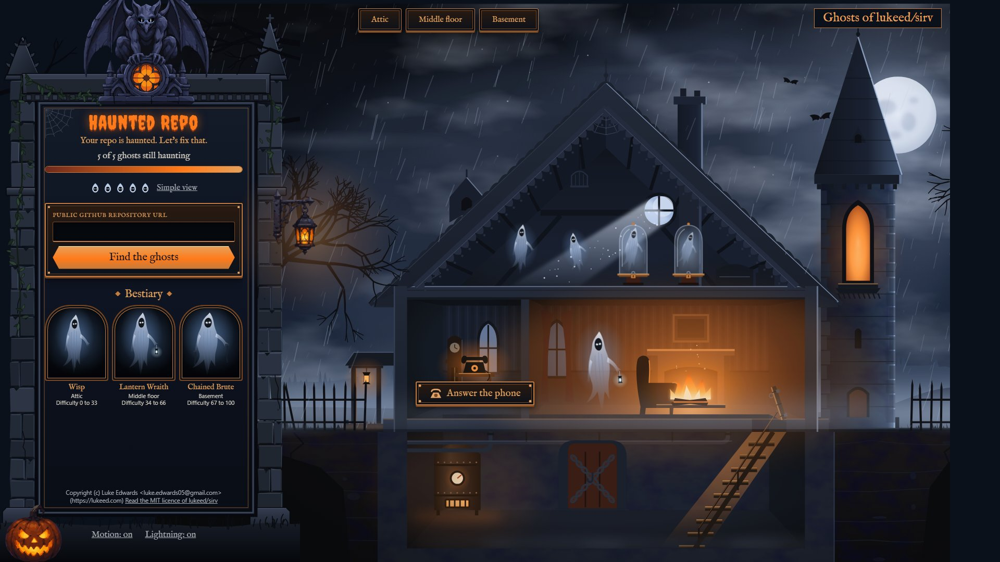

# Haunted Repo

**Your repo is haunted. Let's fix that.**

Your code works. Do you know what it does?

Haunted Repo finds the key files of a repository that you don't understand yet, the **ghosts**, and helps you **exorcise** them: your own Kiro explains each file in plain words and asks you three questions about what it does, until you really understand it.

It is for beginners who build projects by directing an AI, like first-year programming students. In those projects the code works, but nobody has read it. That gap is called **comprehension debt**: the distance between the code a project contains and the code someone understands, a term from [Addy Osmani](https://addyosmani.com/blog/comprehension-debt).

- **The product: a Kiro Power.** Install it in Kiro and your own Kiro becomes the Tutor, for any public GitHub repository. See [Use the Kiro Power](#use-the-kiro-power) and the `packages/power/`](packages/power/) folder.

- **The showcase: a website.** Try the whole idea in one minute, with nothing to install: **https://devcaos.github.io/haunted-repo/**



## Try the website in one minute

Nothing to install and no account needed.

1. Open **https://devcaos.github.io/haunted-repo/**. The house shows the five ghosts of the public repository [lukeed/sirv](https://github.com/lukeed/sirv), MIT licence, from a report saved from a real run: four in the attic and one on the middle floor. The basement of this sample is empty.

2. Pick a floor and read a ghost: the file, its difficulty from 0 to 100 and one plain sentence that says why. The Bestiary shows the creature of each floor: the Wisp, the Lantern Wraith and the Chained Brute.

3. Press **Answer the phone** and exorcise a ghost. On the website you can exorcise three of the five ghosts, two in the attic and the one on the middle floor, by comparing your answer with a model answer. The other two stay locked under glass: judging free answers needs a real Tutor, and that is the Kiro Power. After the third exorcism the sun comes up, and the banner links to the Power.

4. Paste the URL of any public GitHub repository in the form and press **Find the ghosts**. The analysis runs in your browser.

GitHub allows 60 requests per hour without an account. If it refuses, the page says so and shows the sample again.

The page makes no network call when it opens and saves nothing in your browser. The **Motion** button stops every animation, the system's reduced-motion setting is respected, and `?view=simple`](https://devcaos.github.io/haunted-repo/?view=simple) shows the same content as plain text, without the scene. The whole site stays under a size budget of 512,000 bytes gzipped, checked on every pull request.

## Use the Kiro Power

The Power turns your own Kiro into the Tutor. Your Kiro writes the explanations and questions and judges your answers; the Power's engine decides every step and keeps the rules. Haunted Repo never calls a paid AI API and never asks for a token.

### Install

You need [Kiro IDE](https://kiro.dev) and **Node.js 24 or newer**.

1. In Kiro, open the **Powers** panel and choose **Add Custom Power**.

2. Choose **Import power from a repository URL**. Before Kiro IDE 1.4.236 this option is called **Import power from GitHub**.

3. Paste this URL and press **Install**: `https://github.com/devcaos/haunted-repo/tree/main/packages/power`

4. Restart Kiro if the Haunted Repo tools don't show up.

You can also clone this repository and use **Import power from a folder** with the `packages/power/` folder. Kiro copies the folder as it is and installs no dependencies, which is why the server is one bundled file committed to git: `packages/power/bundle/server.mjs`. More details are in the [Kiro documentation on installing powers](https://kiro.dev/docs/powers/installation/).

### Exorcise your first ghost

In a Kiro chat, write something like:

> I want to exorcise the ghosts of https://github.com/lukeed/sirv

The `exorcise-ghosts` skill takes it from there:

1. It asks for a public GitHub repository and whether you know Java, one question per message.

2. It shows the ghosts from easy to hard, with a suggested first one.

3. It explains the file you pick, then asks three questions about its behaviour, one at a time. "I don't know" is a valid answer: you get a simpler explanation and the same question again. A second "I don't know" gets a short model answer.

4. With at least two good answers out of three, and the core question not wrong, the ghost is exorcised.

Kiro asks for approval on each call to a Power tool. Your progress is saved per repository, so you can come back later and continue the house.

### What the Power contains

| File | What it is |

|---|---|

| `plugin.json` | The Power's manifest. |

| `mcp.json` | Starts the MCP server with `node`. |

| `bundle/server.mjs` | The MCP server over stdio, one bundled file with the exorcism engine inside. |

| `skills/exorcise-ghosts/SKILL.md` | Tells Kiro how to be the Tutor. |

The server has six tools: `find_ghosts`, `continue_house`, `pick_ghost`, `send_event`, `judge_answer` and `house_status`. Every answer carries the current `step`, the allowed next events and the instructions for that step, so the engine, not the chat, decides what happens next.

A judgement must end with exactly one line such as `VERDICT: right`. A near miss like `VERDICT: wrong.` is rejected with `INVALID_VERDICT` and Kiro writes the judgement again, without asking you the question again.

**Privacy.** The server only talks to `https://api.github.com`, without a token; any other address is refused. It saves one JSON file per repository in the data folder Kiro gives the Power, and nothing anywhere else.

## How it works

The repository is a haunted house with three floors: the **attic** (easy), the **middle floor** and the **basement** (hard).

1. **Find the ghosts.** From a public GitHub repository URL, Haunted Repo picks up to five key source files written in TypeScript, JavaScript, Java or Python. Each one is a ghost.

2. **Sort them from easy to hard.** Each ghost gets a difficulty score from 0 to 100, a floor and one plain sentence that says why. The score comes from counting lines, decisions, nesting and imports. This step is plain, deterministic code: no AI, no account, no token.

3. **Exorcise them.** The Tutor explains the file in plain words with an everyday comparison, then asks three questions about what the code does, never about a single line. The first one is the core question.

Why a haunted house: the theme does a job. The floors tell a beginner where to start. Each floor has its own creature in the Bestiary. The phone that keeps ringing is the call to action. The candles in the exorcism room are the three questions. A ghost leaves only when you understand it, and its window gets a lit candle.

| Part | Folder | Status |

|---|---|---|

| Ghost detection | `packages/core/src/ghost-detection/` | Done. Runs in the browser and in the Power. |

| Exorcism engine | `packages/core/src/exorcism/` | Done. Pure TypeScript, shared by the website and the Power. |

| Kiro Power | `packages/power/` | Done. Installed from GitHub and tested live in Kiro; the test notes, in Spanish, are in [docs/spike-power-e2e.md](docs/spike-power-e2e.md). |

| Website | `packages/web/` | Done. Haunted house scene, live form, recorded exorcism of three ghosts of lukeed/sirv, simple text view, phone and desktop layouts. |

## Run it locally

Requires **Node.js 24 or newer**. From the repository root:

```sh

npm install

npm run check

```

`npm run check` runs lint, the format check, the build, the size budget of the website and all the tests, more than 1,100 of them. It needs no network and no secrets. Every command also works in Windows PowerShell.

To open the website on your machine:

```sh

npm run build -w @haunted-repo/core

npm run dev -w @haunted-repo/web

```

Then open the address Vite prints, ending in `/haunted-repo/`. The first command is needed once on a clean clone, because the website imports the built engine from `packages/core/dist/`.

Other scripts:

- `npm run test:live` calls the real GitHub API on lukeed/sirv, without a token. It is run by hand and is not part of `npm run check`.

- `npm run shots` takes screenshots of the website with Playwright.

- `npm run sample:make` rebuilds the lukeed/sirv sample from a real run.

## Project structure

```text

packages/core/    ghost detection and the exorcism engine (@haunted-repo/core)

packages/power/   the Kiro Power: manifest, MCP server, skill (@haunted-repo/power)

packages/web/     the website: Vite + TypeScript, no framework, static files on GitHub Pages

.kiro/specs/      one spec per feature: requirements, design, tasks

.kiro/steering/   the rules Kiro follows

.kiro/hooks/      the hook that runs npm run check after each spec task

.kiro/agents/     a read-only reviewer agent

docs/             decisions, frictions, Kiro usage log, spikes and test notes

```

## How it was built with Kiro

Kiro built this repository. It made every commit and opened every pull request, more than 90 of them; the only other commits are the initial one GitHub created with the repository and the merge commits the director made when approving each pull request. The project director is a first-year student who can't review TypeScript yet, so the project was set up to check itself:

- **Specs** in `.kiro/specs/`](.kiro/specs/). Seven features, each with requirements, design and tasks approved before any code: `project-skeleton`, `ghost-detection`, `exorcism`, `pages-deploy`, `web-demo`, `kiro-power` and `scenic-web`. Each task ended in its own commit.

- **Steering** in `.kiro/steering/`](.kiro/steering/). Eight files in three inclusion modes: always for `working-rules`, `git-workflow`, `testing`, `product` and `tech`; manual for `#next-task` and `#close-task`, the task cycle; and file match for `visual-changes`, loaded only when Kiro touches the website's view.

- **Hook**: `.kiro/hooks/test-after-task.json`](.kiro/hooks/test-after-task.json) is a `PostTaskExec` command hook that runs `npm run check` after every spec task.

- **Property-based tests** with fast-check for the rules that must always hold, plus two deliberate mutation checks of the Power's properties, saved in `docs/mutation/`](docs/mutation/).

- **MCP and Powers.** The product itself is a Kiro Power with an MCP server.

- **Custom agent**: `.kiro/agents/reviewer.md`](.kiro/agents/reviewer.md) is a read-only reviewer that can only run `git diff`, `git log`, `git show` and `git status`.

- **CI** in `.github/workflows/`](.github/workflows/). Every pull request runs `npm run check` and checks that the committed Power bundle is up to date; `main` deploys to GitHub Pages.

The raw notes are in [docs/kiro-usage-log.md](docs/kiro-usage-log.md); what went wrong is in [docs/frictions.md](docs/frictions.md) and the decisions are in [docs/decisiones.md](docs/decisiones.md), both in Spanish.

## Built with AI, declared

Every change reached this repository through Kiro, which ran the tests before opening each pull request. Other AI tools helped outside the repository, and all of it is declared here, in the asset manifest at `packages/web/src/view/assets/manifest.ts` and in the Devpost submission:

- **Claude (Anthropic)** helped plan the project, review specs and pull requests in read-only mode, and draft the texts, this README included. For many visual fixes it built and measured a prototype outside the repository, and the instructions given to Kiro included the exact CSS, SVG or code of that prototype; Kiro applied it, ran the tests and opened the pull request. Claude never committed to the repository.

- **House and exorcism room.** `house-scene.svg` and `room-scene.svg` were drafted with Claude, then integrated and animated with Kiro. The house file keeps its C2PA provenance block.

- **Stone gate.** The gargoyle, the lantern and the pumpkin, in `panel-gargoyle.svg`, `panel-lantern.svg` and `panel-pumpkin.svg`, were drawn with ChatGPT (OpenAI) and vectorised with Claude. The stone frame, `panel-frame.svg`, was drawn with Claude after a ChatGPT concept.

- **Gargoyle's eyes.** Drawn by hand in code in `packages/web/src/view/scenic/art/gate.ts`, from an idea taken from an image made with Gemini (Google).

- **Ghosts, padlock, cloche and candle.** Ported into code from a reference sheet drafted with Claude.

- **Browser tab icon.** `packages/web/public/favicon.svg`, a small hooded ghost, was drawn with Claude.

Kiro integrated all of them, connected them to the app and animated everything drawn on top: ghosts, rain, fog, candles, lightning and the dawn.

## Credits and licences

- **Haunted Repo**: [MIT](LICENSE), © 2026 Luis Miguel Castel. The illustration files above are under the same licence.

- **Demo data**: the website shows code from [lukeed/sirv](https://github.com/lukeed/sirv) by Luke Edwards, MIT licence. Its notice is shown on the page and served as `sirv-license.txt`](packages/web/public/sirv-license.txt).

- **Fonts**: Creepster and IM Fell English, SIL Open Font License 1.1, served from this site; see [the font credits](packages/web/public/fonts/CREDITS.txt).

- **Comprehension debt**: the term and its definition come from [Addy Osmani](https://addyosmani.com/blog/comprehension-debt).

Built for [Kiroween 2026](https://kiroween.devpost.com/), Costume Contest category.
